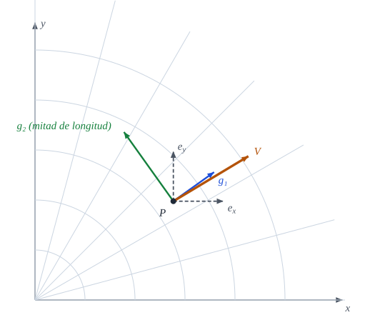
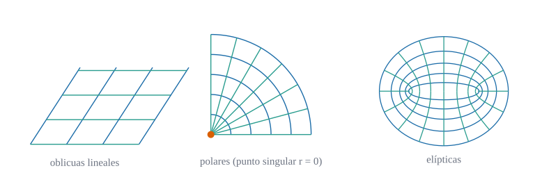
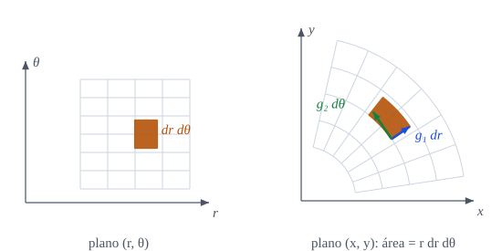

::: {.callout-note title="Objetivos de aprendizaje"}
Al terminar el capítulo sabrás:

1. definir un cambio de coordenadas admisible y calcular su matriz jacobiana y la de su inversa;
2. interpretar el determinante jacobiano como razón entre elementos de área o de volumen;
3. enunciar las leyes de transformación de componentes contravariantes y covariantes, y definir un **tensor** por la forma en que se transforman sus componentes;
4. reconocer los **invariantes** (los números que no dependen del sistema) y usarlos como criterio de corrección;
5. comprobar todo ello en Julia con el cambio cartesianas → polares.
:::

## Motivación {#sec-motivacion-2}

En el @sec-motivacion se insistió en que un vector $\mathbf{V}$ es un objeto geométrico y que sus componentes dependen de la base. La @fig-vector-dos-bases lo muestra con un ejemplo: en el punto $P$ del plano, el mismo vector se descompone sobre la base cartesiana $\{\mathbf{e}_x,\mathbf{e}_y\}$ o sobre la base polar $\{\mathbf{g}_1,\mathbf{g}_2\}$, con listas de números diferentes.

{#fig-vector-dos-bases fig-alt="Base cartesiana y base polar en un punto del plano con un vector" width="85%"}

La pregunta de este capítulo es: **¿qué regla relaciona las dos listas de números?** La respuesta es la ley de transformación, y es lo que define, en sentido estricto, a un tensor.

::: {.callout-important title="Idea clave"}
Un tensor no es «una matriz de números». Es un objeto geométrico cuyas componentes, en cualquier sistema de coordenadas, **se transforman de una manera precisa**. Esa regla es la que garantiza que las ecuaciones de la física valgan en cualquier sistema.
:::

## Cambios de coordenadas admisibles {#sec-admisibles}

::: {#def-cambio-coordenadas}
## Cambio de coordenadas admisible
Sean $\theta^1,\dots,\theta^n$ unas coordenadas en una región $\Omega$. Un **cambio de coordenadas** es un conjunto de funciones
$$
\theta'^{\,i}=\theta'^{\,i}(\theta^1,\dots,\theta^n),\qquad i=1,\dots,n,
$$ {#eq-cambio}
de clase $C^1$ con inversa $\theta^i=\theta^i(\theta'^1,\dots,\theta'^n)$ también de clase $C^1$. Es **admisible** en $\Omega$ si el determinante de su jacobiana no se anula en ningún punto de $\Omega$.
:::

::: {#def-jacobiana}
## Matrices jacobianas
La **jacobiana** del cambio @eq-cambio y la de su inversa son
$$
J^i{}_j=\frac{\partial\theta'^{\,i}}{\partial\theta^{\,j}},
\qquad
\tilde J^i{}_j=\frac{\partial\theta^{\,i}}{\partial\theta'^{\,j}} .
$$ {#eq-jacobianas}
El primer índice numera la fila y el segundo la columna.
:::

::: {#prp-jacobianas-inversas}
## Las jacobianas son inversas
Si el cambio es admisible, $\tilde J=J^{-1}$, es decir
$$
\frac{\partial\theta'^{\,i}}{\partial\theta^{\,k}}\,\frac{\partial\theta^{\,k}}{\partial\theta'^{\,j}}=\delta^i_j .
$$ {#eq-jacobianas-inversas}
:::

::: {.callout-note .demostracion collapse="true"}
## Demostración de @prp-jacobianas-inversas
Derivando la identidad $\theta'^{\,i}(\theta(\theta'))=\theta'^{\,i}$ respecto de $\theta'^{\,j}$ con la regla de la cadena se obtiene $\dfrac{\partial\theta'^{\,i}}{\partial\theta^{\,k}}\dfrac{\partial\theta^{\,k}}{\partial\theta'^{\,j}}=\dfrac{\partial\theta'^{\,i}}{\partial\theta'^{\,j}}=\delta^i_j$. En forma matricial, $J\tilde J=I$. $\blacksquare$
:::

::: {.callout-warning title="Dónde falla un cambio de coordenadas"}
Las coordenadas polares son admisibles en $r>0$, pero no en el origen: allí $\det J$ se anula (o no está definido), la base $\{\mathbf{g}_1,\mathbf{g}_2\}$ degenera ($\mathbf{g}_2=\mathbf{0}$) y $\theta$ carece de valor. Es el **punto singular** que muestra la @fig-galeria. Lo mismo ocurre en los polos de las coordenadas esféricas. Los resultados de este libro valen **fuera** de esos puntos.
:::

{#fig-galeria fig-alt="Mallas de coordenadas lineales oblicuas, polares y elípticas" width="100%"}

## El jacobiano como factor de área {#sec-factor-area}

::: {#prp-jacobiano-area}
## Elemento de área y de volumen
Sea $j=\det(\partial\theta'/\partial\theta)$ el determinante jacobiano. Los elementos de volumen ($n$-dimensional) en ambos sistemas se relacionan por
$$
d\theta'^1\cdots d\theta'^n=|j|\,d\theta^1\cdots d\theta^n,\qquad
|j|=\left|\det\frac{\partial\theta'}{\partial\theta}\right| .
$$ {#eq-jacobiano-volumen}
En particular, al pasar de polares $(\theta^1,\theta^2)=(r,\theta)$ a cartesianas, $dx\,dy=r\,dr\,d\theta$.
:::

La @fig-jacobiano muestra la idea: la celda $dr\,d\theta$ del plano paramétrico se convierte en un trozo de corona circular cuyos lados son $\mathbf{g}_1\,dr$ y $\mathbf{g}_2\,d\theta$. Su área es el área del paralelogramo que forman, $\|\mathbf{g}_1\times\mathbf{g}_2\|\,dr\,d\theta=r\,dr\,d\theta$.

{#fig-jacobiano fig-alt="Celda del plano paramétrico y su imagen en el plano físico como sector de corona" width="100%"}

::: {.callout-note .demostracion collapse="true"}
## Demostración de @prp-jacobiano-area (caso polar)
Es el teorema del cambio de variable en integrales múltiples, que damos por conocido. Para polares, $\partial(x,y)/\partial(r,\theta)=\begin{pmatrix}\cos\theta&-r\sin\theta\\ \sin\theta&r\cos\theta\end{pmatrix}$, cuyo determinante es $r(\cos^2\theta+\sin^2\theta)=r$. Como $\det J=1/\det\tilde J$ por @prp-jacobianas-inversas, la jacobiana inversa tiene determinante $1/r$. $\blacksquare$
:::

## Transformación de componentes {#sec-transformacion-comps}

Fijado el cambio @eq-cambio, las componentes de un vector $\mathbf{V}$ en ambas bases se relacionan así.

::: {#prp-transf-vectores}
## Componentes contravariantes y covariantes
$$
V'^{\,i}=\frac{\partial\theta'^{\,i}}{\partial\theta^{\,j}}\,V^{\,j}=J^i{}_j\,V^j,
\qquad
V'_{\,i}=\frac{\partial\theta^{\,j}}{\partial\theta'^{\,i}}\,V_{\,j}=\tilde J^j{}_i\,V_j .
$$ {#eq-transf-vectores}
:::

::: {.callout-note .demostracion collapse="true"}
## Demostración de @prp-transf-vectores
La primera relación es la última de @eq-transformacion (se demuestra en @prp-transformacion-bases a partir de las bases). Para la segunda, $V'_i=\mathbf{V}\cdot\mathbf{g}'_i=\mathbf{V}\cdot\tilde J^j{}_i\,\mathbf{g}_j=\tilde J^j{}_i\,V_j$, porque $\mathbf{g}'_i=\tilde J^j{}_i\,\mathbf{g}_j$. $\blacksquare$
:::

Las dos leyes difieren en **qué matriz** actúa: $J$ para los índices altos, $\tilde J=J^{-1}$ (trasladada) para los bajos. Un truco mnemotécnico: un índice alto se transforma como la diferencial $d\theta^i$ y uno bajo como la derivada parcial $\partial/\partial\theta^i$.

### Tensores de orden dos

::: {#def-tensor-2}
## Tensor de orden dos
Un conjunto de $n^2$ números que, en cada sistema de coordenadas, forman la tabla $T^{ij}$, $T^i{}_j$ o $T_{ij}$ es un **tensor de orden dos** (contravariante, mixto o covariante) si al cambiar de coordenadas se transforma según
$$
\begin{aligned}
T'^{\,ij}&=J^i{}_k\,J^j{}_l\,T^{kl},\\
T'^{\,i}{}_{j}&=J^i{}_k\,\tilde J^l{}_j\,T^{k}{}_{l},\\
T'_{\,ij}&=\tilde J^k{}_i\,\tilde J^l{}_j\,T_{kl}.
\end{aligned}
$$ {#eq-transf-tensor2}
Un vector es un tensor de orden uno, y un escalar es un tensor de orden cero (no cambia).
:::

La definición se extiende a órdenes mayores: **un factor $J$ por cada índice alto y un factor $\tilde J$ por cada índice bajo**.

::: {.callout-warning title="Un array no es un tensor"}
Que $T^{ij}$ sea una tabla $2\times2$ no basta: hay que saber cómo se transforma. El ejemplo más importante lo veremos en el capítulo 5: los símbolos de Christoffel $\Gamma^k_{ij}$ se escriben como un array de tres índices, pero **no son un tensor**, porque son nulos en cartesianas y no nulos en polares, y un tensor nulo en un sistema es nulo en todos. La prueba de que un objeto es tensorial es siempre la ley @eq-transf-tensor2.
:::

::: {#prp-metrica-tensor}
## El tensor métrico es un tensor
Las componentes $g_{ij}=\mathbf{g}_i\cdot\mathbf{g}_j$ se transforman como un tensor covariante de orden dos, y los $g^{ij}$ como uno contravariante.
:::

::: {.callout-note .demostracion collapse="true"}
## Demostración de @prp-metrica-tensor
Como $\mathbf{g}'_i=\tilde J^k{}_i\,\mathbf{g}_k$,
$g'_{ij}=\mathbf{g}'_i\cdot\mathbf{g}'_j=\tilde J^k{}_i\tilde J^l{}_j\,\mathbf{g}_k\cdot\mathbf{g}_l=\tilde J^k{}_i\tilde J^l{}_j\,g_{kl}$, que es la tercera fila de @eq-transf-tensor2. La versión contravariante es la matriz inversa: $g'^{ij}=J^i{}_kJ^j{}_l\,g^{kl}$. $\blacksquare$
:::

## Invariantes {#sec-invariantes}

Los tensores son útiles porque permiten construir cantidades que **no** dependen de las coordenadas.

::: {#prp-invariantes}
## Contracciones invariantes
Si $V^i,W_i$ son las componentes de dos vectores y $T^i{}_j$ las de un tensor mixto, son invariantes (idénticos en cualquier sistema):
$$
V^iW_i,\qquad T^i{}_i,\qquad g_{ij}V^iV^j=\|\mathbf{V}\|^2 .
$$ {#eq-invariantes}
:::

::: {.callout-note .demostracion collapse="true"}
## Demostración de @prp-invariantes
Con @eq-transf-vectores y @eq-jacobianas-inversas, $V'^iW'_i=J^i{}_j\,\tilde J^k{}_i\,V^jW_k=\delta^k_j\,V^jW_k=V^jW_j$. Del mismo modo, $T'^i{}_i=J^i{}_k\tilde J^l{}_i\,T^k{}_l=\delta^l_k\,T^k{}_l=T^k{}_k$. $\blacksquare$
:::

::: {.callout-important title="Idea clave"}
**Criterio de corrección.** En una fórmula con índices, cada índice libre debe aparecer en los dos miembros en la misma posición (alto o bajo) y cada índice repetido debe aparecer una vez arriba y otra abajo. Si es así, la ecuación se conserva al cambiar de coordenadas. Si no, hay un error (o un objeto que no es tensor).
:::

## Ejemplo computacional en Julia {#sec-julia-transf}

::: {.callout-tip title="Ejemplo computacional"}
<span class="etiqueta-resultado calculado">calculado</span> Cartesianas → polares en el punto $(r,\theta)=(2,\pi/6)$. La jacobiana $\partial(r,\theta)/\partial(x,y)$ se obtiene por diferencias finitas y se compara con la inversa de la base polar.
:::

```{julia}
using Geometria, LinearAlgebra

a_polar(x) = [hypot(x[1], x[2]), atan(x[2], x[1])]   # (x,y) ↦ (r,θ)
r, θ = 2.0, π / 6
x0 = [r * cos(θ), r * sin(θ)]

J = jacobiana_numerica(a_polar, x0)        # ∂(r,θ)/∂(x,y)
B = base_polar(r, θ)                       # ∂(x,y)/∂(r,θ)
(J_por_B = round.(J * B; digits = 8), det_J = det(J), uno_entre_r = 1 / r)
```

```{julia}
V = [0.4, -1.3]                            # componentes cartesianas
W = [-0.9, 0.5]
Vup = transformar_contra(J, V)             # Vʳ, Vᶿ
Wdn = transformar_cov(J, W)                # Wᵣ, Wᶿ
(contravariantes_V = Vup,
 comprobacion = Vup ≈ comps_contravariantes(B, V),
 invariante_polar = dot(Vup, Wdn),
 invariante_cartesiano = dot(V, W))
```

```{julia}
# La métrica cartesiana δ se transforma en el tensor métrico de las polares (@prp-metrica-tensor)
(transformar_tensor_cov(J, Matrix(1.0I, 2, 2)), metrica(B))
```

Estas identidades se verifican de forma automática en `julia/test/runtests.jl` (conjunto «Transformación de coordenadas»).

## Ejercicios {#sec-ejercicios-2}

1. Calcula $J$ y $\det J$ para el paso de cartesianas $(x,y,z)$ a cilíndricas $(\rho,\varphi,z)$ y comprueba que $dV=\rho\,d\rho\,d\varphi\,dz$.
2. Demuestra que $\delta^i_j$ es un tensor mixto invariante: $\delta'^i{}_j=\delta^i{}_j$.
3. Un tensor covariante es **simétrico** si $T_{ij}=T_{ji}$. Prueba que esta propiedad se conserva al cambiar de coordenadas.
4. Con `Geometria`, transforma el tensor covariante $T=\begin{pmatrix}2&1\\1&3\end{pmatrix}$ de cartesianas a polares en $(r,\theta)=(1.5,0.8)$ y verifica que $T_{ij}V^iV^j$ no cambia.
5. ¿Para qué cambios lineales $\theta'=A\theta$ coinciden las leyes de $V^i$ y $V_i$? (Pista: la condición es $A^{-\mathsf T}=A$, es decir, $A$ ortogonal.)

## Referencias comentadas {#sec-refs-2}

Lecturas para profundizar. Aún **no se han contrastado línea a línea con este texto**; los comentarios indican el tipo de apoyo.

- @Heinbockel — desarrollo paso a paso de las leyes de transformación de tensores, con muchos ejemplos resueltos.
- @Lebedev — presentación de los tensores a partir de las leyes de transformación y sus invariantes.
- @Spiegel — texto de problemas resueltos de análisis vectorial y tensorial; útil para ejercitarse.
- @Flugge — enlaza el análisis tensorial con la mecánica del continuo, que es el destino de este libro.
- @Lipschultz — colección de problemas de geometría diferencial; los primeros capítulos sirven de repaso de coordenadas curvilíneas.
