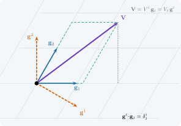

{.portada fig-alt="Una base oblicua formada por dos vectores azules g1 y g2, su base recíproca en naranja discontinuo g1 y g2 con índices altos, y un vector V violeta que se descompone de dos maneras: como suma de múltiplos de g1 y g2 (paralelogramo verde) y por sus proyecciones sobre los ejes"}

::: {.pregunta-guia}
Si los ejes no son perpendiculares ni miden lo mismo, ¿qué números describen un vector: cuántos pasos damos a lo largo de cada eje o cuánto «sombrea» el vector sobre cada eje
:::

## Objetivos y prerrequisitos {.unnumbered}

**Objetivos.** Al terminar el tema sabrás:

- distinguir las dos descomposiciones de un vector en una base no ortonormal: **componiendo** ($V^i$) y **proyectando** ($V_i$);
- construir la **base recíproca** $\{\mathbf{g}^i\}$ a partir de la base natural $\{\mathbf{g}_i\}$ y comprobar $\mathbf{g}^i\cdot\mathbf{g}_j=\delta^i_j$;
- calcular el tensor métrico $g_{ij}$ y usarlo para **subir y bajar índices**;
- deducir cómo cambian bases y componentes al cambiar de coordenadas, y por qué se llaman *contravariantes* y *covariantes*;
- verificar todo ello con un ejemplo concreto (una placa oblicua) y con las coordenadas polares.

**Prerrequisitos.** [Transformación de coordenadas y tensores](02-transformacion.qmd) y, de álgebra lineal, el producto escalar y la inversa de una matriz $2\times2$.

**Temas de la unidad**

- **Sección 3.1** · Dos preguntas sobre un mismo vector
- **Sección 3.2** · La base recíproca
- **Sección 3.3** · Componentes y tensor métrico: subir y bajar índices
- **Sección 3.4** · Qué ocurre al cambiar de coordenadas
- **Secciones 3.5 y 3.6** · Laboratorio interactivo y práctica guiada en Julia

::: {.callout-note title="Notación y convenciones de este tema"}
| Símbolo | Significado |
|---|---|
| $\mathbf{V}$ | vector (objeto geométrico, no depende de la base) |
| $\mathbf{g}_i$ | base **natural** (covariante): vectores tangentes a las curvas coordenadas |
| $\mathbf{g}^i$ | base **recíproca** (contravariante): $\mathbf{g}^i\cdot\mathbf{g}_j=\delta^i_j$ |
| $V^i$ | componentes **contravariantes**: $\mathbf{V}=V^i\mathbf{g}_i$ |
| $V_i$ | componentes **covariantes**: $\mathbf{V}=V_i\mathbf{g}^i$, $V_i=\mathbf{V}\cdot\mathbf{g}_i$ |
| $g_{ij}$, $g^{ij}$ | tensor métrico covariante y contravariante, $g^{ij}g_{jk}=\delta^i_k$ |

**Convenio de Einstein:** un índice repetido, una vez arriba y otra abajo, indica suma. El índice de arriba **no** es un exponente: $V^2$ es «la componente número 2», no $V\cdot V$.
:::

## Dos preguntas sobre un mismo vector {#sec-dos-preguntas}

En un sistema cartesiano ortonormal todo es sencillo: las componentes de un vector son a la vez «cuánto avanzo en cada eje» y «cuánto proyecta el vector sobre cada eje». Ambas ideas coinciden y por eso se confunden. Pero basta que los ejes no sean perpendiculares, o que no midan lo mismo, para que se separen en **dos listas de números distintas**.

Un ejemplo físico lo muestra enseguida. Una **placa oblicua** (un paralelogramo) tiene sus lados formando $60^\circ$. Es natural elegir como ejes los propios lados:
$$
\mathbf{g}_1=(1,\,0),\qquad \mathbf{g}_2=\Bigl(\tfrac12,\ \tfrac{\sqrt3}{2}\Bigr),
$$ {#eq-placa-base}
dados en una base cartesiana ortonormal. Sea $\mathbf{V}=(2,\ \tfrac32)$ un vector (por ejemplo, un desplazamiento) expresado en cartesianas. Hay dos preguntas razonables:

1. **Componer.** ¿Cuántas veces hay que sumar $\mathbf{g}_1$ y $\mathbf{g}_2$ para obtener $\mathbf{V}$? Es decir, ¿qué $V^1,V^2$ cumplen $\mathbf{V}=V^1\mathbf{g}_1+V^2\mathbf{g}_2$?
2. **Proyectar.** ¿Cuánto vale el producto escalar de $\mathbf{V}$ con cada eje, $V_1=\mathbf{V}\cdot\mathbf{g}_1$ y $V_2=\mathbf{V}\cdot\mathbf{g}_2$?

{#fig-componer-proyectar fig-alt="Dos paneles con el mismo vector: a la izquierda, el paralelogramo que lo descompone en múltiplos de los ejes oblicuos; a la derecha, las perpendiculares de su punta a cada eje" width="95%"}

::: {#exm-placa}
## Ejemplo resuelto: componer y proyectar en la placa oblicua
**Componer.** Se resuelve $V^1\mathbf{g}_1+V^2\mathbf{g}_2=\mathbf{V}$ por coordenadas:
$$
\begin{cases}
V^1+\tfrac12V^2=2\\[2pt]
\tfrac{\sqrt3}{2}V^2=\tfrac32
\end{cases}
\ \Longrightarrow\
V^2=\sqrt3\approx1{,}732,\qquad V^1=2-\tfrac{\sqrt3}{2}\approx1{,}134 .
$$
**Proyectar.**
$$
V_1=\mathbf{V}\cdot\mathbf{g}_1=2,\qquad
V_2=\mathbf{V}\cdot\mathbf{g}_2=2\cdot\tfrac12+\tfrac32\cdot\tfrac{\sqrt3}{2}=1+\tfrac{3\sqrt3}{4}\approx2{,}299 .
$$
Cuatro números distintos, $(1{,}134;\,1{,}732)$ y $(2;\,2{,}299)$, describen **el mismo vector**.
:::

::: {.callout-tip .idea-clave title="Idea clave"}
En una base no ortonormal hay **dos** descomposiciones de un mismo vector. Las componentes **contravariantes** $V^i$ son los coeficientes de la combinación lineal (se obtienen *componiendo*). Las **covariantes** $V_i$ son los productos escalares con la base (se obtienen *proyectando*). Solo coinciden si la base es ortonormal.
:::

::: {.callout-warning title="Dos puntos que suelen confundir"}
- **El vector no es contravariante ni covariante**; lo son sus *componentes*. $\mathbf{V}$ es el mismo en ambos casos: lo que cambia es la lista de números.
- «Contravariante» no significa «contrario a $\mathbf{V}$», ni «covariante» «igual que $\mathbf{V}$». Los nombres vienen de cómo se transforman las componentes cuando se cambia la base (sección @sec-cambio).
:::

::: {.callout-note .historia icon=false title="Un poco de historia: de dónde vienen los nombres"}
Los términos «covariante» y «contravariante» se atribuyen a James Joseph Sylvester, que los introdujo hacia 1851 en la **teoría de invariantes algebraicos**: el estudio de qué expresiones de los coeficientes de un polinomio se conservan, o cambian de forma controlada, al transformar las variables. Cayley había abierto ese camino en 1846 con la idea de covarianza. Los nombres llegaron después a la geometría y la física: la memoria de Ricci-Curbastro y Levi-Civita sobre el cálculo diferencial absoluto, escrita a petición de Felix Klein y publicada en *Mathematische Annalen* (vol. 54) hacia 1900, fue la fuente de la que Einstein, con la ayuda de Marcel Grossmann, aprendió el lenguaje tensorial unos quince años después para formular la relatividad general.

<span class="fuentes-caja">Fuentes (secundarias): [Covariance and contravariance of vectors, Wikipedia](https://en.wikipedia.org/wiki/Covariance_and_contravariance_of_vectors); [Notes in Pure Mathematics, arXiv:2105.14863](https://arxiv.org/pdf/2105.14863); [Levi-Civita, MacTutor](https://mathshistory.st-andrews.ac.uk/DSB/Levi-Civita.pdf). Algunas fuentes dan 1901 para la memoria; no se consultó la fuente primaria. Consultado el 21-10-2026.</span>
:::

**Pon a prueba lo anterior.** Los ejercicios se corrigen en tu navegador y no envían nada a ningún sitio.

::: {.ejercicio tipo="opcion" id="b2-ortonormal" respuesta="c"}
Si la base $\{\mathbf{g}_1,\mathbf{g}_2\}$ es **ortonormal**, ¿qué relación hay entre $V^i$ y $V_i$?

::: {.opciones}
- $V_i=V^i/g_{ii}$ en cualquier base
- Son listas completamente distintas
- Son iguales: $V_i=V^i$
- $V_i=-V^i$
:::

::: {.solucion}
Si $\mathbf{g}_i\cdot\mathbf{g}_j=\delta_{ij}$, entonces $V_i=\mathbf{V}\cdot\mathbf{g}_i$ es también el coeficiente de $\mathbf{g}_i$ en $\mathbf{V}$, así que $V_i=V^i$. Por eso en cartesianas no se distinguen.
:::
:::

::: {.ejercicio tipo="numerico" id="b2-v1" respuesta="1.134" tol="1%"}
En la placa oblicua de $60^\circ$ del @exm-placa, calcula la componente contravariante $V^1$.

::: {.pista}
Resuelve primero la segunda ecuación, que solo contiene $V^2$.
:::

::: {.solucion}
$V^2=\sqrt3$ y $V^1=2-\sqrt3/2\approx1{,}134$.
:::
:::

::: {.ejercicio tipo="vf" id="b2-vi-coef" respuesta="falso"}
Las componentes covariantes $V_i$ son los coeficientes de la combinación $\mathbf{V}=V_1\mathbf{g}_1+V_2\mathbf{g}_2$.

::: {.solucion}
**Falso.** Los $V_i$ son productos escalares. Son los coeficientes de $\mathbf{V}$ respecto de la base **recíproca**: $\mathbf{V}=V_i\mathbf{g}^i$ (sección @sec-reciproca). En el ejemplo, $V_1\mathbf{g}_1+V_2\mathbf{g}_2=(2+1{,}150,\ 1{,}991)\neq\mathbf{V}$.
:::
:::

## La base recíproca {#sec-reciproca}

Para que $V_i$ también sean *coeficientes* de una combinación lineal hace falta otra base. Primero fijamos la que ya tenemos.

::: {#def-base-covariante}
## Base covariante natural
Sea $\mathbf{r}(\theta^1,\dots,\theta^n)$ el vector de posición. La **base covariante** en un punto es
$$
\mathbf{g}_i=\frac{\partial\mathbf{r}}{\partial\theta^i},\qquad i=1,\dots,n,
$$ {#eq-base-cov}
supuesta linealmente independiente.
:::

::: {#def-metrica}
## Tensor métrico
Las componentes **covariantes** del tensor métrico son $g_{ij}=\mathbf{g}_i\cdot\mathbf{g}_j$, y las **contravariantes** $g^{ij}$ son los elementos de la matriz inversa: $g^{ij}g_{jk}=\delta^i_k$.
:::

::: {#def-base-recip}
## Base recíproca (contravariante)
La **base recíproca** $\{\mathbf{g}^i\}$ está definida por la condición de reciprocidad
$$
\mathbf{g}^i\cdot\mathbf{g}_j=\delta^i_j .
$$ {#eq-reciprocidad}
:::

::: {#prp-g-dual}
## Construcción de la base recíproca
La base recíproca existe, es única y verifica
$$
\mathbf{g}^i=g^{ij}\,\mathbf{g}_j,\qquad
\mathbf{g}_i=g_{ij}\,\mathbf{g}^j,\qquad
g^{ij}=\mathbf{g}^i\cdot\mathbf{g}^j .
$$ {#eq-subir-bajar-base}
:::

::: {.callout-note .demostracion collapse="true"}
## Demostración de @prp-g-dual
$(g_{ij})$ es la matriz de Gram de vectores linealmente independientes, luego es simétrica definida positiva y, por tanto, invertible; así $g^{ij}$ existe.

*Existencia.* Sea $\mathbf{g}^i:=g^{ik}\mathbf{g}_k$. Entonces $\mathbf{g}^i\cdot\mathbf{g}_j=g^{ik}g_{kj}=\delta^i_j$, que es @eq-reciprocidad.

*Unicidad.* Como $\{\mathbf{g}_k\}$ es base, cualquier solución se escribe $\mathbf{g}^i=A^{ik}\mathbf{g}_k$. Imponer @eq-reciprocidad da $A^{ik}g_{kj}=\delta^i_j$, o sea $A=(g_{ij})^{-1}$.

*Fórmulas restantes.* $\mathbf{g}^i\cdot\mathbf{g}^j=g^{ik}\,\mathbf{g}_k\cdot\mathbf{g}^j=g^{ik}\delta_k^j=g^{ij}$. Multiplicando $\mathbf{g}^j=g^{jk}\mathbf{g}_k$ por $g_{ij}$ y usando $g_{ij}g^{jk}=\delta_i^k$ se obtiene $\mathbf{g}_i=g_{ij}\mathbf{g}^j$. $\blacksquare$
:::

La condición @eq-reciprocidad tiene una lectura geométrica sencilla (@fig-reciproca): $\mathbf{g}^1$ es **perpendicular a $\mathbf{g}_2$** (porque $\mathbf{g}^1\cdot\mathbf{g}_2=0$) y su longitud se ajusta para que $\mathbf{g}^1\cdot\mathbf{g}_1=1$; análogamente $\mathbf{g}^2\perp\mathbf{g}_1$. Las construcciones con $g^{ij}$ son las habituales en los textos de cálculo tensorial [@Lebedev; @Heinbockel].

{#fig-reciproca fig-alt="Los vectores g1 y g2 en azul a 60 grados y los vectores recíprocos g1 y g2 con índice alto en naranja, cada uno perpendicular al vector azul de índice distinto, con marcas de ángulo recto" width="60%"}

::: {#exm-reciproca}
## Ejemplo resuelto: la base recíproca de la placa oblicua
La métrica es
$$
(g_{ij})=\begin{pmatrix}\mathbf{g}_1\!\cdot\!\mathbf{g}_1&\mathbf{g}_1\!\cdot\!\mathbf{g}_2\\ \mathbf{g}_2\!\cdot\!\mathbf{g}_1&\mathbf{g}_2\!\cdot\!\mathbf{g}_2\end{pmatrix}
=\begin{pmatrix}1&\tfrac12\\[2pt] \tfrac12&1\end{pmatrix},\qquad
\det(g_{ij})=\tfrac34,\qquad
(g^{ij})=\tfrac43\begin{pmatrix}1&-\tfrac12\\[2pt] -\tfrac12&1\end{pmatrix}.
$$
Con @eq-subir-bajar-base:
$$
\mathbf{g}^1=g^{11}\mathbf{g}_1+g^{12}\mathbf{g}_2=\tfrac43\mathbf{g}_1-\tfrac23\mathbf{g}_2=\Bigl(1,\,-\tfrac1{\sqrt3}\Bigr),\qquad
\mathbf{g}^2=g^{21}\mathbf{g}_1+g^{22}\mathbf{g}_2=\tfrac43\mathbf{g}_2-\tfrac23\mathbf{g}_1=\Bigl(0,\,\tfrac2{\sqrt3}\Bigr).
$$
**Comprobación de @eq-reciprocidad:** $\mathbf{g}^1\cdot\mathbf{g}_1=1$, $\mathbf{g}^1\cdot\mathbf{g}_2=\tfrac12-\tfrac1{\sqrt3}\tfrac{\sqrt3}{2}=0$, $\mathbf{g}^2\cdot\mathbf{g}_1=0$ y $\mathbf{g}^2\cdot\mathbf{g}_2=\tfrac{2}{\sqrt3}\tfrac{\sqrt3}{2}=1$.

Observa que $\|\mathbf{g}^1\|=\sqrt{1+\tfrac13}=\tfrac{2}{\sqrt3}\approx1{,}155>1=\|\mathbf{g}_1\|$: **al cerrarse el ángulo entre los ejes, los recíprocos se alargan** ($\|\mathbf{g}^1\|=1/\operatorname{sen}\varphi$ cuando $\|\mathbf{g}_i\|=1$).
:::

::: {.callout-warning title="Errores frecuentes"}
- **$\mathbf{g}^1$ no es $\mathbf{g}_1/\|\mathbf{g}_1\|^2$** ni «el inverso de $\mathbf{g}_1$» (un vector no tiene inverso). Solo coincide con $\mathbf{g}_1$ cuando la base es ortonormal.
- **$\mathbf{g}^1$ no es paralelo a $\mathbf{g}_1$**: es perpendicular a $\mathbf{g}_2$.
- No confundir $\mathbf{g}^2$ (segundo vector recíproco) con «$\mathbf{g}$ al cuadrado».
:::

::: {.callout-note .historia icon=false title="Un poco de historia: el sistema recíproco de Gibbs"}
La construcción de la base recíproca entró en el análisis vectorial de la mano de J. Willard Gibbs, que la presentó hacia 1881 en sus *Elements of Vector Analysis*, un texto impreso a título privado para sus estudiantes de Yale. Dados tres vectores $\mathbf{a},\mathbf{b},\mathbf{c}$, Gibbs define un «sistema recíproco» $\mathbf{a}',\mathbf{b}',\mathbf{c}'$ con $\mathbf{a}\cdot\mathbf{a}'=1$ y $\mathbf{a}\cdot\mathbf{b}'=\mathbf{a}\cdot\mathbf{c}'=0$, que hoy llamamos base dual. El adjetivo «recíproco» sobrevive en **cristalografía**, donde el *espacio recíproco* de una red cristalina se construye con esta misma idea.

<span class="fuentes-caja">Fuentes: [Reciprocal space, IUCr Online Dictionary of Crystallography](https://dictionary.iucr.org/Reciprocal_space); [Elements of vector analysis, Smithsonian Libraries](https://library.si.edu/es/digital-library/book/elementsvectora00gibb); [Back to the Roots of Vector and Tensor Calculus: Heaviside versus Gibbs, arXiv:2010.09679](https://arxiv.org/pdf/2010.09679). Consultado el 21-10-2026.</span>
:::

**Pon a prueba lo anterior.**

::: {.ejercicio tipo="numerico" id="b2-g12" respuesta="0.5" tol="abs:0.01"}
Para la placa oblicua del @exm-placa, calcula $g_{12}=\mathbf{g}_1\cdot\mathbf{g}_2$.

::: {.solucion}
$g_{12}=1\cdot\tfrac12+0\cdot\tfrac{\sqrt3}{2}=\tfrac12=\cos60^\circ$, porque $\|\mathbf{g}_1\|=\|\mathbf{g}_2\|=1$.
:::
:::

::: {.ejercicio tipo="numerico" id="b2-gr1" respuesta="1.1547" tol="0.5%"}
¿Cuánto mide el primer vector recíproco $\|\mathbf{g}^1\|$ de la placa oblicua?

::: {.pista}
$\mathbf{g}^1=(1,-1/\sqrt3)$, o bien usa $\|\mathbf{g}^1\|^2=g^{11}$.
:::

::: {.solucion}
$\|\mathbf{g}^1\|^2=g^{11}=\tfrac43$, luego $\|\mathbf{g}^1\|=2/\sqrt3\approx1{,}1547$.
:::
:::

::: {.ejercicio tipo="vf" id="b2-paralelo" respuesta="falso"}
En una base oblicua, $\mathbf{g}^1$ es paralelo a $\mathbf{g}_1$.

::: {.solucion}
**Falso.** $\mathbf{g}^1\perp\mathbf{g}_2$; solo es paralelo a $\mathbf{g}_1$ si $\mathbf{g}_1\perp\mathbf{g}_2$ (base ortogonal).
:::
:::

## Componentes y tensor métrico: subir y bajar índices {#sec-componentes}

Ya podemos formalizar las dos descomposiciones del @exm-placa.

::: {#prp-componentes}
## Componentes de un vector
Todo vector admite dos descomposiciones,
$$
\mathbf{V}=V^i\,\mathbf{g}_i=V_i\,\mathbf{g}^i,
$$ {#eq-descomposicion}
con
$$
V^i=\mathbf{V}\cdot\mathbf{g}^i,\qquad V_i=\mathbf{V}\cdot\mathbf{g}_i,\qquad
V_i=g_{ij}V^j,\qquad V^i=g^{ij}V_j,
$$ {#eq-componentes}
y la norma cumple $\|\mathbf{V}\|^2=g_{ij}V^iV^j=V^iV_i$.
:::

::: {.callout-note .demostracion collapse="true"}
## Demostración de @prp-componentes
Al ser $\{\mathbf{g}_i\}$ base, $\mathbf{V}=V^j\mathbf{g}_j$. Multiplicando por $\mathbf{g}^i$ y usando @eq-reciprocidad, $V^i=\mathbf{V}\cdot\mathbf{g}^i$. Análogamente, como $\{\mathbf{g}^i\}$ también es base (por @prp-g-dual), $\mathbf{V}=V_j\mathbf{g}^j$ y $V_i=\mathbf{V}\cdot\mathbf{g}_i$. Entonces $V_i=\mathbf{V}\cdot\mathbf{g}_i=V^j\,\mathbf{g}_j\cdot\mathbf{g}_i=g_{ij}V^j$, y de modo simétrico $V^i=g^{ij}V_j$. Finalmente $\|\mathbf{V}\|^2=\mathbf{V}\cdot\mathbf{V}=V^i\,\mathbf{g}_i\cdot V^j\mathbf{g}_j=g_{ij}V^iV^j=V^iV_i$. $\blacksquare$
:::

El tensor métrico es, por tanto, el «conversor» entre las dos listas: $g_{ij}$ **baja** el índice y $g^{ij}$ lo **sube**.

::: {#exm-subir-bajar}
## Ejemplo resuelto: subir y bajar índices en la placa oblicua
Con $V^1=2-\tfrac{\sqrt3}{2}\approx1{,}134$, $V^2=\sqrt3\approx1{,}732$ y $(g_{ij})$ del @exm-reciproca:
$$
V_1=g_{11}V^1+g_{12}V^2=1{,}134+\tfrac12\cdot1{,}732=2{,}000,\qquad
V_2=g_{21}V^1+g_{22}V^2=\tfrac12\cdot1{,}134+1{,}732=2{,}299 ,
$$
que coinciden con los productos escalares calculados directamente en el @exm-placa. Y la norma:
$$
V^iV_i=1{,}134\cdot2{,}000+1{,}732\cdot2{,}299=6{,}25=2^2+\bigl(\tfrac32\bigr)^2=\|\mathbf{V}\|^2 .
$$
:::

**Pon a prueba lo anterior.**

::: {.ejercicio tipo="numerico" id="b2-v2cov" respuesta="2.299" tol="0.5%"}
Calcula la componente covariante $V_2=\mathbf{V}\cdot\mathbf{g}_2$ del vector $\mathbf{V}=(2,\,3/2)$ en la placa oblicua.

::: {.solucion}
$V_2=2\cdot\tfrac12+\tfrac32\cdot\tfrac{\sqrt3}{2}=1+\tfrac{3\sqrt3}{4}\approx2{,}299$.
:::
:::

::: {.ejercicio tipo="opcion" id="b2-invariante" respuesta="b"}
¿Cuál de estas cantidades **no cambia** si se cambia de base (es un escalar invariante)?

::: {.opciones}
- $V^1$
- $V^iV_i$
- $V_2$
- $g_{12}$
:::

::: {.solucion}
$V^iV_i=\|\mathbf{V}\|^2$ es la longitud al cuadrado del vector y no depende de la base. $V^1$, $V_2$ y $g_{12}$ sí cambian con ella.
:::
:::

## Qué ocurre al cambiar de coordenadas {#sec-cambio}

Las bases naturales dependen de las coordenadas. ¿Cómo cambian al pasar de unas $\theta^i$ a otras $\theta'^i$?

::: {#prp-transformacion-bases}
## Cambio de coordenadas
Si $\theta'^i=\theta'^i(\theta^1,\dots,\theta^n)$ es un cambio de coordenadas regular, entonces
$$
\mathbf{g}'_i=\frac{\partial\theta^j}{\partial\theta'^i}\,\mathbf{g}_j,\qquad
\mathbf{g}'^i=\frac{\partial\theta'^i}{\partial\theta^j}\,\mathbf{g}^j,\qquad
V'^i=\frac{\partial\theta'^i}{\partial\theta^j}\,V^j .
$$ {#eq-transformacion}
:::

::: {.callout-note .demostracion collapse="true"}
## Demostración de @prp-transformacion-bases
Por la regla de la cadena, $\mathbf{g}'_i=\partial\mathbf{r}/\partial\theta'^i=(\partial\theta^j/\partial\theta'^i)\,\partial\mathbf{r}/\partial\theta^j$. Sea $J^i_j=\partial\theta'^i/\partial\theta^j$ y $\tilde J^j_i=\partial\theta^j/\partial\theta'^i$; son matrices inversas entre sí. Definiendo $\mathbf{g}'^i:=J^i_j\mathbf{g}^j$ se tiene $\mathbf{g}'^i\cdot\mathbf{g}'_k=J^i_j\tilde J^l_k\,\delta^j_l=J^i_j\tilde J^j_k=\delta^i_k$, así que es la base recíproca (por unicidad). Como $\mathbf{V}$ no depende de la base, $V'^i=\mathbf{V}\cdot\mathbf{g}'^i=J^i_j\,\mathbf{V}\cdot\mathbf{g}^j=J^i_jV^j$. $\blacksquare$
:::

Las componentes $V^i$ se transforman **como las diferenciales** $d\theta^i$ (con la matriz $J$) y la base $\mathbf{g}_i$ **como las derivadas** $\partial/\partial\theta^i$ (con la inversa): se mueven «en sentido contrario». De ahí los nombres: las componentes que **contravarían** respecto de la base son las $V^i$, y las que **covarían** con ella, las $V_i$. El vector $\mathbf{V}$ no cambia.

::: {#exm-polares}
## Ejemplo resuelto: un vector constante en polares
Sea $\mathbf{V}=(1,0)$ el mismo vector en todos los puntos del plano. Con coordenadas polares $(\theta^1,\theta^2)=(r,\theta)$, la base natural es $\mathbf{g}_1=(\cos\theta,\operatorname{sen}\theta)$ y $\mathbf{g}_2=r(-\operatorname{sen}\theta,\cos\theta)$ (ortogonal, con $g_{11}=1$, $g_{22}=r^2$). En el punto $r=2$, $\theta=\pi/6$:
$$
V^1=\mathbf{V}\cdot\mathbf{g}^1=\cos\theta=0{,}866,\qquad
V^2=\mathbf{V}\cdot\mathbf{g}^2=-\frac{\operatorname{sen}\theta}{r}=-0{,}25,
$$
$$
V_2=\mathbf{V}\cdot\mathbf{g}_2=-r\operatorname{sen}\theta=-1,\qquad V_2=g_{22}V^2=4\cdot(-0{,}25)=-1\ \checkmark
$$
(usando $\mathbf{g}^2=\mathbf{g}_2/r^2$, que sale de @eq-subir-bajar-base con $g^{22}=1/r^2$). Aunque $\mathbf{V}$ es constante, sus componentes polares **varían de punto a punto**: es el origen de los símbolos de Christoffel (capítulo 5).
:::

**Pon a prueba lo anterior.**

::: {.ejercicio tipo="numerico" id="b2-polar-vtheta" respuesta="-0.25" tol="abs:0.005"}
En coordenadas polares, en el punto $r=2$, $\theta=\pi/6$, ¿cuánto vale la componente contravariante $V^\theta$ del vector constante $\mathbf{V}=(1,0)$?

::: {.pista}
$V^\theta=\mathbf{V}\cdot\mathbf{g}^2$ con $\mathbf{g}^2=\mathbf{g}_2/r^2$ y $\mathbf{g}_2=r(-\operatorname{sen}\theta,\cos\theta)$.
:::

::: {.solucion}
$V^\theta=\dfrac{\mathbf{V}\cdot\mathbf{g}_2}{r^2}=\dfrac{-r\operatorname{sen}\theta}{r^2}=-\dfrac{\operatorname{sen}\theta}{r}=-\dfrac{0{,}5}{2}=-0{,}25$.
:::
:::

::: {.ejercicio tipo="numerico" id="b2-polar-vcov2" respuesta="-1" tol="abs:0.01"}
En el mismo punto, ¿cuánto vale la componente covariante $V_\theta=\mathbf{V}\cdot\mathbf{g}_2$?

::: {.solucion}
$V_\theta=-r\operatorname{sen}\theta=-2\cdot0{,}5=-1$. Comprobación: $g_{22}V^2=r^2V^\theta=4\cdot(-0{,}25)=-1$.
:::
:::

## Laboratorio interactivo {#sec-lab-bases}

::: {.laboratorio}
<div class="laboratorio-titulo">Laboratorio · Bases covariante y contravariante en el plano</div>
<span class="etiqueta-resultado calculado">calculado en el navegador</span> Verificado frente a Julia (`web/tests/bases.test.mjs`).

Se fija una base oblicua $\{\mathbf{g}_1,\mathbf{g}_2\}$ (azul) y se muestra su base recíproca (naranja, discontinua). **Qué observar:**

1. $\mathbf{g}^1\perp\mathbf{g}_2$ y $\mathbf{g}^2\perp\mathbf{g}_1$ para cualquier ángulo y cualquier longitud.
2. Con ángulo $90^\circ$ y longitudes 1, ambas bases coinciden y también $V^i=V_i$ (compruébalo en la tabla).
3. Al **cerrar el ángulo** ($\to0^\circ$ o $\to180^\circ$) los recíprocos se alargan: $\|\mathbf{g}^i\|=1/(\|\mathbf{g}_i\|\operatorname{sen}\varphi)$, y $\det(g_{ij})\to0$.
4. Los valores iniciales ($60^\circ$, $|\mathbf{g}_1|=|\mathbf{g}_2|=1$, $\mathbf{V}=(2;\,1{,}5)$) son los de la placa del @exm-placa: comprueba en la tabla $V^i$, $V_i$ y $g_{ij}$.
:::

```{ojs}
//| echo: false
bases = import(new URL("../../web/ojs/bases.js", document.baseURI))
```

```{ojs}
//| echo: false
viewof ang = Inputs.range([20, 160], {value: 60, step: 1, label: "Ángulo entre g₁ y g₂ (°)"})
viewof l1 = Inputs.range([0.5, 2], {value: 1, step: 0.05, label: "|g₁|"})
viewof l2 = Inputs.range([0.5, 2], {value: 1, step: 0.05, label: "|g₂|"})
viewof vx = Inputs.range([-2, 2], {value: 2, step: 0.05, label: "Vₓ (cartesiana)"})
viewof vy = Inputs.range([-2, 2], {value: 1.5, step: 0.05, label: "V_y (cartesiana)"})
```

```{ojs}
//| echo: false
base = bases.baseDesdeAngulo(l1, l2, ang)
V = [vx, vy]
res = bases.analizar(base.g1, base.g2, V)
txt = bases.resumen(res)
html`<div>${(() => { const d = document.createElement("div"); d.innerHTML = bases.dibujarSVG(base.g1, base.g2, V, res); return d; })()}</div>`
```

```{ojs}
//| echo: false
html`<table class="table table-sm" style="max-width:34rem">
<tr><td>Métrica gᵢⱼ</td><td>[${txt.g[0].join(", ")}; ${txt.g[1].join(", ")}]</td></tr>
<tr><td>Contravariantes Vⁱ</td><td>(${txt.contra.join(", ")})</td></tr>
<tr><td>Covariantes Vᵢ</td><td>(${txt.co.join(", ")})</td></tr>
<tr><td>Reciprocidad gⁱ·gⱼ</td><td>[${txt.reciprocidad[0].join(", ")}; ${txt.reciprocidad[1].join(", ")}]</td></tr>
</table>`
```

## Práctica guiada en Julia {#sec-julia-bases}

::: {.callout-tip title="Ejemplo computacional"}
<span class="etiqueta-resultado calculado">calculado</span> Primero, la placa oblicua de $60^\circ$ (@exm-placa, @exm-reciproca y @exm-subir-bajar) con el paquete `Geometria`; después, una base con coeficientes racionales para ver que la reciprocidad es **exactamente** la identidad.
:::

```{julia}
using Geometria, LinearAlgebra

B = [1.0 0.5; 0.0 sqrt(3)/2]        # columnas: g₁ = (1,0), g₂ = (1/2, √3/2)
V = [2.0, 1.5]

(g = metrica(B),                                  # [1 0.5; 0.5 1]
 gr1 = base_reciproca(B)[:, 1],                   # (1, −1/√3)
 gr2 = base_reciproca(B)[:, 2],                   # (0, 2/√3)
 Vup = comps_contravariantes(B, V),               # (1.134, 1.732)
 Vdn = comps_covariantes(B, V),                   # (2, 2.299)
 norma = dot(comps_contravariantes(B, V), comps_covariantes(B, V)) ≈ dot(V, V))
```

```{julia}
# Aritmética exacta con racionales: g₁ = (2,0), g₂ = (1,3), V = (5,4)
Br = [2//1 1//1; 0//1 3//1]
Vr = [5//1, 4//1]
g   = metrica(Br)
Vup = comps_contravariantes(Br, Vr)
Vdn = comps_covariantes(Br, Vr)

(; g, reciprocidad = reciprocidad(Br), Vup, Vdn,
   bajar = Vdn == g * Vup,                     # V_i = g_ij V^j
   norma = dot(Vup, Vdn) == dot(Vr, Vr))       # |V|² = Vⁱ Vᵢ
```

Las mismas identidades se comprueban de forma automática en `julia/test/runtests.jl` (conjuntos «Bases covariantes y contravariantes» y «Base oblicua a 60°») y, para el código JavaScript del laboratorio, en `web/tests/bases.test.mjs`. Las respuestas numéricas de los ejercicios de este tema se verifican con `scripts/verificar_ejercicios.jl`.

## Ejercicios {#sec-ejercicios-3}

1. **Determinante.** Demuestra que $\det(g_{ij})=(\det B)^2$ si $B$ es la matriz de columnas $\mathbf{g}_i$.

   ::: {.callout-note collapse="true" title="Solución"}
   $g_{ij}=\mathbf{g}_i\cdot\mathbf{g}_j$ es $B^{\mathsf T}B$ (matriz de Gram), luego $\det(g_{ij})=\det(B^{\mathsf T})\det B=(\det B)^2$. En la placa oblicua, $\det B=\tfrac{\sqrt3}{2}$ y $(\det B)^2=\tfrac34$, que coincide con el @exm-reciproca.
   :::

2. **Ángulo variable.** Para dos vectores unitarios que forman un ángulo $\varphi$, calcula $g^{11}$ y $\|\mathbf{g}^1\|$. Comprueba el resultado para $\varphi=60^\circ$.

   ::: {.callout-note collapse="true" title="Solución"}
   $g_{ij}=\begin{pmatrix}1&\cos\varphi\\\cos\varphi&1\end{pmatrix}$, $\det=\operatorname{sen}^2\varphi$, $g^{11}=1/\operatorname{sen}^2\varphi$, luego $\|\mathbf{g}^1\|=1/\operatorname{sen}\varphi$. Para $60^\circ$: $2/\sqrt3\approx1{,}155$ ✓.
   :::

3. **Polares.** En coordenadas polares demuestra que $\mathbf{g}^2=\mathbf{g}_2/r^2$ y que $V^\theta=V_\theta/r^2$.

   ::: {.callout-note collapse="true" title="Solución"}
   La métrica es $\operatorname{diag}(1,r^2)$, luego $g^{22}=1/r^2$ y $\mathbf{g}^2=g^{22}\mathbf{g}_2=\mathbf{g}_2/r^2$ (@eq-subir-bajar-base). Entonces $V^\theta=g^{22}V_\theta=V_\theta/r^2$.
   :::

4. **Invariancia.** Prueba que $V^iW_i$ no depende de la base, usando @eq-transformacion y la matriz inversa.

   ::: {.callout-note collapse="true" title="Solución"}
   Con $V'^i=J^i_jV^j$ y $W'_i=\tilde J^k_iW_k$: $V'^iW'_i=J^i_j\tilde J^k_iV^jW_k=\delta^k_jV^jW_k=V^jW_j$, porque $\tilde J=J^{-1}$.
   :::

5. **Con Julia.** Con `Geometria`, calcula $V^i$, $V_i$ y $\|\mathbf{V}\|^2$ de $\mathbf{V}=(1,1)$ en la base $\mathbf{g}_1=(1,0)$, $\mathbf{g}_2=(\cos45^\circ,\operatorname{sen}45^\circ)$ y comprueba $V_i=g_{ij}V^j$.

   ::: {.callout-note collapse="true" title="Solución"}
   `B = [1 cosd(45); 0 sind(45)]; V = [1.0, 1.0]`; `comps_contravariantes(B, V)` da $(1-\cot45^\circ\cdot1,\ 1/\operatorname{sen}45^\circ)=(0;\,1{,}414)$, `comps_covariantes(B, V)` da $(1;\,1{,}414)$ y $V^iV_i=2=\|\mathbf{V}\|^2$.
   :::

## La doy por superada si… {.unnumbered}

- Distingo, para un mismo vector, las componentes **contravariantes** (coeficientes de la combinación) y las **covariantes** (productos escalares).
- Construyo la base recíproca a partir de $g_{ij}$ y compruebo $\mathbf{g}^i\cdot\mathbf{g}_j=\delta^i_j$.
- Sé que $\mathbf{g}^1\perp\mathbf{g}_2$ y que los recíprocos se alargan cuando se cierra el ángulo entre los ejes.
- Subo y bajo índices con $g^{ij}$ y $g_{ij}$ y reconozco $V^iV_i$ como la norma al cuadrado.
- Explico por qué se llaman *contravariantes* y *covariantes* a partir de @eq-transformacion.
- Sé que un vector constante tiene componentes polares variables, y que esto motiva los símbolos de Christoffel.

::: {.callout-note collapse="true" title="Fuentes, correcciones y qué queda pendiente"}
**Fuentes.** Texto autónomo, escrito a partir de resultados estándar de cálculo tensorial [@Lebedev; @Heinbockel; @Spiegel; @Struik]. El ejemplo de la placa oblicua de $60^\circ$ y el del vector constante en polares se han calculado y comprobado con `Geometria` (tests citados arriba). Las notas históricas se apoyan en fuentes secundarias enlazadas en cada caja.

**Qué queda pendiente.**

1. Las figuras de este tema (TikZ, geometría exacta) tienen **revisión visual humana pendiente**.
2. Las referencias de la bibliografía **no se han leído línea a línea** para este tema; los comentarios indican solo el tipo de apoyo.
3. El laboratorio se ha comprobado frente a Julia (`npm test`), pero **no** se ha revisado su comportamiento en todos los navegadores ni en móvil.
:::

::: {.callout-note appearance="simple" icon=false}
Las referencias citadas aparecen **en el margen**, junto al texto (y en una tarjeta al pasar el ratón por la cita); al final del tema se repiten en una lista. La bibliografía completa del libro está en la sección *Referencias*.
:::
