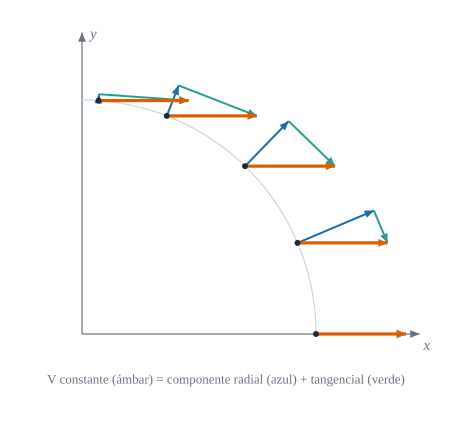

::: {.callout-note title="Objetivos de aprendizaje"}
Al terminar el capítulo sabrás:

1. explicar por qué derivar las componentes de un vector no basta cuando la base varía de punto a punto;
2. definir los símbolos de Christoffel como las componentes de $\partial\mathbf{g}_i/\partial\theta^j$ sobre la base y calcularlos a partir de la métrica;
3. definir la derivada covariante de componentes contravariantes y covariantes;
4. demostrar que la métrica es «constante» para la derivada covariante;
5. comprobar con Julia que un campo constante tiene derivada covariante nula aunque sus componentes polares varíen.
:::

## Motivación {#sec-motivacion-5}

En cartesianas, la base $\{\mathbf{e}_x,\mathbf{e}_y\}$ es la misma en todos los puntos, y derivar un campo vectorial es derivar sus componentes. En polares la base **gira y se estira** de un punto a otro (@fig-christoffel). Si $\mathbf{V}$ es un campo constante, sus componentes polares no lo son (@fig-campo-constante), y derivarlas por separado daría una derivada «distinta de cero» para un campo que no cambia.

{#fig-christoffel fig-alt="Base polar en tres puntos de una circunferencia y las derivadas de la base respecto de theta" width="100%"}

{#fig-campo-constante fig-alt="Un campo vectorial constante y sus componentes polares en cinco puntos" width="85%"}

::: {.callout-important title="Idea clave"}
La derivada de $\mathbf{V}=V^i\mathbf{g}_i$ tiene dos contribuciones: cómo cambian las componentes $V^i$ y cómo cambia la base $\mathbf{g}_i$. Los símbolos de Christoffel recogen la segunda.
:::

## Símbolos de Christoffel {#sec-christoffel}

::: {#def-christoffel}
## Símbolos de Christoffel
Para unas coordenadas $\theta^i$ en el espacio euclídeo, las derivadas de los vectores de la base se descomponen sobre la propia base:
$$
\frac{\partial\mathbf{g}_i}{\partial\theta^j}=\Gamma^{k}_{ij}\,\mathbf{g}_k ,
\qquad\text{es decir,}\qquad
\Gamma^{k}_{ij}=\mathbf{g}^k\cdot\frac{\partial\mathbf{g}_i}{\partial\theta^j} .
$$ {#eq-christoffel-def}
Los $\Gamma^k_{ij}$ son los **símbolos de Christoffel de segunda especie**. Los de primera especie son $\Gamma_{ij,k}=\mathbf{g}_k\cdot\partial_j\mathbf{g}_i=g_{kl}\Gamma^l_{ij}$.
:::

::: {.callout-warning title="Convenio de índices"}
En @eq-christoffel-def el primer índice inferior $i$ es el del vector derivado y el segundo, $j$, el de la coordenada respecto de la que se deriva. Como $\partial_j\mathbf{g}_i=\partial_j\partial_i\mathbf{r}=\partial_i\mathbf{g}_j$, los símbolos son **simétricos** en $i,j$ en espacios sin torsión (como los considerados aquí). Otros textos usan órdenes de índices o notaciones distintas ($\left\{{k\atop ij}\right\}$); en este libro, la posición de los índices de $\Gamma$ en superficies está pendiente de confirmar en el apéndice de notación (@sec-notacion).
:::

::: {#prp-christoffel-metrica}
## Los símbolos de Christoffel dependen solo de la métrica
$$
\Gamma^{k}_{ij}=\tfrac12\,g^{kl}\left(\frac{\partial g_{lj}}{\partial\theta^i}+\frac{\partial g_{li}}{\partial\theta^j}-\frac{\partial g_{ij}}{\partial\theta^l}\right)
$$ {#eq-christoffel-metrica}
y son simétricos: $\Gamma^k_{ij}=\Gamma^k_{ji}$.
:::

::: {.callout-note .demostracion collapse="true"}
## Demostración de @prp-christoffel-metrica
La simetría viene de $\partial_j\mathbf{g}_i=\partial_i\mathbf{g}_j$. Para la fórmula, derivando $g_{ij}=\mathbf{g}_i\cdot\mathbf{g}_j$:
$$
\partial_k g_{ij}=\Gamma_{ik,j}+\Gamma_{jk,i}.
$$
Escribiendo esta igualdad con los índices permutados cíclicamente, sumando dos de ellas y restando la tercera, y usando la simetría $\Gamma_{ij,k}=\Gamma_{ji,k}$, queda
$\Gamma_{ij,l}=\tfrac12(\partial_i g_{lj}+\partial_j g_{li}-\partial_l g_{ij})$. Subiendo el índice con $g^{kl}$ se obtiene @eq-christoffel-metrica. $\blacksquare$
:::

::: {.callout-warning title="Los $\Gamma^k_{ij}$ no son un tensor"}
En cartesianas, $\mathbf{g}_i$ es constante y todos los símbolos son nulos; en polares no. Un tensor nulo en un sistema es nulo en todos, así que $\Gamma^k_{ij}$ **no es un tensor**: su ley de transformación incluye un término con segundas derivadas,
$$
\Gamma'^{\,k}_{ij}=\frac{\partial\theta'^{\,k}}{\partial\theta^{\,p}}\left(\frac{\partial\theta^{\,q}}{\partial\theta'^{\,i}}\frac{\partial\theta^{\,r}}{\partial\theta'^{\,j}}\,\Gamma^p_{qr}+\frac{\partial^2\theta^{\,p}}{\partial\theta'^{\,i}\partial\theta'^{\,j}}\right).
$$ {#eq-christoffel-transf}
:::

### Ejemplos

::: {.callout-tip title="Polares y esféricas"}
<span class="etiqueta-resultado analitico">analítico</span> Los únicos símbolos no nulos son:

| Sistema | Símbolos no nulos |
|---|---|
| Polares $(r,\theta)$ | $\Gamma^1_{22}=-r$, $\;\Gamma^2_{12}=\Gamma^2_{21}=1/r$ |
| Esféricas $(r,\theta,\varphi)$ | $\Gamma^1_{22}=-r$, $\;\Gamma^1_{33}=-r\sin^2\theta$, $\;\Gamma^2_{12}=\Gamma^2_{21}=1/r$, $\;\Gamma^2_{33}=-\sin\theta\cos\theta$, $\;\Gamma^3_{13}=\Gamma^3_{31}=1/r$, $\;\Gamma^3_{23}=\Gamma^3_{32}=\cot\theta$ |

En polares coinciden con los coeficientes de la @fig-christoffel: $\partial_\theta\mathbf{g}_1=\Gamma^2_{12}\mathbf{g}_2=\mathbf{g}_2/r$ y $\partial_\theta\mathbf{g}_2=\Gamma^1_{22}\mathbf{g}_1=-r\,\mathbf{g}_1$.
:::

## Derivada covariante {#sec-derivada-cov}

::: {#def-derivada-cov}
## Derivada covariante de un vector
Si $\mathbf{V}=V^i\mathbf{g}_i=V_i\mathbf{g}^i$, la derivada $\partial_j\mathbf{V}$ se descompone como $\partial_j\mathbf{V}=V^i{}_{\|j}\,\mathbf{g}_i=V_{i\|j}\,\mathbf{g}^i$. Las **derivadas covariantes** de las componentes son
$$
V^{i}{}_{\|j}=\frac{\partial V^i}{\partial\theta^j}+\Gamma^{i}_{kj}\,V^k,
\qquad
V_{i\|j}=\frac{\partial V_i}{\partial\theta^j}-\Gamma^{k}_{ij}\,V_k .
$$ {#eq-derivada-cov}
:::

::: {.callout-note .demostracion collapse="true"}
## Deducción de @eq-derivada-cov
Por la regla del producto y @eq-christoffel-def,
$\partial_j\mathbf{V}=\partial_jV^i\,\mathbf{g}_i+V^i\,\Gamma^k_{ij}\,\mathbf{g}_k=\bigl(\partial_jV^k+\Gamma^k_{ij}V^i\bigr)\mathbf{g}_k$, que es la primera fórmula tras renombrar índices. Para la segunda, derivando $\mathbf{g}^i\cdot\mathbf{g}_k=\delta^i_k$ se obtiene $\partial_j\mathbf{g}^i=-\Gamma^i_{kj}\,\mathbf{g}^k$, de donde $\partial_j\mathbf{V}=\partial_jV_i\,\mathbf{g}^i-V_i\Gamma^i_{kj}\mathbf{g}^k=\bigl(\partial_jV_k-\Gamma^i_{kj}V_i\bigr)\mathbf{g}^k$. $\blacksquare$
:::

::: {#prp-compatibilidad}
## Compatibilidad con la métrica
$$
g_{ij\|k}=\frac{\partial g_{ij}}{\partial\theta^k}-\Gamma^l_{ik}\,g_{lj}-\Gamma^l_{jk}\,g_{il}=0 ,
$$ {#eq-compatibilidad}
y por tanto subir y bajar índices **conmuta** con la derivada covariante.
:::

::: {.callout-note .demostracion collapse="true"}
## Demostración de @prp-compatibilidad
Con @eq-christoffel-def, $\Gamma^l_{ik}g_{lj}=\Gamma_{ik,j}=\mathbf{g}_j\cdot\partial_k\mathbf{g}_i$ y $\Gamma^l_{jk}g_{il}=\mathbf{g}_i\cdot\partial_k\mathbf{g}_j$. Su suma es $\partial_k(\mathbf{g}_i\cdot\mathbf{g}_j)=\partial_kg_{ij}$, luego la diferencia es cero. $\blacksquare$
:::

::: {.callout-important title="Idea clave"}
La derivada covariante es la derivada «que se le puede preguntar al vector»: mide cuánto cambia $\mathbf{V}$ **descontando** el giro de la base. Un campo constante tiene derivada covariante nula; la derivada parcial de sus componentes, no.
:::

## Del plano a la superficie {#sec-hacia-superficies}

Sobre una superficie curva, como la esfera de la @fig-esfera, la base tangente $\{\mathbf{g}_\theta,\mathbf{g}_\varphi\}$ también varía, pero la derivada $\partial_j\mathbf{g}_i$ ya no queda contenida en el plano tangente: tiene además una componente **normal**. Los símbolos de Christoffel de la superficie son sus componentes tangentes, y las normales dan lugar a la curvatura (capítulos de la Parte II). Para la esfera de radio $r$ fijo, los símbolos $\Gamma^2_{33}=-\sin\theta\cos\theta$ y $\Gamma^3_{23}=\cot\theta$ de la tabla anterior son los de la superficie.

{#fig-esfera fig-alt="Esfera con meridianos y paralelos, vectores tangentes y normal en un punto" width="75%"}

## Ejemplo computacional en Julia {#sec-julia-christoffel}

::: {.callout-tip title="Ejemplo computacional"}
<span class="etiqueta-resultado calculado">calculado</span> Se calculan los $\Gamma^k_{ij}$ de las polares de dos formas independientes (con la base, @eq-christoffel-def; y solo con la métrica, @eq-christoffel-metrica) y se compara con los valores analíticos.
:::

```{julia}
using Geometria, LinearAlgebra

r, θ = 1.6, 0.9
polar(t) = base_polar(t[1], t[2])
Γ_base = cristoffel(polar, [r, θ])
Γ_met  = cristoffel_desde_metrica(t -> metrica(polar(t)), [r, θ])

esperado = zeros(2, 2, 2)
esperado[1, 2, 2] = -r
esperado[2, 1, 2] = esperado[2, 2, 1] = 1 / r
(Γ¹₂₂ = Γ_base[1, 2, 2], menos_r = -r,
 Γ²₁₂ = Γ_base[2, 1, 2], uno_entre_r = 1 / r,
 coinciden = Γ_base ≈ Γ_met ≈ esperado)
```

```{julia}
# Campo constante V = (1,0): componentes polares variables, derivada covariante nula
V(t) = [cos(t[2]), -sin(t[2]) / t[1]]
t0 = [r, θ]
dV = jacobiana_numerica(V, t0)                         # ∂ⱼVⁱ  (derivada parcial)
Vcov = derivada_cov_contra(Γ_base, V(t0), dV)          # Vⁱ‖ⱼ
(parcial = round.(dV; digits = 4), covariante = round.(Vcov; digits = 8))
```

Las identidades (incluida @eq-compatibilidad y las esféricas) se comprueban en `julia/test/runtests.jl`, conjunto «Símbolos de Christoffel y derivada covariante».

## Ejercicios {#sec-ejercicios-5}

1. Calcula a mano $\Gamma^k_{ij}$ de las cilíndricas $(\rho,\varphi,z)$ con @eq-christoffel-metrica.
2. Comprueba que, en polares, $\partial_\theta\mathbf{g}_2=-r\,\mathbf{g}_1$ derivando $\mathbf{g}_2=r(-\sin\theta,\cos\theta)$.
3. Usa @eq-christoffel-transf para pasar de cartesianas (donde $\Gamma=0$) a polares y recupera $\Gamma^1_{22}=-r$.
4. Demuestra que la divergencia de un campo vale $V^i{}_{\|i}=\dfrac{1}{\sqrt g}\,\partial_i\bigl(\sqrt g\,V^i\bigr)$ (pista: $\Gamma^k_{ik}=\partial_i\ln\sqrt g$).
5. Con `cristoffel`, calcula los símbolos de la esfera en $(\theta,\varphi)=(0{,}8,\,0{,}5)$ y verifica $\Gamma^3_{23}=\cot\theta$.

## Referencias comentadas {#sec-refs-5}

Aún **no se han contrastado línea a línea con este texto**.

- @Heinbockel — deducción detallada de los símbolos de Christoffel y de la derivada covariante, con ejemplos en polares y esféricas.
- @Lebedev — derivada covariante y su relación con la métrica.
- @Flugge — uso de Christoffel en mecánica del continuo y láminas.
- @DoCarmo — símbolos de Christoffel de una superficie y ecuaciones de Gauss; hilo conductor de la Parte II.
- @Struik — tratamiento clásico (en español) de las fórmulas de Gauss y Weingarten.
