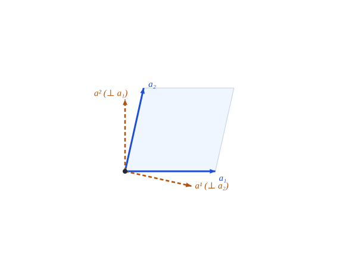

::: {.callout-note title="Objetivos de aprendizaje"}
Al terminar el capítulo sabrás:

1. definir una superficie regular parametrizada y su plano tangente;
2. construir los vectores básicos tangentes $\mathbf{a}_\alpha$, la normal unitaria $\hat{\mathbf{a}}_3$ y la base recíproca $\mathbf{a}^\alpha$;
3. calcular el tensor métrico $a_{\alpha\beta}$ de la superficie, su determinante $a$ y su inversa;
4. relacionar la base de la superficie con la base tridimensional $\mathbf{g}_i$ del capítulo 3;
5. comprobar en Julia las relaciones de ortogonalidad y reciprocidad sobre un paraboloide hiperbólico.
:::

## Motivación {#sec-motivacion-6}

Hasta aquí todo ocurría en el plano o en el espacio con coordenadas curvilíneas. Una lámina es distinta: su geometría la gobierna una **superficie media** curva. Para describirla se eligen dos parámetros $(\theta^1,\theta^2)$ sobre la superficie y una tercera coordenada $\theta^3$, la distancia medida a lo largo de la normal. La posición de un punto cualquiera de la lámina es

$$
\mathbf{r}(\theta^1,\theta^2,\theta^3)={}_0\mathbf{r}(\theta^1,\theta^2)+\theta^3\,\hat{\mathbf{a}}_3(\theta^1,\theta^2),
$$ {#eq-posicion-lamina}

donde ${}_0\mathbf{r}$ es el vector de posición de la superficie de referencia ($\theta^3=0$) y $\hat{\mathbf{a}}_3$ su normal unitaria.

::: {.callout-important title="Idea clave"}
La geometría de una superficie se estudia con **dos bases a la vez**: la tangente (dos vectores, $\mathbf{a}_\alpha$) y la normal ($\hat{\mathbf{a}}_3$). Lo que ya sabemos de bases covariantes y recíprocas vale aquí, con la normal como tercer vector.
:::

## Superficie regular y plano tangente {#sec-regular}

::: {#def-superficie}
## Superficie regular parametrizada
Una **superficie regular parametrizada** es una aplicación $\mathbf{r}:\ U\subset\mathbb{R}^2\to\mathbb{R}^3$, $(\theta^1,\theta^2)\mapsto{}_0\mathbf{r}$, de clase $C^2$ en $U$, tal que los vectores
$$
\mathbf{a}_\alpha=\frac{\partial\,{}_0\mathbf{r}}{\partial\theta^\alpha}\equiv{}_0\mathbf{r}_{,\alpha},\qquad\alpha=1,2,
$$ {#eq-a-alfa}
son linealmente independientes en todo punto, es decir, $\mathbf{a}_1\times\mathbf{a}_2\neq\mathbf{0}$.
:::

Los $\mathbf{a}_\alpha$ son tangentes a las curvas coordenadas (@fig-hypar-triada). Generan en cada punto el **plano tangente**.

::: {#def-normal}
## Normal unitaria
$$
\hat{\mathbf{a}}_3=\hat{\mathbf{a}}^3=\frac{\mathbf{a}_1\times\mathbf{a}_2}{\|\mathbf{a}_1\times\mathbf{a}_2\|} .
$$ {#eq-normal}
:::

::: {.callout-warning title="Convenio de orientación"}
La normal depende del **orden** de las coordenadas: intercambiar $\theta^1\leftrightarrow\theta^2$ cambia el signo de $\hat{\mathbf{a}}_3$. Este libro fija @eq-normal, de modo que $(\mathbf{a}_1,\mathbf{a}_2,\hat{\mathbf{a}}_3)$ es una terna **dextrógira**. Más adelante (@sec-convenio-b) veremos que el signo de la curvatura depende de esta elección.
:::

{#fig-hypar-triada fig-alt="Paraboloide hiperbólico con la base tangente, la base recíproca y la normal en un punto" width="90%"}

## El tensor métrico de la superficie {#sec-metrica-superficie}

::: {#def-metrica-sup}
## Tensor métrico de la superficie
$$
a_{\alpha\beta}=\mathbf{a}_\alpha\cdot\mathbf{a}_\beta,\qquad a=\det(a_{\alpha\beta})=a_{11}a_{22}-a_{12}^2 ,
$$ {#eq-a-metrica}
y $(a^{\alpha\beta})=(a_{\alpha\beta})^{-1}$.
:::

Es el tensor $g_{\alpha\beta}$ del capítulo 3 evaluado en $\theta^3=0$. Como la matriz es $2\times2$ se invierte a mano:

$$
a^{11}=\frac{a_{22}}{a},\qquad a^{22}=\frac{a_{11}}{a},\qquad a^{12}=a^{21}=-\frac{a_{12}}{a},\qquad \det(a^{\alpha\beta})=\frac1a .
$$ {#eq-a-inversa}

::: {#prp-sqrt-a}
## Área del paralelogramo tangente
$\|\mathbf{a}_1\times\mathbf{a}_2\|=\sqrt{a}$, y por tanto $\mathbf{a}_1\times\mathbf{a}_2=\sqrt{a}\;\hat{\mathbf{a}}_3$. El elemento de área de la superficie es
$$
dA=\sqrt{a}\;d\theta^1d\theta^2 .
$$ {#eq-dA}
:::

::: {.callout-note .demostracion collapse="true"}
## Demostración de @prp-sqrt-a
Es la identidad de Lagrange: $\|\mathbf{u}\times\mathbf{v}\|^2=\|\mathbf{u}\|^2\|\mathbf{v}\|^2-(\mathbf{u}\cdot\mathbf{v})^2$. Con $\mathbf{u}=\mathbf{a}_1$, $\mathbf{v}=\mathbf{a}_2$ resulta $a_{11}a_{22}-a_{12}^2=a$. La segunda afirmación es la definición @eq-normal, y @eq-dA se sigue de @eq-area. $\blacksquare$
:::

## La terna de bases {#sec-terna}

::: {#prp-terna}
## Bases covariante y recíproca de la superficie
En cada punto hay dos ternas, $\{\mathbf{a}_1,\mathbf{a}_2,\hat{\mathbf{a}}_3\}$ y $\{\mathbf{a}^1,\mathbf{a}^2,\hat{\mathbf{a}}_3\}$, con

1. $\mathbf{a}^\alpha=a^{\alpha\beta}\mathbf{a}_\beta$ y $\mathbf{a}_\alpha=a_{\alpha\beta}\mathbf{a}^\beta$, ambos **tangentes** a la superficie;
2. $\mathbf{a}^\alpha\cdot\mathbf{a}_\beta=\delta^\alpha_\beta$ y $\hat{\mathbf{a}}_3\cdot\mathbf{a}_\alpha=\hat{\mathbf{a}}_3\cdot\mathbf{a}^\alpha=0$;
3. $\mathbf{a}^3=\hat{\mathbf{a}}_3$ (la normal es su propia recíproca);
4. con $\bar e_{\alpha\beta}=\sqrt{a}\,\epsilon_{\alpha\beta}$ ($\epsilon_{12}=1$, $\epsilon_{21}=-1$):
$$
\mathbf{a}_\alpha\times\mathbf{a}_\beta=\bar e_{\alpha\beta}\,\hat{\mathbf{a}}_3,\qquad
\hat{\mathbf{a}}_3\times\mathbf{a}_\alpha=\bar e_{\alpha\beta}\,\mathbf{a}^\beta .
$$ {#eq-productos-base}
:::

::: {.callout-note .demostracion collapse="true"}
## Demostración de @prp-terna
(1) y (2) son @prp-g-dual aplicada en $\mathbb{R}^3$ a la base $\{\mathbf{a}_1,\mathbf{a}_2,\hat{\mathbf{a}}_3\}$, cuya métrica es $\operatorname{diag}(a_{\alpha\beta},1)$ por la ortogonalidad de $\hat{\mathbf{a}}_3$. Por esa estructura en bloques, la recíproca de $\mathbf{a}_\alpha$ no tiene componente normal y $\mathbf{a}^3=\hat{\mathbf{a}}_3$, lo que da (3). Para (4), la primera relación es @prp-sqrt-a. Para la segunda, $\hat{\mathbf{a}}_3\times\mathbf{a}_\alpha$ es tangente (luego combinación de los $\mathbf{a}^\beta$) y su producto con $\mathbf{a}_\gamma$ vale $(\hat{\mathbf{a}}_3\times\mathbf{a}_\alpha)\cdot\mathbf{a}_\gamma=\hat{\mathbf{a}}_3\cdot(\mathbf{a}_\alpha\times\mathbf{a}_\gamma)=\bar e_{\alpha\gamma}$, que es el de $\bar e_{\alpha\beta}\mathbf{a}^\beta$ con $\mathbf{a}_\gamma$. $\blacksquare$
:::

Dentro del plano tangente, el problema es el de las bases oblicuas del capítulo 3: $\mathbf{a}^1\perp\mathbf{a}_2$ y $\mathbf{a}^2\perp\mathbf{a}_1$ (@fig-plano-tangente). Esta figura reconstruye el plano tangente solo con los números $a_{\alpha\beta}$ del punto, sin necesidad del espacio tridimensional: la métrica **determina** la geometría dentro del plano.

{#fig-plano-tangente fig-alt="Base tangente y base recíproca en el plano tangente" width="70%"}

### Relación con la base tridimensional

Si $\mathbf{r}={}_0\mathbf{r}+\theta^3\hat{\mathbf{a}}_3$ (@eq-posicion-lamina), en $\theta^3=0$ se tiene $\mathbf{g}_\alpha=\mathbf{a}_\alpha$, $\mathbf{g}_3=\hat{\mathbf{a}}_3$ y $g_{\alpha\beta}=a_{\alpha\beta}$. Fuera de la superficie, $\mathbf{g}_\alpha$ y $g_{\alpha\beta}$ dependen de $\theta^3$ y de la curvatura (@sec-lamina-8). Además,

$$
\sqrt{a}=\hat{\mathbf{a}}_3\cdot(\mathbf{a}_1\times\mathbf{a}_2),\qquad \sqrt{g}=\mathbf{g}_3\cdot(\mathbf{g}_1\times\mathbf{g}_2) \xrightarrow{\ \theta^3=0\ }\sqrt a .
$$ {#eq-sqrt-g-a}

## Ejemplo: paraboloide hiperbólico {#sec-ejemplo-6}

::: {.callout-tip title="Ejemplo analítico y computacional"}
<span class="etiqueta-resultado analitico">analítico</span> Sea $z=-\tfrac12\bigl(x^2/R_x+y^2/R_y\bigr)$ con $R_x,R_y$ de signo contrario, parametrizada por $(\theta^1,\theta^2)=(x,y)$:
$$
{}_0\mathbf{r}=\Bigl(\theta^1,\ \theta^2,\ -\tfrac12\bigl(\tfrac{(\theta^1)^2}{R_x}+\tfrac{(\theta^2)^2}{R_y}\bigr)\Bigr),\quad
\mathbf{a}_1=\Bigl(1,0,-\tfrac{\theta^1}{R_x}\Bigr),\quad
\mathbf{a}_2=\Bigl(0,1,-\tfrac{\theta^2}{R_y}\Bigr).
$$
Entonces
$$
\begin{aligned}
a_{11}&=1+\Bigl(\tfrac{\theta^1}{R_x}\Bigr)^2,\quad a_{22}=1+\Bigl(\tfrac{\theta^2}{R_y}\Bigr)^2,\quad a_{12}=\tfrac{\theta^1\theta^2}{R_xR_y},\\
a&=1+\Bigl(\tfrac{\theta^1}{R_x}\Bigr)^2+\Bigl(\tfrac{\theta^2}{R_y}\Bigr)^2,\qquad
\hat{\mathbf{a}}_3=\frac{1}{\sqrt{a}}\Bigl(\tfrac{\theta^1}{R_x},\ \tfrac{\theta^2}{R_y},\ 1\Bigr).
\end{aligned}
$$ {#eq-hypar-metrica}
:::

```{julia}
using Geometria, LinearAlgebra

Rx, Ry = 3.0, -2.0
θ = [0.7, -0.4]
r = paraboloide_curvo(Rx, Ry)

A  = base_superficie(r, θ)          # columnas a₁, a₂
a  = metrica(A)                     # a_{αβ}
n  = normal_unitaria(A)             # n̂ = a₁×a₂/|a₁×a₂|
Ar = A * inv(a)                     # base recíproca tangente a^α

adet = 1 + (θ[1]/Rx)^2 + (θ[2]/Ry)^2
(métrica_correcta = a ≈ [1+(θ[1]/Rx)^2  θ[1]*θ[2]/(Rx*Ry); θ[1]*θ[2]/(Rx*Ry)  1+(θ[2]/Ry)^2],
 det_a = det(a), fórmula = adet,
 normal_correcta = n ≈ [θ[1]/Rx, θ[2]/Ry, 1] / sqrt(adet),
 ortogonal = round.([dot(n, A[:,1]), dot(n, A[:,2])]; digits = 8),
 reciprocidad = round.(transpose(Ar) * A; digits = 8))
```

Las fórmulas @eq-hypar-metrica se verifican contra el código en `julia/test/runtests.jl` («Superficies: paraboloide hiperbólico de bordes curvos»). La continuación de este ejemplo (curvatura, símbolos de Christoffel) está en el capítulo 9.

## Ejercicios {#sec-ejercicios-6}

1. Para la esfera de radio $\rho$ con $\mathbf{r}=\rho(\sin\theta^1\cos\theta^2,\sin\theta^1\sin\theta^2,\cos\theta^1)$ calcula $\mathbf{a}_\alpha$, $a_{\alpha\beta}$, $a$ y $\hat{\mathbf{a}}_3$. ¿Hacia dónde apunta $\hat{\mathbf{a}}_3$ con este orden de coordenadas?
2. Demuestra @eq-a-inversa a partir de la fórmula de la inversa de una matriz $2\times2$.
3. Prueba que $a_{\alpha\beta}$ es definida positiva y que $a>0$ para una superficie regular.
4. Cambia el orden $(\theta^1,\theta^2)\to(\theta^2,\theta^1)$ en el paraboloide y comprueba con `Geometria` que $\hat{\mathbf{a}}_3$ cambia de signo.
5. Calcula el área de la porción del paraboloide con $|x|\le1$, $|y|\le1$ y $R_x=-R_y=3$ integrando $\sqrt{a}$ numéricamente.

## Referencias comentadas {#sec-refs-6}

Aún **no se han contrastado línea a línea con este texto**.

- @DoCarmo — definición de superficie regular, plano tangente y primera forma fundamental; el texto de referencia en español.
- @Struik — geometría diferencial clásica con notación tensorial próxima a la de este libro.
- @Weatherburn — tratamiento vectorial de las superficies; útil para la terna $\mathbf{a}_\alpha,\hat{\mathbf{a}}_3$.
- @Costaejercicios — ejercicios resueltos de curvas y superficies.
- @Lipschultz — problemas de superficies parametrizadas.
