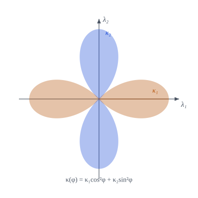

::: {.callout-note title="Objetivos de aprendizaje"}
Al terminar el capítulo sabrás:

1. definir la curvatura normal en una dirección y calcularla con $b_{\alpha\beta}$;
2. obtener las curvaturas y direcciones **principales** como problema de autovalores y demostrar su ortogonalidad;
3. definir las curvaturas de **Gauss** $K$ y **media** $H$ y clasificar los puntos de una superficie;
4. demostrar la fórmula de **Euler** $\kappa(\varphi)=\kappa_1\cos^2\varphi+\kappa_2\sin^2\varphi$;
5. expresar la base de la lámina y los diferenciales de área y volumen con $H$ y $K$.
:::

## Motivación {#sec-motivacion-8}

El tensor $b_{\alpha\beta}$ guarda toda la información de curvatura, pero son cuatro números que dependen de las coordenadas. Lo que interesa en mecánica es **cuánto se curva la superficie en cada dirección** y cuáles son las direcciones extremas. Eso se resume en dos números invariantes: $K$ y $H$.

::: {.callout-important title="Idea clave"}
Si se corta la superficie con un plano que contiene a la normal, se obtiene una curva plana (una **sección normal**). Su curvatura, con signo, es la curvatura normal en esa dirección. Sus valores máximo y mínimo son las curvaturas principales.
:::

## Curvatura normal {#sec-normal}

Sea $\hat{\boldsymbol\lambda}=\lambda^\alpha\mathbf{a}_\alpha$ un vector tangente unitario ($a_{\alpha\beta}\lambda^\alpha\lambda^\beta=1$), tangente a una curva de la superficie de longitud de arco $\ell$.

::: {#def-curv-normal}
## Curvatura normal
$$
\kappa=\hat{\mathbf{a}}_3\cdot\frac{d\hat{\boldsymbol\lambda}}{d\ell}=-\frac{d\hat{\mathbf{a}}_3}{d\ell}\cdot\hat{\boldsymbol\lambda} .
$$ {#eq-kappa-def}
:::

::: {#prp-kappa-b}
## Curvatura normal y segunda forma
$$
\kappa=b_{\alpha\beta}\,\lambda^\alpha\lambda^\beta .
$$ {#eq-kappa-b}
Si $\boldsymbol\lambda$ no es unitario, $\kappa=\dfrac{b_{\alpha\beta}\lambda^\alpha\lambda^\beta}{a_{\alpha\beta}\lambda^\alpha\lambda^\beta}$. Solo depende de la dirección, no de la curva elegida.
:::

::: {.callout-note .demostracion collapse="true"}
## Demostración de @prp-kappa-b
Con $\hat{\boldsymbol\lambda}=\lambda^\alpha\mathbf{a}_\alpha$ y $d\theta^\beta/d\ell=\lambda^\beta$, $\dfrac{d\hat{\boldsymbol\lambda}}{d\ell}=\lambda^\alpha_{,\beta}\lambda^\beta\mathbf{a}_\alpha+\lambda^\alpha\lambda^\beta\mathbf{a}_{\alpha,\beta}$. Su producto con $\hat{\mathbf{a}}_3$ elimina el primer término ($\hat{\mathbf{a}}_3\perp\mathbf{a}_\alpha$) y deja $\lambda^\alpha\lambda^\beta\,\hat{\mathbf{a}}_3\cdot\mathbf{a}_{\alpha,\beta}=b_{\alpha\beta}\lambda^\alpha\lambda^\beta$ por @eq-b-def. $\blacksquare$
:::

Con la normal hacia arriba y el convenio del @sec-convenio-b, $\kappa>0$ si la curva se dobla **hacia** $\hat{\mathbf{a}}_3$ y $\kappa<0$ si se aleja. La @fig-secciones lo muestra en un punto de silla.

{#fig-secciones fig-alt="Secciones normales de un paraboloide hiperbólico en el punto de silla" width="90%"}

### Torsión y curvatura geodésica

Sobre una curva con tangente $\hat{\boldsymbol\lambda}_1$ se forma el triedro $\{\hat{\boldsymbol\lambda}_1,\hat{\boldsymbol\lambda}_2=\hat{\mathbf{a}}_3\times\hat{\boldsymbol\lambda}_1,\hat{\mathbf{a}}_3\}$. Al avanzar, $\hat{\boldsymbol\lambda}_1$ gira hacia $\hat{\mathbf{a}}_3$ (curvatura normal $\kappa_{11}$) y hacia $\hat{\boldsymbol\lambda}_2$ (**curvatura geodésica** $\sigma_{12}=\hat{\boldsymbol\lambda}_2\cdot d\hat{\boldsymbol\lambda}_1/d\ell$). Por su parte, $\hat{\boldsymbol\lambda}_2$ gira sobre $\hat{\mathbf{a}}_3$ con la **torsión** $\tau_{12}=\hat{\mathbf{a}}_3\cdot d\hat{\boldsymbol\lambda}_2/d\ell=b_{\alpha\beta}\lambda_1^\alpha\lambda_2^\beta$. En las direcciones principales (siguiente sección) la torsión se anula.

## Curvaturas y direcciones principales {#sec-principales}

Los extremos de $\kappa(\boldsymbol\lambda)$ sujetos a $a_{\alpha\beta}\lambda^\alpha\lambda^\beta=1$ cumplen, por multiplicadores de Lagrange,
$$
\bigl(b_{\alpha\beta}-\kappa\,a_{\alpha\beta}\bigr)\lambda^\alpha=0 .
$$ {#eq-autovalores}

::: {#prp-principales}
## Curvaturas principales, Gauss y media
Sean $\kappa_1,\kappa_2$ las raíces de $\det(b_{\alpha\beta}-\kappa a_{\alpha\beta})=0$. Entonces:

1. $\kappa^2-2H\kappa+K=0$, con
$$
H=\tfrac12\,b^\alpha_\alpha=\tfrac12(\kappa_1+\kappa_2),\qquad K=\det\bigl(b^\alpha_\beta\bigr)=\frac{\det(b_{\alpha\beta})}{a}=\kappa_1\kappa_2 .
$$ {#eq-HK}
2. Las raíces son reales. Si $\kappa_1\neq\kappa_2$, las direcciones principales son **ortogonales**: $a_{\alpha\beta}\lambda_1^\alpha\lambda_2^\beta=0$.
3. En una dirección principal, la torsión es nula.
:::

::: {.callout-note .demostracion collapse="true"}
## Demostración de @prp-principales
(1) El sistema @eq-autovalores equivale a $(b^\alpha_\beta-\kappa\delta^\alpha_\beta)\lambda^\beta=0$, luego $\kappa$ es autovalor de $(b^\alpha_\beta)$ y $\det(b^\alpha_\beta-\kappa\delta)=\kappa^2-(\operatorname{tr}b)\kappa+\det b^\alpha_\beta$. Los términos son $2H$ y $K$. Además $\det(b^\alpha_\beta)=\det(a^{\alpha\gamma})\det(b_{\gamma\beta})=\det b_{\gamma\beta}/a$.

(2) $a^{-1}b$ es simétrica respecto del producto interno $a$: la forma $\langle\mathbf{x},\mathbf{y}\rangle_a=x^{\mathsf T}ay$ da $\langle b^\cdot_\cdot x,y\rangle_a=x^{\mathsf T}b\,y=\langle x,b^\cdot_\cdot y\rangle_a$. Los autovalores de un operador autoadjunto en un espacio con producto interno son reales y sus autovectores de autovalores distintos, ortogonales. Explícitamente, multiplicando @eq-autovalores para $\kappa_1$ por $\lambda_2^\beta$ y para $\kappa_2$ por $\lambda_1^\beta$ y restando, se tiene $(\kappa_1-\kappa_2)\,a_{\alpha\beta}\lambda_1^\alpha\lambda_2^\beta=0$ por la simetría de $a_{\alpha\beta}$ y $b_{\alpha\beta}$.

(3) $\tau_{12}=b_{\alpha\beta}\lambda_1^\alpha\lambda_2^\beta=\kappa_1\,a_{\alpha\beta}\lambda_1^\alpha\lambda_2^\beta=0$ por (2). $\blacksquare$
:::

::: {#prp-euler}
## Fórmula de Euler
Si $\varphi$ es el ángulo entre $\hat{\boldsymbol\lambda}$ y la primera dirección principal,
$$
\kappa(\varphi)=\kappa_1\cos^2\varphi+\kappa_2\sin^2\varphi .
$$ {#eq-euler}
:::

::: {.callout-note .demostracion collapse="true"}
## Demostración de @prp-euler
Como las direcciones principales $\hat{\boldsymbol\lambda}_1,\hat{\boldsymbol\lambda}_2$ son ortonormales y tangentes, $\hat{\boldsymbol\lambda}=\cos\varphi\,\hat{\boldsymbol\lambda}_1+\sin\varphi\,\hat{\boldsymbol\lambda}_2$, es decir, $\lambda^\alpha=\cos\varphi\,\lambda_1^\alpha+\sin\varphi\,\lambda_2^\alpha$. Sustituyendo en @eq-kappa-b y usando $b_{\alpha\beta}\lambda_1^\alpha\lambda_1^\beta=\kappa_1$, $b_{\alpha\beta}\lambda_2^\alpha\lambda_2^\beta=\kappa_2$, $b_{\alpha\beta}\lambda_1^\alpha\lambda_2^\beta=0$, queda @eq-euler. $\blacksquare$
:::

{#fig-euler fig-alt="Curvatura normal en función del ángulo, en forma de cuatro lóbulos" width="65%"}

::: {.callout-tip title="Clasificación de los puntos"}
| Signo de $K$ | Tipo de punto | Ejemplos |
|---|---|---|
| $K>0$ | **elíptico**: $\kappa_1,\kappa_2$ del mismo signo | esfera, cúpula |
| $K<0$ | **hiperbólico**: signos opuestos (silla) | paraboloide hiperbólico |
| $K=0$, $H\neq0$ | **parabólico**: una curvatura principal nula | cilindro, cono |
| $K=H=0$ | **plano** | plano |
| $\kappa_1=\kappa_2$ | **umbilical**: $\kappa$ no depende de la dirección | esfera |

$K$ **no** cambia al invertir la normal; $H$ sí.
:::

## La base de la lámina y los diferenciales de área y volumen {#sec-lamina-8}

Con $\mathbf{r}={}_0\mathbf{r}+\theta^3\hat{\mathbf{a}}_3$ (@eq-posicion-lamina), derivando respecto de $\theta^\alpha$ y usando Weingarten (@eq-weingarten):

$$
\mathbf{g}_\alpha=\mathbf{a}_\alpha+\theta^3\,\hat{\mathbf{a}}_{3,\alpha}=\mathbf{a}_\alpha-\theta^3\,b^\beta_\alpha\,\mathbf{a}_\beta,\qquad\mathbf{g}_3=\hat{\mathbf{a}}_3 .
$$ {#eq-g-lamina}

::: {#prp-g-lamina}
## Métrica y volumen de la lámina
$$
\begin{aligned}
g_{\alpha\beta}&=a_{\alpha\beta}-2\theta^3\,b_{\alpha\beta}+(\theta^3)^2\,b_{\alpha\gamma}b^\gamma_\beta,\qquad g_{\alpha3}=0,\ g_{33}=1,\\
\sqrt{g}&=\sqrt{a}\,\bigl[\,1-2H\,\theta^3+K\,(\theta^3)^2\bigr] .
\end{aligned}
$$ {#eq-g-metrica}
Por tanto,
$$
dA=\sqrt{g}\,d\theta^1d\theta^2,\qquad d\upsilon=\sqrt{g}\,d\theta^1d\theta^2d\theta^3,\qquad \frac{\sqrt g}{\sqrt a}=1-2H\theta^3+K(\theta^3)^2 .
$$ {#eq-area-volumen}
:::

::: {.callout-note .demostracion collapse="true"}
## Demostración de @prp-g-lamina
De @eq-g-lamina, $g_{\alpha\beta}=\mathbf{g}_\alpha\cdot\mathbf{g}_\beta=a_{\alpha\beta}-\theta^3(b_\alpha^\gamma a_{\gamma\beta}+b_\beta^\gamma a_{\alpha\gamma})+(\theta^3)^2b^\gamma_\alpha b^\delta_\beta a_{\gamma\delta}$. Como $b^\gamma_\alpha a_{\gamma\beta}=b_{\alpha\beta}$ y $b_\beta^\gamma a_{\alpha\gamma}=b_{\alpha\beta}$, resulta la primera fórmula. Para el determinante: $\mathbf{g}_\alpha=\mathbf{a}_\beta\,(\delta^\beta_\alpha-\theta^3b^\beta_\alpha)$ implica $\mathbf{g}_1\times\mathbf{g}_2=\det(\delta-\theta^3b^\cdot_\cdot)\,\mathbf{a}_1\times\mathbf{a}_2$. Con $\det(\delta-\theta^3B)=1-\theta^3\operatorname{tr}B+(\theta^3)^2\det B$ y @eq-HK, $\sqrt{g}=\mathbf{g}_3\cdot(\mathbf{g}_1\times\mathbf{g}_2)=\sqrt{a}\,(1-2H\theta^3+K(\theta^3)^2)$. $\blacksquare$
:::

::: {.callout-important title="Consecuencia para láminas"}
Una lámina de espesor $h$ tiene $\theta^3\in[-h/2,h/2]$. El cociente $\sqrt g/\sqrt a$ solo es $\approx1$ si $|H|h\ll1$ y $|K|h^2\ll1$: es la hipótesis de **lámina delgada**. Si no, los elementos de área y volumen difieren apreciablemente entre las caras.
:::

## Ejemplo computacional en Julia {#sec-julia-curv}

::: {.callout-tip title="Ejemplo computacional"}
<span class="etiqueta-resultado calculado">calculado</span> Curvaturas del paraboloide hiperbólico ($R_x=3$, $R_y=-2$) en $\theta=(0{,}7,-0{,}4)$; fórmula de Euler; y $\sqrt g/\sqrt a$ en una esfera con normal saliente, donde debe valer $(1+\theta^3/\rho)^2$.
:::

```{julia}
using Geometria, LinearAlgebra

Rx, Ry = 3.0, -2.0
θ = [0.7, -0.4]
r = paraboloide_curvo(Rx, Ry)
A = base_superficie(r, θ); a = metrica(A); b = segunda_forma(r, θ)
pc = curvaturas_principales(a, b)

w2 = 1 + (θ[1]/Rx)^2 + (θ[2]/Ry)^2
(κ_principales = pc.κ, K = pc.K, K_analítica = 1 / (Rx * Ry * w2^2), H = pc.H,
 ortogonales = round(pc.λ[:, 1]' * a * pc.λ[:, 2]; digits = 10),
 κ1κ2_igual_K = pc.κ[1] * pc.κ[2] ≈ pc.K)
```

```{julia}
# Fórmula de Euler
φ = 0.8
λ = cos(φ) * pc.λ[:, 1] + sin(φ) * pc.λ[:, 2]
(curvatura_normal(a, b, λ), pc.κ[1] * cos(φ)^2 + pc.κ[2] * sin(φ)^2)
```

```{julia}
# Esfera de radio ρ con normal saliente: √g/√a = (1 + θ³/ρ)²
ρ = 2.0
esf(t) = ρ .* [sin(t[1]) * cos(t[2]), sin(t[1]) * sin(t[2]), cos(t[1])]
te = [1.0, 0.3]
Ae = base_superficie(esf, te); ae = metrica(Ae); be = segunda_forma(esf, te)
pe = curvaturas_principales(ae, be)
θ3 = 0.1
(H = pe.H, K = pe.K, cociente = area_relativa(pe.H, pe.K, θ3), esperado = (1 + θ3 / ρ)^2)
```

## Ejercicios {#sec-ejercicios-8}

1. Calcula las curvaturas principales, $K$ y $H$ de un cilindro de radio $\rho$ y de un cono, e indica el tipo de punto.
2. Demuestra que $K$ no depende del orden de las coordenadas y que $H\to-H$ al invertir $\hat{\mathbf{a}}_3$.
3. Comprueba en Julia @eq-g-metrica para el paraboloide con $\theta^3=\pm0{,}05$.
4. En el paraboloide $R_x=-R_y=R$, ¿qué direcciones tienen curvatura normal nula en el origen? Justifícalo con @eq-euler.
5. Explica por qué para una lámina esférica el volumen real entre las caras $\pm h/2$ difiere del producto área por espesor, y calcula la diferencia relativa a primer orden en $h/\rho$.

## Referencias comentadas {#sec-refs-8}

Aún **no se han contrastado línea a línea con este texto**.

- @DoCarmo — curvaturas normal, principal, de Gauss y media; fórmula de Euler y clasificación de puntos.
- @Struik — tratamiento clásico de las curvaturas con notación tensorial.
- @Weatherburn — curvaturas con técnica vectorial.
- @Novozhilov — uso de $H$, $K$ y los radios principales en láminas.
- @Costaejercicios — ejercicios resueltos de curvaturas.
