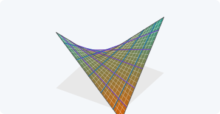
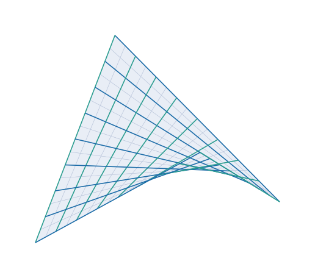

{#fig-apertura-cap09 .apertura fig-alt="Superficie en forma de silla con dos familias de rectas y cuatro bordes rectos" width="100%"}

::: {.callout-note title="Objetivos de aprendizaje"}
Al terminar el capítulo sabrás:

1. describir el paraboloide hiperbólico como superficie explícita y como superficie reglada;
2. obtener todos sus tensores geométricos ($a_{\alpha\beta}$, $\hat{\mathbf{a}}_3$, $b_{\alpha\beta}$, $\bar\Gamma^\gamma_{\alpha\beta}$, $K$) en forma cerrada y contrastarlos numéricamente;
3. explicar por qué las curvas coordenadas **no** son líneas de curvatura en un punto cualquiera;
4. distinguir las tipologías de **bordes curvos** y de **bordes rectos** y relacionarlas por un giro de $45^\circ$ en planta;
5. justificar cuándo una lámina de este tipo puede considerarse «muy plana» (*shallow*).
:::

## Motivación {#sec-motivacion-9}

El paraboloide hiperbólico («hypar») es una superficie de doble curvatura **negativa** ($K<0$) que puede construirse con elementos rectos. Esa combinación de rigidez geométrica y facilidad de encofrado lo ha convertido en una forma frecuente de cubiertas de hormigón de espesor muy pequeño. Para el análisis estructural tiene una dificultad: sus curvas coordenadas naturales **no son ortogonales** (@sec-no-ortogonal), de modo que no sirven las teorías de láminas que suponen coordenadas ortogonales.

::: {.callout-important title="Idea clave"}
Lo que se ha aprendido en los capítulos 6 a 8 se aplica aquí sin hipótesis adicionales: $a_{\alpha\beta}$ es **no diagonal**, y por eso el formalismo tensorial completo (bases covariante y recíproca distintas, símbolos de Christoffel no nulos) es necesario.
:::

## Descripción geométrica {#sec-descripcion}

### Forma explícita (bordes curvos)

::: {#def-hypar-curvo}
## Paraboloide hiperbólico en ejes principales
Con ejes cartesianos $(x,y,z)$, la superficie media es
$$
z=-\frac12\left(\frac{x^2}{R_x}+\frac{y^2}{R_y}\right),\qquad R_xR_y<0,
$$ {#eq-hypar-curvo}
y su proyección en planta es un rectángulo $[-a/2,a/2]\times[-b/2,b/2]$. Los bordes son **parábolas** en los planos $x=\pm a/2$ e $y=\pm b/2$.
:::

Se parametriza por $(\theta^1,\theta^2)=(x,y)$. Las secciones por planos $y=\text{cte}$ son parábolas que se curvan hacia abajo si $R_x>0$, y las de $x=\text{cte}$ hacia arriba si $R_y<0$.

### Forma reglada (bordes rectos)

::: {#def-hypar-recto}
## Paraboloide hiperbólico reglado
$$
z=c\,x\,y,\qquad {}_0\mathbf{r}(\theta^1,\theta^2)=\bigl(\theta^1,\ \theta^2,\ c\,\theta^1\theta^2\bigr).
$$ {#eq-hypar-recto}
:::

Las curvas $\theta^1=\text{cte}$ y $\theta^2=\text{cte}$ son **rectas** (@fig-generatrices): fijado $\theta^1=u$, $\theta^2\mapsto(u,\theta^2,c\,u\,\theta^2)$ es lineal. Por tanto el paraboloide hiperbólico contiene **dos familias de generatrices rectas**, y por eso se llama superficie *doblemente reglada*.

{#fig-generatrices fig-alt="Paraboloide hiperbólico con dos familias de rectas" width="80%"}

::: {#prp-giro-45}
## Las dos formas son la misma superficie
Con $R_x=R$, $R_y=-R$ y el giro de $45^\circ$ en planta $x=(X-Y)/\sqrt2$, $y=(X+Y)/\sqrt2$, la ecuación @eq-hypar-curvo equivale a @eq-hypar-recto con $c=-1/R$.
:::

::: {.callout-note .demostracion collapse="true"}
## Demostración de @prp-giro-45
Con $R_x=R,R_y=-R$: $z=-\tfrac{1}{2R}(X^2-Y^2)$. Con $X=(x+y)/\sqrt2$, $Y=(y-x)/\sqrt2$ (el giro inverso), $X^2-Y^2=2xy$, luego $z=-xy/R=c\,xy$ con $c=-1/R$. $\blacksquare$
:::

Así, **la misma superficie** admite dos tipologías de lámina según cómo se recorte en planta (@fig-bordes):

- **bordes curvos:** el rectángulo en planta tiene lados paralelos a los ejes principales (las secciones con los planos verticales de los bordes son parábolas);
- **bordes rectos:** el rectángulo tiene lados paralelos a las generatrices, es decir, a $45^\circ$ de los ejes principales (los bordes son segmentos rectos).

{#fig-bordes fig-alt="Planta con ejes principales, generatrices y los dos rectángulos" width="75%"}

## Tensores geométricos del paraboloide de bordes curvos {#sec-tensores-curvo}

Con ${}_0\mathbf{r}=(\theta^1,\theta^2,-\tfrac12(\theta^{1\,2}/R_x+\theta^{2\,2}/R_y))$ y $w^2\equiv a$ (@eq-hypar-metrica), se obtienen, como se ha calculado en los capítulos 6 y 7:

::: {.callout-tip title="Resultados analíticos y verificación"}
<span class="etiqueta-resultado analitico">analítico</span> <span class="etiqueta-resultado calculado">verificado numéricamente</span>

| Objeto | Expresión |
|---|---|
| $\mathbf{a}_{1,1},\ \mathbf{a}_{2,2},\ \mathbf{a}_{1,2}$ | $(0,0,-1/R_x)$, $(0,0,-1/R_y)$, $\mathbf{0}$ |
| $a^{11},\ a^{22},\ a^{12}$ | $\dfrac{R_x^2(R_y^2+\theta_2^2)}{D},\ \dfrac{R_y^2(R_x^2+\theta_1^2)}{D},\ -\dfrac{R_xR_y\theta_1\theta_2}{D}$ con $D=R_y^2\theta_1^2+R_x^2(R_y^2+\theta_2^2)=R_x^2R_y^2\,a$ |
| $b_{11},\ b_{22},\ b_{12}$ | $-\dfrac{1}{R_x\sqrt{a}},\ -\dfrac{1}{R_y\sqrt{a}},\ 0$ |
| $\bar\Gamma^1_{11},\ \bar\Gamma^1_{22}$ | $\dfrac{R_y^2\theta_1}{D},\ \dfrac{R_xR_y\theta_1}{D}$ |
| $\bar\Gamma^2_{11},\ \bar\Gamma^2_{22}$ | $\dfrac{R_xR_y\theta_2}{D},\ \dfrac{R_x^2\theta_2}{D}$ |
| $\bar\Gamma^1_{12},\ \bar\Gamma^2_{12}$ | $0,\ 0$ |
| $K=\det(b^\alpha_\beta)$ | $\dfrac{1}{R_xR_y\,a^2}<0$ |
:::

La expresión de $\bar\Gamma^2_{22}$ se ha **deducido por simetría** con la de $\bar\Gamma^1_{11}$; se verifica junto con las demás en el test «Superficies: paraboloide hiperbólico de bordes curvos». El resto coincide con las que se obtienen a mano con @eq-gauss.

### Las curvas coordenadas no son líneas de curvatura {#sec-no-ortogonal}

::: {.callout-warning title="Curvas coordenadas y direcciones principales"}
Como $a_{12}=\theta^1\theta^2/(R_xR_y)\neq0$ salvo sobre los ejes, las curvas coordenadas **no son ortogonales**. Además, $b_{12}=0$ pero $a_{12}\neq0$, así que las direcciones coordenadas **no** son principales (para serlo, $b_{12}-\kappa a_{12}=0$ con el mismo $\kappa$ en ambas). Solo en el origen y sobre los ejes coinciden las direcciones coordenadas con las principales. Esta es la dificultad que impide usar teorías de láminas con coordenadas ortogonales.
:::

## Curvaturas del paraboloide reglado {#sec-curvaturas-recto}

Para $z=c\,x\,y$:

::: {.callout-tip title="Resultados analíticos"}
<span class="etiqueta-resultado analitico">analítico</span> <span class="etiqueta-resultado calculado">verificado numéricamente</span>
$$
a_{11}=1+c^2(\theta^2)^2,\quad a_{22}=1+c^2(\theta^1)^2,\quad a_{12}=c^2\theta^1\theta^2,\quad a=1+c^2\bigl[(\theta^1)^2+(\theta^2)^2\bigr],
$$
$$
b_{11}=b_{22}=0,\qquad b_{12}=\frac{c}{\sqrt{a}},\qquad K=-\frac{c^2}{a^2} .
$$ {#eq-hypar-recto-tensores}
:::

Como $b_{11}=b_{22}=0$, la curvatura normal en las direcciones coordenadas es nula: **las rectas generatrices son líneas asintóticas** ($\kappa=0$), como era de esperar. En el origen, $a_{\alpha\beta}=\delta_{\alpha\beta}$, $b_{12}=c$ y las curvaturas principales son $\pm c$ en las direcciones a $\pm45^\circ$.

## Láminas muy planas {#sec-planas}

Se dice que una lámina de este tipo es **muy plana** (*shallow*) si la pendiente de la superficie es pequeña, $|\partial z/\partial x|,|\partial z/\partial y|\ll1$. En un paraboloide con planta $a\times b$ y radios $R_x,R_y$, las pendientes máximas son $a/(2|R_x|)$ y $b/(2|R_y|)$. Entonces $a_{\alpha\beta}\approx\delta_{\alpha\beta}$, $\hat{\mathbf{a}}_3\approx\mathbf{e}_z$ y $b_{\alpha\beta}\approx\operatorname{diag}(-1/R_x,-1/R_y)$ son aproximadamente constantes. La @tbl-shallow cuantifica la desviación de la métrica.

```{julia}
#| label: tbl-shallow
#| output: asis
#| echo: true
#| tbl-cap: "Desviación máxima de la métrica respecto de la identidad en el paraboloide $R_x=-R_y=R$, planta cuadrada de lado $a$ (esquina $\\theta=(a/2, a/2)$)."
using Geometria, LinearAlgebra, Printf

a_lado = 1.0
println("| \$R/a\$ | pendiente máxima \$a/2R\$ | desviación máx. de \$a_{\\alpha\\beta}\$ | \$(a/2R)^2\$ |")
println("|---:|---:|---:|---:|")
for ratio in (2.0, 5.0, 10.0, 20.0, 50.0)
    R = ratio * a_lado
    r = paraboloide_curvo(R, -R)
    A = base_superficie(r, [a_lado / 2, a_lado / 2])
    dev = maximum(abs.(metrica(A) - I(2)))
    pend = a_lado / (2R)
    @printf("| %g | %.4f | %.6f | %.6f |\n", ratio, pend, dev, pend^2)
end
```

La desviación es del orden de la pendiente al cuadrado, $(a/2R)^2$. Para $R/a\ge10$ la métrica se desvía menos de un $0{,}3\,\%$ de la euclídea.

## Ejemplo computacional en Julia {#sec-julia-hypar}

::: {.callout-tip title="Ejemplo computacional"}
<span class="etiqueta-resultado calculado">calculado</span> Se comprueban las fórmulas de la tabla de @sec-tensores-curvo y de @eq-hypar-recto-tensores, y la @prp-giro-45, en puntos concretos.
:::

```{julia}
using Geometria, LinearAlgebra

Rx, Ry = 3.0, -2.0
θ = [0.7, -0.4]
r = paraboloide_curvo(Rx, Ry)
A = base_superficie(r, θ); a = metrica(A); b = segunda_forma(r, θ)
Γ = cristoffel_superficie(r, θ)
ainv = inv(a)
D = Ry^2 * θ[1]^2 + Rx^2 * (Ry^2 + θ[2]^2)
w = sqrt(det(a))

(b_ok = b ≈ [-1/(Rx*w) 0; 0 -1/(Ry*w)],
 ainv12_ok = ainv[1, 2] ≈ -Rx*Ry*θ[1]*θ[2] / D,
 Γ1_11_ok = Γ[1, 1, 1] ≈ Ry^2 * θ[1] / D,
 Γ1_22_ok = Γ[1, 2, 2] ≈ Rx*Ry*θ[1] / D,
 Γ2_11_ok = Γ[2, 1, 1] ≈ Rx*Ry*θ[2] / D,
 Γ2_22_ok = Γ[2, 2, 2] ≈ Rx^2 * θ[2] / D,
 K_ok = curvaturas_principales(a, b).K ≈ 1 / (Rx*Ry*det(a)^2))
```

```{julia}
# Direcciones principales en el punto: ¿coinciden con las coordenadas?
pc = curvaturas_principales(a, b)
(κ = pc.κ, λ1 = pc.λ[:, 1], λ2 = pc.λ[:, 2], a12 = a[1, 2])
```

```{julia}
# Paraboloide reglado z = c·x·y: b₁₁ = b₂₂ = 0, K = −c²/a²
c0 = 0.8; rec = paraboloide_recto(c0); t = [0.5, -0.7]
Ar = base_superficie(rec, t); ar = metrica(Ar); br = segunda_forma(rec, t)
ap = 1 + c0^2 * (t[1]^2 + t[2]^2)
(b = round.(br; digits = 6), b12_ok = br[1, 2] ≈ c0 / sqrt(ap),
 K = curvaturas_principales(ar, br).K, K_ok = curvaturas_principales(ar, br).K ≈ -c0^2 / ap^2)
```

```{julia}
# Giro de 45°: misma altura z en ambas descripciones (R_x = −R_y = R, c = −1/R)
R = 2.5
cur = paraboloide_curvo(R, -R); rect = paraboloide_recto(-1 / R)
X = [0.4, 0.9]
xy = [(X[1] - X[2]) / sqrt(2), (X[1] + X[2]) / sqrt(2)]
(cur(X)[3], rect(xy)[3])
```

## Ejercicios {#sec-ejercicios-9}

1. Demuestra que la recta $\theta^1=u$ de @eq-hypar-recto está contenida en la superficie y que, dado un punto, hay exactamente dos generatrices que pasan por él.
2. Comprueba @eq-hypar-recto-tensores con `Geometria` para $c=1$ en tres puntos distintos.
3. Calcula las direcciones principales de $z=c\,x\,y$ en un punto $(\theta^1,\theta^2)$ cualquiera y comprueba que solo en el origen forman $45^\circ$ con los ejes.
4. Para $R_x=-R_y=R$, ¿para qué valores de $a/R$ la pendiente máxima en el borde del rectángulo de planta $a\times a$ supera $0{,}25$?
5. Dibuja, para $c=0{,}5$, las curvas de nivel $z=\text{cte}$ y las generatrices proyectadas en planta; ¿qué forma tienen?

## Referencias comentadas {#sec-refs-9}

Aún **no se han leído en detalle para este libro**; los comentarios reflejan su título y su lugar en la bibliografía del tema.

- @Canals — estudio monográfico de los cascarones parabólico-hiperbólicos: geometría, hypar como superficie reglada, de traslación y cuádrica.
- @Margarit_ph — cálculo de estructuras con forma de paraboloide hiperbólico.
- @Narita — vibraciones de láminas muy planas de planta rectangular apoyadas en las esquinas; referencia del esquema geométrico ($R_x$, $R_y$) usado para el hypar de bordes curvos.
- @Novozhilov — teoría de láminas delgadas; fundamento de la hipótesis de lámina muy plana.
- @DoCarmo — superficies regladas y curvatura de Gauss negativa.
