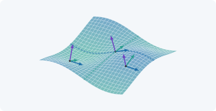

{#fig-portada-a1 .portada fig-alt="Dibujo plano de una cubierta ligera con forma de silla de montar, con una cuadrícula de líneas rectas sobre su superficie, apoyada en tres esquinas bajas; debajo caminan tres personas diminutas" width="100%"}

::: {.pregunta-guia}
Cómo puede una cáscara de hormigón de pocos centímetros de espesor cubrir un restaurante entero sin una sola columna en medio, y qué matemáticas necesitamos para calcular una forma así
:::

## Objetivos y prerrequisitos {.unnumbered}

**Objetivos.** Al terminar el tema sabrás:

- describir qué es una **lámina** (o cáscara) y por qué la curvatura le da rigidez;
- reconocer el **paraboloide hiperbólico** y por qué se puede construir con elementos rectos;
- explicar por qué una lámina obliga a usar **coordenadas curvilíneas** y herramientas tensoriales;
- orientarte en el mapa del libro: qué pregunta responde cada bloque;
- calcular en Julia la base natural y la métrica de las coordenadas polares, el primer ejemplo del libro.

**Prerrequisitos.** Ninguno específico: bastan álgebra lineal y cálculo de primer ciclo universitario (vectores, matrices, derivadas parciales).

**Secciones del tema**

- **Sección 1.1** · Una cubierta que parece imposible
- **Sección 1.2** · Por qué la curvatura da rigidez
- **Sección 1.3** · Qué necesitamos saber: el mapa del libro
- **Sección 1.4** · Un primer ejemplo: coordenadas polares

## Una cubierta que parece imposible {#sec-candela}

En 1958 se terminó en Xochimilco, al sur de la Ciudad de México, el restaurante **Los Manantiales**: una cubierta formada por cuatro paraboloides hiperbólicos que se cruzan en el centro y cubren un comedor de unos 32 metros de ancho sin apoyos intermedios. Las cubiertas de este tipo, con láminas de hormigón armado de apenas unos pocos centímetros de espesor, se asocian sobre todo al ingeniero y constructor Félix Candela.

::: {#exm-esbeltez}
## Ejemplo resuelto: ¿cuán delgada es una cáscara?
La medida natural de lo delgada que es una lámina es la **esbeltez** $L/h$ (luz dividida por espesor). Con los datos citados abajo, $L\approx106$ pies $\approx32{,}3$ m y $h\approx4$ cm:
$$
\frac{L}{h}\approx\frac{32{,}3}{0{,}04}\approx 800 .
$$
Es la esbeltez de una hoja de papel de 20 cm de lado y $0{,}25$ mm de espesor (algo más gruesa que un folio). Eso es posible porque la forma, y no solo el material, es la que soporta la carga.
:::

::: {.callout-warning title="Dos puntos que suelen confundir"}
- **Delgada no es débil.** Una lámina de 4 cm puede soportar la cubierta de un edificio *porque* es curva. La misma chapa plana se doblaría bajo su peso.
- **El espesor de 4 cm es un orden de magnitud**, no un dato exacto: las fuentes citadas dan 40 mm para este edificio y unas 1,5 pulgadas (≈ 38 mm) como espesor habitual de las cáscaras de Candela.
:::

::: {.callout-note .historia icon=false title="Un poco de historia: las cáscaras de Candela"}
Félix Candela (m. 1997), ingeniero y constructor, es el nombre más asociado a las cubiertas de hormigón armado muy delgadas basadas en paraboloides hiperbólicos. Las fuentes consultadas coinciden en que **Los Manantiales** se construyó entre 1957 y 1958 y que su cubierta es una flor de cuatro «hypars» con forma de bóveda de arista de ocho lados; lo llaman «La Flor» en la zona. Un informe de ingeniería da un espesor de unos **40 mm**; las reseñas generales de su obra hablan de 1,5 pulgadas (unos 38 mm) como espesor típico. Las cáscaras de Candela resistieron bien los grandes terremotos de la Ciudad de México de 1958 y 1985, según *Structure Magazine*. Una de las fuentes atribuye el proyecto de Los Manantiales a los arquitectos Joaquín y Fernando Álvarez Ordóñez, con Candela como ingeniero y constructor; otras lo presentan como obra de Candela.

La última gran obra asociada a su nombre es la cubierta del restaurante del **Oceanogràfic** de la Ciudad de las Artes y las Ciencias de Valencia, de la que se dice que se diseñó cerca de su muerte, en 1997: las fuentes discrepan en el número de paraboloides y en el papel exacto de Candela.

<span class="fuentes-caja">Fuentes (secundarias): [AD Classics: Los Manantiales, ArchDaily](https://www.archdaily.com/496202/ad-classics-los-manantiales-felix-candela/); [Félix Candela, EBSCO Research Starters](https://www.ebsco.com/research-starters/history/felix-candela/); [CivilFEM: Los Manantiales Hyperboloid Roof](https://www.civilfem.com/web_download/project_showcase/CivilFEM.Marc_Los_Manatiales_Hyperboloid_Roof.pdf); [Structure Magazine, Félix Candela](https://www.structuremag.org/wp-content/uploads/2014/09/D-GA-Felix-Candela1.pdf); [L'Oceanogràfic – Félix Candela, Chalmers](https://research.chalmers.se/publication/508102); [Candela o Calatrava, Valencia Plaza](https://valenciaplaza.com/arquitectura-patrimonio-valencia-comunitat-valenciana/candela-o-calatrava-el-merito-oculto-detras-del-oceanografic-de-valencia). Los datos de espesor y de autoría **no se han contrastado con fuentes primarias**. Consultado el 21-10-2026.</span>
:::

**Pon a prueba lo anterior.** Los ejercicios se corrigen en tu navegador y no envían nada a ningún sitio.

::: {.ejercicio tipo="numerico" id="a1-esbeltez" respuesta="800" tol="2%"}
Una cáscara de 32 m de luz y 4 cm de espesor, ¿qué esbeltez $L/h$ tiene?

::: {.solucion}
$L/h=32/0{,}04=800$.
:::
:::

::: {.ejercicio tipo="vf" id="a1-curva-plana" respuesta="falso"}
Una chapa plana y otra curva del mismo material y espesor soportan igual una carga repartida sobre ellas.

::: {.solucion}
**Falso.** La curvatura permite que la carga se transmita sobre todo por esfuerzos **en el plano** de la lámina (de membrana), mucho más eficientes que la flexión, que es el único recurso de una chapa plana (@sec-rigidez).
:::
:::

## Por qué la curvatura da rigidez {#sec-rigidez}

Coge una hoja de papel por un borde: se cae. Dóblala en forma de teja (curvatura en un sentido) y se sostiene mucho mejor. La razón es que una lámina puede soportar una carga de dos maneras:

- **por flexión**, como una viga: la carga transversal se resiste con esfuerzos que varían a través del espesor. Es poco eficiente cuando el espesor es pequeño, porque la rigidez a flexión crece con el *cubo* del espesor;
- **por membrana**: la carga se reparte por esfuerzos **dentro del plano** de la lámina, uniformes en el espesor, como en un globo. Es eficiente, y depende de que la lámina esté curvada.

Una cáscara bien diseñada trabaja casi toda como una membrana. Cuando se aproxima a un borde, a un apoyo o a un cambio brusco de forma, aparece además la flexión en una zona estrecha («efecto de borde»). Calcular ese reparto exige conocer con precisión **cómo se curva** la lámina y **cómo se deforma**: es el objetivo de todo el libro.

::: {.callout-tip .idea-clave title="Idea clave"}
La forma de una lámina es parte de su resistencia. Por eso este libro empieza por la geometría de las superficies antes de hablar de tensiones.
:::

### El paraboloide hiperbólico

El **paraboloide hiperbólico** («hypar») es la superficie $z=c\,x\,y$ (o, girada $45^\circ$, $z=\tfrac12(x^2/a^2-y^2/b^2)$). Tiene dos propiedades que lo hacen ideal:

1. **Es reglada:** por cada punto pasan **dos rectas contenidas en la superficie**. Se puede encofrar con tablones rectos, lo que simplifica mucho la construcción (@sec-descripcion).
2. **Tiene curvatura de Gauss negativa** en todos sus puntos (forma de silla): se curva hacia arriba en una dirección y hacia abajo en otra, lo que le da rigidez en dos sentidos a la vez.

{#fig-apertura-cap01 .apertura fig-alt="Lámina curva con bases tangentes y normales que varían de un punto a otro" width="100%"}

La @fig-apertura-cap01 muestra, además, el problema que nos espera: sobre una superficie curva **no existen ejes cartesianos globales**, y la base de vectores tangentes y la normal cambian de un punto a otro (azul y verde: tangentes; naranja: normal).

## Qué necesitamos saber: el mapa del libro {#sec-mapa}

Calcular una lámina como la de Candela con un ordenador exige responder, en este orden, cinco preguntas. Cada una es un **bloque** del libro (el recorrido completo, con el estado de cada tema, está en el *Mapa del libro*):

| Bloque | Pregunta | Herramienta |
|---|---|---|
| **A · Preludio** | ¿Por qué una cáscara fina resiste, y qué hace falta saber? | Este tema |
| **B · Cálculo tensorial** | ¿Cómo se escriben las leyes de la física sin depender de las coordenadas? | Bases covariante y contravariante, métrica, Christoffel |
| **C · Geometría de superficies** | ¿Qué es una superficie curva y cómo medimos su forma? | Formas fundamentales, curvaturas, paraboloide hiperbólico |
| **D · Elasticidad** | ¿Cómo se deforma una lámina y cuánta energía almacena? | Cinemática de la lámina, Kirchhoff–Love y Reissner–Mindlin |
| **E · Elementos finitos** | ¿Cómo lo calcula un ordenador sin que el elemento se bloquee? | Elemento de cuatro nodos, Hu–Washizu por subdominios |
| **F · Vibraciones** | ¿A qué frecuencias vibra un hypar y cuánto podemos fiarnos? | Modos propios, comparación y convergencia |

::: {.callout-note title="Cómo usar este libro"}
Cada tema tiene el mismo esquema: una **pregunta guía**, teoría con **ejemplos resueltos**, demostraciones **plegadas** (ábrelas si quieres el detalle), **preguntas intercaladas** que se corrigen en tu navegador, ejemplos en Julia, ejercicios con solución y una lista «La doy por superada si…». Los bloques de color tienen significado fijo: *definiciones* (azul), *resultados* (verde azulado), *ejemplos* (ámbar), *ideas clave* (violeta), *historia* (ocre).
:::

**Pon a prueba lo anterior.**

::: {.ejercicio tipo="opcion" id="a1-reglada" respuesta="b"}
¿Qué propiedad del paraboloide hiperbólico permitió encofrarlo con tablones rectos?

::: {.opciones}
- Que su curvatura de Gauss es positiva
- Que es una superficie reglada: contiene rectas
- Que es una superficie de revolución
- Que es un plano inclinado
:::

::: {.solucion}
Es **reglada**: por cada punto pasan dos rectas contenidas en la superficie (@sec-descripcion). No es de revolución y su curvatura de Gauss es negativa.
:::
:::

## Un primer ejemplo: coordenadas polares {#sec-polares}

Antes de la superficie curva, el ejemplo más sencillo donde las bases cambian de punto a punto: el **plano en coordenadas polares**. Con $x=r\cos\theta$, $y=r\sin\theta$, el vector de posición es $\mathbf{r}(r,\theta)=(r\cos\theta,\,r\sin\theta)$ y las bases naturales son

$$
\mathbf{g}_1=\frac{\partial\mathbf{r}}{\partial r}=(\cos\theta,\;\sin\theta),
\qquad
\mathbf{g}_2=\frac{\partial\mathbf{r}}{\partial\theta}=(-r\sin\theta,\;r\cos\theta).
$$ {#eq-base-polar}

Son ortogonales, pero $\|\mathbf{g}_2\|=r$ **no es 1**, y ambas **giran** con $\theta$. Sus productos escalares $g_{ij}=\mathbf{g}_i\cdot\mathbf{g}_j$ forman el tensor métrico:

$$
(g_{ij})=\begin{pmatrix}1&0\\0&r^2\end{pmatrix}
\quad\Longrightarrow\quad
ds^2=g_{ij}\,d\theta^i\,d\theta^j=dr^2+r^2\,d\theta^2 .
$$ {#eq-metrica-polar}

La longitud de un arco depende de la métrica: la misma variación $d\theta$ recorre más distancia cuanto mayor es $r$. Ese es el contenido geométrico de $g_{22}=r^2$.

### Vector y componentes {#sec-motivacion}

::: {.callout-warning title="Vector y componentes no son lo mismo"}
Escribir $\mathbf{V}=(2,-1)$ no define un vector: define sus componentes **respecto a una base concreta**. En este libro se distingue siempre entre el vector $\mathbf{V}$ y sus componentes $V^i$ o $V_i$.
:::

::: {.callout-tip title="Ejemplo computacional"}
<span class="etiqueta-resultado calculado">calculado</span> El módulo `Geometria` implementa @eq-base-polar y la métrica; se comprueba @eq-metrica-polar en un punto.
:::

```{julia}
using Geometria

r, θ = 2.0, π / 6
B = base_polar(r, θ)      # columnas: g₁ y g₂
metrica(B)                # debe ser diag(1, r²) = diag(1, 4)
```

```{julia}
# Reciprocidad gⁱ·gⱼ = δⁱⱼ y reconstrucción de un vector
V = [1.0, 0.5]
Vup = comps_contravariantes(B, V)
(reciprocidad(B), desde_contravariantes(B, Vup) ≈ V)
```

**Pon a prueba lo anterior.**

::: {.ejercicio tipo="numerico" id="a1-g22" respuesta="4" tol="abs:0.01"}
En coordenadas polares, en el punto $r=2$, ¿cuánto vale $g_{22}$?

::: {.solucion}
$g_{22}=\|\mathbf{g}_2\|^2=r^2=4$.
:::
:::

## Ejercicios {#sec-ejercicios-1}

1. **Cilíndricas.** Calcula $g_{ij}$ para las coordenadas cilíndricas $(\rho,\varphi,z)$ y comprueba que $ds^2=d\rho^2+\rho^2d\varphi^2+dz^2$.

   ::: {.callout-note collapse="true" title="Solución"}
   $\mathbf{r}=(\rho\cos\varphi,\rho\sin\varphi,z)$ da $\mathbf{g}_1=(\cos\varphi,\sin\varphi,0)$, $\mathbf{g}_2=\rho(-\sin\varphi,\cos\varphi,0)$, $\mathbf{g}_3=(0,0,1)$, ortogonales con $g_{11}=1$, $g_{22}=\rho^2$, $g_{33}=1$.
   :::

2. **Determinante.** Con `base_polar`, verifica numéricamente que $\det(g_{ij})=r^2$ para varios valores de $r$ y $\theta$.

   ::: {.callout-note collapse="true" title="Solución"}
   `using Geometria, LinearAlgebra; [det(metrica(base_polar(r, θ))) ≈ r^2 for r in 0.5:0.5:3, θ in 0:0.4:2]` devuelve todo `true`.
   :::

3. **Vector y componentes.** Explica con tus palabras por qué $\mathbf{V}=(2,-1)$ no basta para definir un vector.

   ::: {.callout-note collapse="true" title="Solución"}
   Esos dos números son las componentes respecto de **una** base. Sin decir cuál, no se sabe qué vector es: en otra base, el mismo vector tendría otros números.
   :::

4. **Grosor.** Una cubierta curva y una losa plana del mismo material cubren la misma luz con la misma carga. ¿Cuál necesita más espesor? Razona con la idea de membrana frente a flexión.

   ::: {.callout-note collapse="true" title="Solución"}
   La **losa plana**: trabaja a flexión, cuya rigidez crece con $h^3$, y debe compensar la falta de curvatura con espesor. La cáscara trabaja sobre todo por membrana y necesita mucho menos material.
   :::

## La doy por superada si… {.unnumbered}

- Explico por qué una lámina delgada puede ser fuerte y cuál es el papel de la curvatura.
- Distingo la forma de trabajo por **membrana** de la de **flexión**.
- Reconozco el paraboloide hiperbólico como superficie **reglada** de curvatura de Gauss negativa.
- Sé qué pregunta responde cada bloque del libro.
- Calculo la base natural y la métrica de las coordenadas polares y entiendo por qué $\mathbf{g}_2$ no es unitario.

::: {.callout-note collapse="true" title="Fuentes, correcciones y qué queda pendiente"}
**Fuentes.** Texto autónomo. Las notas históricas se apoyan en fuentes secundarias enlazadas en la propia caja; los datos de espesor y autoría de Los Manantiales y del Oceanogràfic **no se han contrastado con fuentes primarias**. Para la teoría, resultados estándar de mecánica de láminas [@Novozhilov; @Flugge].

**Qué queda pendiente.**

1. La ilustración de portada (FigureLabs) y la figura de apertura (TikZ) tienen **revisión visual humana pendiente**.
2. La comparación con el papel es una analogía de escala (esbeltez 800), no un dato de ingeniería.
3. Referencias **no leídas línea a línea** para este tema.
:::

::: {.callout-note appearance="simple" icon=false}
Las referencias citadas aparecen **en el margen**, junto al texto (y en una tarjeta al pasar el ratón por la cita); al final del tema se repiten en una lista.
:::
