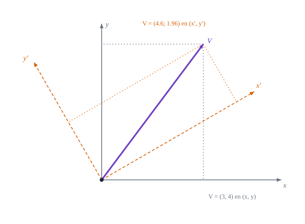

{#fig-ejes-girados .portada fig-alt="Un vector violeta y dos pares de ejes cartesianos, uno gris y otro naranja girado 30 grados, con las proyecciones del vector sobre cada par de ejes"}

::: {.pregunta-guia}
Si dos observadores miden el mismo vector con ejes distintos y obtienen números distintos, qué es lo que realmente tiene el vector
:::

## Objetivos y prerrequisitos {.unnumbered}

**Objetivos.** Al terminar el tema sabrás:

- distinguir un **vector** (objeto físico) de sus **componentes** (números que dependen de la base);
- calcular las componentes de un vector tras un **giro de ejes** y comprobar qué se conserva;
- reconocer los **invariantes** (longitud, producto escalar, trabajo) y usarlos para detectar errores;
- explicar qué exige una ley física para valer en cualquier sistema de coordenadas;
- repasar las herramientas mínimas que usa el libro: producto escalar, determinante, inversa de una matriz $2\times2$ y regla de la cadena.

**Prerrequisitos.** [La cáscara y el paraboloide hiperbólico](A1-caparazon-hypar.qmd). Matemáticas de primer ciclo universitario.

**Secciones del tema**

- **@sec-no-lista** · Un vector no es una lista de números
- **@sec-invariantes-fisicos** · Lo que no cambia: invariantes físicos
- **@sec-leyes** · Las leyes de la física y las coordenadas
- **@sec-repaso** · Repaso exprés

## Un vector no es una lista de números {#sec-no-lista}

Cuando decimos «la fuerza vale $(3,4)$ N», esos dos números son las componentes de la fuerza **respecto a unos ejes elegidos**. Si otro observador gira sus ejes $\alpha=30^\circ$, la misma fuerza tendrá otras componentes. Lo que no cambia es la flecha: su módulo, su dirección y su sentido en el espacio.

::: {#exm-giro}
## Ejemplo resuelto: giro de ejes
Sea $\mathbf{V}=(3,4)$ en los ejes $(x,y)$ y sean $(x',y')$ otros ejes cartesianos girados $\alpha=30^\circ$ en sentido antihorario. Los vectores unitarios de los nuevos ejes, en las coordenadas antiguas, son $\mathbf{e}'_1=(\cos\alpha,\sin\alpha)$ y $\mathbf{e}'_2=(-\sin\alpha,\cos\alpha)$. Las nuevas componentes son las proyecciones:
$$
V'_x=\mathbf{V}\cdot\mathbf{e}'_1=3\cos30^\circ+4\sin30^\circ\approx4{,}598,\qquad
V'_y=\mathbf{V}\cdot\mathbf{e}'_2=-3\sin30^\circ+4\cos30^\circ\approx1{,}964 .
$$
**Qué cambia y qué no.** Las componentes cambiaron, pero la longitud es la misma:
$$
\sqrt{V'^2_x+V'^2_y}=\sqrt{4{,}598^2+1{,}964^2}=\sqrt{25}=5=\sqrt{3^2+4^2}.
$$
Y el vector se reconstruye desde cualquiera de las dos listas: $V'_x\mathbf{e}'_1+V'_y\mathbf{e}'_2=(3,4)$.
:::

La @fig-ejes-girados lo muestra: las proyecciones grises dan $(3,4)$ y las naranjas $(4{,}598;\,1{,}964)$ sobre **la misma flecha violeta**.

::: {.callout-tip .idea-clave title="Idea clave"}
Un vector es un objeto geométrico; sus componentes son **su descripción en una base**. Mientras los ejes sean cartesianos y ortonormales, las componentes se transforman con una **matriz de giro**. En el resto del libro los ejes no serán ortonormales ni constantes, y la regla será la ley de transformación del tema siguiente.
:::

::: {.callout-warning title="Errores frecuentes"}
- Igualar vectores comparando sus componentes **en bases distintas**: $(3,4)\neq(4{,}598;\,1{,}964)$ como listas, pero son el mismo vector.
- Creer que «el vector cambió» al girar los ejes: lo que cambió fue el observador.
:::

::: {.callout-note .historia icon=false title="Un poco de historia: las coordenadas de Descartes"}
Describir un punto del plano con dos números medidos desde unos ejes fijos es la idea de la **geometría analítica**, que René Descartes publicó en 1637 en *La Géométrie*, un apéndice del *Discurso del método*, y que Fermat desarrolló por su lado. De ahí el nombre «cartesianas». Con ellas una curva se convierte en una ecuación $f(x,y)=0$. Descartes llegó a considerar también sistemas de ejes oblicuos, que es justo lo que volveremos a necesitar en este libro. La edición latina de Frans van Schooten (1649) difundió la obra.

<span class="fuentes-caja">Fuentes (secundarias): [La Géométrie, Wikipedia](https://en.wikipedia.org/wiki/La_G%C3%A9om%C3%A9trie); [A Survey of the Development of Geometry up to 1870, arXiv:1409.1140](https://arxiv.org/pdf/1409.1140); [Descartes, MAA](https://www.maa.org/node/105493). Consultado el 21-10-2026.</span>
:::

**Pon a prueba lo anterior.** Los ejercicios se corrigen en tu navegador y no envían nada a ningún sitio.

::: {.ejercicio tipo="numerico" id="a2-xp" respuesta="4.598" tol="0.5%"}
Con los datos del @exm-giro, ¿cuánto vale la componente $V'_x$ en los ejes girados $30^\circ$?

::: {.solucion}
$V'_x=3\cos30^\circ+4\sin30^\circ=2{,}598+2=4{,}598$.
:::
:::

::: {.ejercicio tipo="numerico" id="a2-norma" respuesta="5" tol="0.5%"}
¿Cuánto mide el vector $\mathbf{V}=(3,4)$ y cuánto medirá en cualquier otro sistema cartesiano?

::: {.solucion}
$\|\mathbf{V}\|=\sqrt{3^2+4^2}=5$, y es el mismo en todos los sistemas cartesianos (la longitud es invariante).
:::
:::

::: {.ejercicio tipo="vf" id="a2-vector-cambia" respuesta="falso"}
Al girar los ejes, el vector cambia porque sus componentes cambian.

::: {.solucion}
**Falso.** Cambian las componentes (la descripción), no el vector. Su módulo y su dirección en el espacio son los mismos.
:::
:::

## Lo que no cambia: invariantes físicos {#sec-invariantes-fisicos}

Algunas cantidades sí son iguales para todos los observadores. Son las que tienen significado físico propio:

| Cantidad | Fórmula en componentes | Por qué es invariante |
|---|---|---|
| Longitud de un vector | $\sqrt{V_xV_x+V_yV_y}$ | es la longitud de la flecha |
| Producto escalar | $\mathbf{V}\cdot\mathbf{W}=V_xW_x+V_yW_y$ | $\|\mathbf{V}\|\|\mathbf{W}\|\cos\varphi$ |
| Trabajo | $W=\mathbf{F}\cdot\mathbf{d}$ | es una energía |
| Energía cinética | $\tfrac12m\,\mathbf{v}\cdot\mathbf{v}$ | es una energía |

Un chequeo muy útil: **toda fórmula física tiene que dar el mismo resultado en cualquier sistema**. Si un resultado cambia al girar los ejes, o la fórmula está mal, o lo que se calculó no era un invariante.

```{julia}
using LinearAlgebra

giro(α) = [cos(α) sin(α); -sin(α) cos(α)]     # componentes nuevas = giro(α) * componentes viejas
V, W = [3.0, 4.0], [-1.0, 2.0]
R = giro(π / 6)

(Vp = R * V,                                   # (4.598, 1.964)
 norma_igual = norm(R * V) ≈ norm(V),
 escalar_igual = dot(R * V, R * W) ≈ dot(V, W),
 R_ortogonal = R' * R ≈ I)
```

::: {.callout-tip title="Ejemplo computacional"}
<span class="etiqueta-resultado calculado">calculado</span> La matriz de giro $R$ es **ortogonal** ($R^{\mathsf T}R=I$): por eso conserva longitudes y productos escalares. En el tema siguiente veremos qué cambia cuando los ejes dejan de ser ortonormales.
:::

## Las leyes de la física y las coordenadas {#sec-leyes}

Una ecuación como $\mathbf{F}=m\,\mathbf{a}$ **no menciona ejes**: dice que dos vectores son iguales. Al escribirla en componentes, $F_x=ma_x$, $F_y=ma_y$, la forma se conserva si se giran los ejes, porque los dos miembros se transforman igual. En cambio, la «ecuación» $F_x=m\,a_y$ no es una ley física: es cierta en unos ejes y falsa en otros.

::: {.callout-warning title="Dos puntos que suelen confundir"}
- **Una ecuación entre componentes** solo vale si en ella aparecen **los mismos índices a los dos lados**. En cartesianas basta con eso; en curvilíneas habrá que cuidar además si el índice va arriba o abajo (tema siguiente).
- **Igual que $F_x=ma_x$ no es lo mismo que $F=ma$:** la primera es una igualdad entre números, la segunda entre vectores.
:::

**Pon a prueba lo anterior.**

::: {.ejercicio tipo="opcion" id="a2-ley" respuesta="a"}
¿Cuál de estas igualdades puede ser una ley física válida en cualquier sistema cartesiano?

::: {.opciones}
- $F_x=m\,a_x$ junto con $F_y=m\,a_y$
- $F_x=m\,a_y$
- $F_x=5$ N
- $\|\mathbf{F}\|=F_x$
:::

::: {.solucion}
La primera: iguala cada componente con la correspondiente, y las dos listas se transforman igual. Las demás dependen de la elección de ejes (o solo valen en ejes concretos).
:::
:::

## Repaso exprés {#sec-repaso}

Cinco herramientas que usa todo el libro. Si te son familiares, salta a las preguntas finales.

::: {.callout-note title="Producto escalar"}
$\mathbf{u}\cdot\mathbf{v}=\sum_iu_iv_i=\|\mathbf{u}\|\|\mathbf{v}\|\cos\varphi$. Vale cero si y solo si los vectores son perpendiculares. La longitud al cuadrado es $\mathbf{u}\cdot\mathbf{u}$.
:::

::: {.callout-note title="Determinante y área"}
En el plano, $\det\begin{pmatrix}a&b\\c&d\end{pmatrix}=ad-bc$ es el **área orientada** del paralelogramo de lados $(a,c)$ y $(b,d)$. Si es cero, los vectores son paralelos.
:::

::: {.callout-note title="Inversa de una matriz $2\times2$"}
$\begin{pmatrix}a&b\\c&d\end{pmatrix}^{-1}=\dfrac1{ad-bc}\begin{pmatrix}d&-b\\-c&a\end{pmatrix}$. Se usará para pasar de $g_{ij}$ a $g^{ij}$.
:::

::: {.callout-note title="Regla de la cadena"}
Si $\mathbf{r}$ depende de $\theta^j$ y cada $\theta^j$ de $\theta'^i$, entonces $\dfrac{\partial\mathbf{r}}{\partial\theta'^i}=\dfrac{\partial\theta^j}{\partial\theta'^i}\dfrac{\partial\mathbf{r}}{\partial\theta^j}$ (suma sobre $j$). Es la base de las leyes de transformación.
:::

::: {.callout-note title="Convenio de suma (Einstein)"}
Un índice **repetido** en un mismo término, una vez arriba y otra abajo, indica suma: $V^ig_i=\sum_iV^ig_i$. El índice de arriba **no** es un exponente.
:::

**Pon a prueba lo anterior.**

::: {.ejercicio tipo="numerico" id="a2-det" respuesta="0.75" tol="abs:0.005"}
Calcula $\det\begin{pmatrix}1&0{,}5\\0{,}5&1\end{pmatrix}$.

::: {.solucion}
$1\cdot1-0{,}5\cdot0{,}5=0{,}75$. (Es la matriz métrica de una base oblicua a $60^\circ$ que aparecerá en el tema siguiente.)
:::
:::

## Ejercicios {#sec-ejercicios-a2}

1. **Giro de $90^\circ$.** Calcula las componentes de $\mathbf{V}=(3,4)$ en unos ejes girados $90^\circ$ y comprueba que la longitud es $5$.

   ::: {.callout-note collapse="true" title="Solución"}
   Con $\alpha=90^\circ$: $V'_x=3\cos90^\circ+4\sin90^\circ=4$ y $V'_y=-3\sin90^\circ+4\cos90^\circ=-3$, de longitud $\sqrt{16+9}=5$.
   :::

2. **Ortogonalidad.** Comprueba que la matriz de giro $R$ del ejemplo verifica $R^{\mathsf T}R=I$ y deduce que $R$ conserva el producto escalar.

   ::: {.callout-note collapse="true" title="Solución"}
   $(R\mathbf{u})\cdot(R\mathbf{v})=\mathbf{u}^{\mathsf T}R^{\mathsf T}R\,\mathbf{v}=\mathbf{u}^{\mathsf T}\mathbf{v}$.
   :::

3. **Detectar un error.** Un compañero afirma que la «norma» $\sqrt{V_x+V_y}$ es invariante. Pruébalo con $\mathbf{V}=(3,4)$ y un giro de $30^\circ$.

   ::: {.callout-note collapse="true" title="Solución"}
   $\sqrt{3+4}=2{,}646$ pero $\sqrt{4{,}598+1{,}964}=2{,}562$: no es invariante. La suma de **cuadrados** sí lo es.
   :::

## La doy por superada si… {.unnumbered}

- Distingo un vector de sus componentes y sé que las componentes dependen de los ejes.
- Calculo las componentes tras un giro de ejes y verifico que la longitud se conserva.
- Identifico invariantes físicos (longitud, producto escalar, trabajo, energía).
- Sé por qué $F_x=ma_y$ no puede ser una ley física.
- Manejo con soltura producto escalar, determinante $2\times2$, inversa $2\times2$ y regla de la cadena.

::: {.callout-note collapse="true" title="Fuentes, correcciones y qué queda pendiente"}
**Fuentes.** Texto autónomo, resultados estándar de álgebra lineal y mecánica [@Spiegel; @Heinbockel]. El ejemplo del giro se ha calculado y comprobado con Julia (`scripts/verificar_ejercicios.jl` y la figura de portada, que verifica la invariancia de la norma antes de dibujar).

**Qué queda pendiente.** Revisión visual de la figura; nota histórica con fuentes secundarias; referencias no leídas línea a línea.
:::
