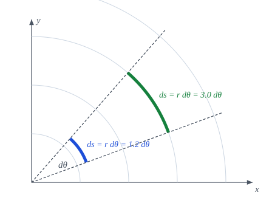

{#fig-arcos .portada fig-alt="Dos arcos con el mismo incremento angular d theta y distinta longitud, mayor el más alejado del origen"}

::: {.pregunta-guia}
Si las coordenadas curvilíneas ya no son longitudes, cómo recuperamos las distancias, los ángulos y las áreas
:::

## Objetivos y prerrequisitos {.unnumbered}

**Objetivos.** Al terminar el tema sabrás:

- escribir el elemento de línea $ds^2=g_{ij}\,d\theta^i d\theta^j$ y usarlo para calcular **longitudes** de curva;
- obtener **ángulos**, **áreas** y **volúmenes** a partir de la métrica;
- calcular la métrica de las coordenadas cilíndricas y esféricas;
- definir las **componentes físicas** de un vector en una base ortogonal y explicar por qué tienen las unidades correctas;
- verificar cada fórmula numéricamente con `Geometria`.

**Prerrequisitos.** [Bases covariantes y contravariantes](B2-bases.qmd) (tensor métrico, subir y bajar índices).

**Secciones del tema**

- **@sec-motivacion-4** · Motivación · **@sec-medidas** · Longitud, ángulo y área · **@sec-metricas** · Métricas habituales
- **@sec-fisicas** · Componentes físicas · **@sec-julia-metrica** · Práctica guiada en Julia

## Motivación {#sec-motivacion-4}

Las coordenadas curvilíneas se eligen por comodidad geométrica, pero ya no son longitudes: $\theta$ en polares es un ángulo, no una distancia. Para volver a medir distancias hace falta un «factor de conversión» en cada punto. Ese factor es el **tensor métrico**, y el tema anterior ya lo construyó a partir de los vectores de la base. Aquí lo usamos para medir.

::: {.callout-important title="Idea clave"}
Toda la geometría *intrínseca* de una superficie (longitudes, ángulos, áreas) se deduce de las componentes $g_{ij}$. Dos sistemas de coordenadas distintos tienen $g_{ij}$ distintos, pero los resultados geométricos coinciden.
:::

## Longitud, ángulo y área {#sec-medidas}

::: {#def-elemento-linea}
## Elemento de línea
Si $\mathbf{r}(\theta^1,\dots,\theta^n)$ es el vector de posición, un desplazamiento infinitesimal es $d\mathbf{r}=\mathbf{g}_i\,d\theta^i$, y el cuadrado de su longitud es
$$
ds^2=d\mathbf{r}\cdot d\mathbf{r}=g_{ij}\,d\theta^i\,d\theta^j .
$$ {#eq-elemento-linea}
:::

::: {#prp-medidas}
## Longitud, ángulo y área
1. **Longitud de una curva** $\theta^i=\theta^i(t)$, $t\in[a,b]$:
$$
L=\int_a^b\sqrt{g_{ij}\,\dot\theta^i\dot\theta^j}\;dt .
$$ {#eq-longitud}
2. **Ángulo** $\varphi$ entre dos vectores $\mathbf{V},\mathbf{W}$:
$$
\cos\varphi=\frac{g_{ij}V^iW^j}{\sqrt{g_{kl}V^kV^l}\,\sqrt{g_{mn}W^mW^n}} .
$$ {#eq-angulo}
3. **Área del paralelogramo** de lados $\mathbf{g}_1\,d\theta^1$ y $\mathbf{g}_2\,d\theta^2$ ($n=2$):
$$
dA=\sqrt{\det(g_{ij})}\;d\theta^1d\theta^2 .
$$ {#eq-area}
:::

::: {.callout-note .demostracion collapse="true"}
## Demostración de @prp-medidas
(1) Sobre la curva, $d\mathbf{r}=\mathbf{g}_i\dot\theta^i\,dt$, luego $\|d\mathbf{r}\|=\sqrt{g_{ij}\dot\theta^i\dot\theta^j}\,dt$ y se integra. (2) $\mathbf{V}\cdot\mathbf{W}=g_{ij}V^iW^j$ y las normas son $\sqrt{\mathbf{V}\cdot\mathbf{V}}$, $\sqrt{\mathbf{W}\cdot\mathbf{W}}$ por el tema de bases (@sec-componentes). (3) Si $B$ es la matriz de columnas $\mathbf{g}_1,\mathbf{g}_2$, el área del paralelogramo es $\sqrt{\det(B^{\mathsf T}B)}=\sqrt{\det g}$ (determinante de Gram); en el plano, $\sqrt{\det g}=|\det B|$, el valor absoluto del jacobiano. $\blacksquare$
:::

::: {#prp-det-metrica}
## Determinante de la métrica y jacobiano
Si $B$ es la matriz cuadrada de columnas $\mathbf{g}_i$, entonces $\det(g_{ij})=(\det B)^2$ y el elemento de volumen es
$$
dV=\sqrt{\det(g_{ij})}\;d\theta^1\cdots d\theta^n .
$$ {#eq-volumen}
:::

Es el mismo factor $|j|$ del @eq-jacobiano-volumen: $\sqrt g$ es el jacobiano del paso de las coordenadas curvilíneas a las cartesianas. La demostración es la del ejercicio 1 del tema de bases (@sec-ejercicios-3).


::: {#exm-medidas}
## Ejemplo resuelto: longitud, ángulo y área en la placa oblicua y en una circunferencia
**Ángulo.** En la placa oblicua de $60^\circ$ del tema anterior, $g_{11}=g_{22}=1$ y $g_{12}=\tfrac12$. El ángulo entre $\mathbf{g}_1$ y $\mathbf{g}_2$ (componentes $(1,0)$ y $(0,1)$) es, por @eq-angulo,
$$
\cos\varphi=\frac{g_{12}}{\sqrt{g_{11}g_{22}}}=\frac12\ \Longrightarrow\ \varphi=60^\circ .
$$
**Área.** El paralelogramo de lados $\mathbf{g}_1,\mathbf{g}_2$ tiene área $\sqrt{\det(g_{ij})}=\sqrt{3/4}=\tfrac{\sqrt3}{2}\approx0{,}866$, por @eq-area.

**Longitud.** Un arco de la circunferencia $r=3$ entre $\theta=0{,}2$ y $\theta=1{,}4$: la curva es $\theta^1=3$ (constante), $\theta^2=t$, luego $\dot\theta=(0,1)$ y $g_{ij}\dot\theta^i\dot\theta^j=g_{22}=r^2=9$. Entonces
$$
L=\int_{0{,}2}^{1{,}4}\sqrt{9}\,dt=3\cdot1{,}2=3{,}6 .
$$
:::

**Pon a prueba lo anterior.** Los ejercicios se corrigen en tu navegador y no envían nada a ningún sitio.

::: {.ejercicio tipo="numerico" id="b3-angulo" respuesta="60" tol="0.5%" unidad="grados"}
Dos vectores base con $g_{11}=g_{22}=1$ y $g_{12}=0{,}5$: ¿qué ángulo forman?

::: {.solucion}
$\cos\varphi=g_{12}/\sqrt{g_{11}g_{22}}=0{,}5$, luego $\varphi=60^\circ$.
:::
:::

::: {.ejercicio tipo="numerico" id="b3-area" respuesta="0.866" tol="0.5%"}
¿Cuánto vale el área del paralelogramo de lados $\mathbf{g}_1$ y $\mathbf{g}_2$ del ejercicio anterior?

::: {.pista}
Usa $\sqrt{\det(g_{ij})}$.
:::

::: {.solucion}
$\det(g_{ij})=1-0{,}25=0{,}75$ y $\sqrt{0{,}75}=0{,}866$.
:::
:::

::: {.ejercicio tipo="vf" id="b3-ds" respuesta="verdadero"}
En coordenadas polares, el desplazamiento infinitesimal $(dr,d\theta)=(0,d\theta)$ tiene longitud $r\,d\theta$.

::: {.solucion}
**Verdadero.** $ds^2=dr^2+r^2d\theta^2$ con $dr=0$ da $ds=r\,d\theta$.
:::
:::

## Métricas habituales {#sec-metricas}

::: {.callout-tip title="Ejemplo: cilíndricas y esféricas"}
<span class="etiqueta-resultado analitico">analítico</span> Con $\mathbf{r}=(\rho\cos\varphi,\rho\sin\varphi,z)$ se tiene $\mathbf{g}_1=(\cos\varphi,\sin\varphi,0)$, $\mathbf{g}_2=\rho(-\sin\varphi,\cos\varphi,0)$ y $\mathbf{g}_3=(0,0,1)$, de donde
$$
ds^2=d\rho^2+\rho^2\,d\varphi^2+dz^2,\qquad \sqrt g=\rho .
$$
En esféricas $(r,\theta,\varphi)$, con $\theta$ la colatitud,
$$
ds^2=dr^2+r^2\,d\theta^2+r^2\sin^2\theta\,d\varphi^2,\qquad \sqrt g=r^2\sin\theta .
$$ {#eq-metrica-esferica}
:::

Las tres métricas (polares, cilíndricas, esféricas) son **diagonales**: las bases son ortogonales. Es el caso más común en las aplicaciones y el único en el que las componentes físicas se definen sin ambigüedad.

::: {#exm-esfera-area}
## Ejemplo resuelto: el área de una esfera con la métrica
Sobre la esfera de radio $R$ ($r=R$ fijo, coordenadas $(\theta,\varphi)$) la métrica restringida es $\operatorname{diag}(R^2,R^2\sin^2\theta)$ y $\sqrt g=R^2\sin\theta$. El área es
$$
A=\int_0^{2\pi}\!\!\int_0^\pi R^2\sin\theta\,d\theta\,d\varphi=R^2\cdot2\cdot2\pi=4\pi R^2 ,
$$
y con $R=2$ da $16\pi\approx50{,}27$. El volumen de la bola usa $\sqrt g=r^2\sin\theta$ en @eq-metrica-esferica: $\int_0^R r^2dr\cdot2\cdot2\pi=\tfrac43\pi R^3$.
:::

::: {.ejercicio tipo="numerico" id="b3-esfera" respuesta="50.27" tol="0.5%"}
Calcula el área de una esfera de radio $R=2$ integrando $\sqrt g\,d\theta\,d\varphi$.

::: {.solucion}
$A=4\pi R^2=16\pi\approx50{,}27$.
:::
:::

::: {.callout-note .historia icon=false title="Un poco de historia: Gauss, la topografía y la métrica"}
La idea de describir una superficie por su **elemento de línea** $ds^2$ se la debemos a Gauss. Sus *Disquisitiones generales circa superficies curvas* (Göttingen, presentadas en 1827; algunas ediciones dan 1828) introducen la primera forma fundamental, la curvatura de Gauss y el *Theorema Egregium*, y se alimentan de su trabajo de geodesia y topografía: medir una parte de la superficie terrestre. Gauss ya trataba la superficie como un objeto que se puede medir **desde dentro**, sin salir al espacio, y Riemann, discípulo suyo, llevó después esa idea a espacios de cualquier dimensión.

<span class="fuentes-caja">Fuentes (secundarias): [Gauss' Disquisitiones Generales Circa Superficies Curvas, MAA](https://www.maa.org/node/105949); [Gauss' other Disquisitiones, Universidad de Sevilla](https://institucional.us.es/blogimus/en/2022/05/gauss-other-disquisitiones); [arXiv:1402.1018](https://pdf.arxiv.org/pdf/1402.1018). Fechas de publicación dispares entre fuentes. Consultado el 21-10-2026.</span>
:::

## Componentes físicas {#sec-fisicas}

Las componentes contravariantes $V^i$ no tienen en general las dimensiones del vector. En polares, $V^\theta$ se mide en rad/s si $\mathbf{V}$ es una velocidad, y no en m/s. Para recuperar unidades físicas se normaliza la base.

::: {#def-comps-fisicas}
## Componentes físicas (base ortogonal)
Sea $\{\mathbf{g}_i\}$ una base **ortogonal**, con vectores unitarios $\hat{\mathbf{g}}_i=\mathbf{g}_i/\sqrt{g_{ii}}$ (sin suma). Las **componentes físicas** $V^{(i)}$ de $\mathbf{V}$ son sus coordenadas en la base normalizada:
$$
\mathbf{V}=V^{(i)}\,\hat{\mathbf{g}}_i,\qquad V^{(i)}=\sqrt{g_{ii}}\;V^i=\frac{V_i}{\sqrt{g_{ii}}}\quad\text{(sin suma)} .
$$ {#eq-comps-fisicas}
:::

{#fig-fisicas fig-alt="Componentes físicas de un vector en la base polar normalizada" width="85%"}

::: {#prp-fisicas-norma}
## Propiedades de las componentes físicas
En una base ortogonal,

1. $\|\mathbf{V}\|^2=\sum_i\bigl(V^{(i)}\bigr)^2$;
2. $V^{(i)}=\mathbf{V}\cdot\hat{\mathbf{g}}_i$ (proyección sobre el vector unitario);
3. $V^{(i)}$ tiene las mismas unidades que $\mathbf{V}$.
:::

::: {.callout-note .demostracion collapse="true"}
## Demostración de @prp-fisicas-norma
Por la ortogonalidad, $g_{ij}=0$ si $i\ne j$, de modo que $\|\mathbf{V}\|^2=g_{ii}(V^i)^2=\bigl(\sqrt{g_{ii}}V^i\bigr)^2=\sum_i(V^{(i)})^2$. Además $\mathbf{V}\cdot\hat{\mathbf{g}}_i=V_i/\sqrt{g_{ii}}=\sqrt{g_{ii}}\,V^i$, porque $V_i=g_{ii}V^i$. Para las unidades: $\hat{\mathbf{g}}_i$ es adimensional, luego $V^{(i)}$ comparte las unidades de $\mathbf{V}$. $\blacksquare$
:::

::: {.callout-warning title="Convenio: solo bases ortogonales"}
Para una base **no ortogonal** existen varias definiciones razonables de «componentes físicas» (por ejemplo, proyectar sobre $\hat{\mathbf{g}}_i$ o descomponer sobre $\hat{\mathbf{g}}_i$ no dan lo mismo). En este libro la @def-comps-fisicas se usa **solo con bases ortogonales**. El convenio para láminas, donde la base no siempre lo es, está pendiente de confirmar en el apéndice de notación (@sec-notacion).
:::

La tabla recoge la relación entre las componentes de $\mathbf{V}$ en polares, cuando $\mathbf{V}$ es una velocidad:

| Componente | Símbolo | Unidades | Relación |
|---|---|---|---|
| contravariante radial | $V^1=\dot r$ | m/s | $V^{(1)}=V^1$ |
| contravariante angular | $V^2=\dot\theta$ | rad/s | $V^{(2)}=r\,V^2$ |
| física radial | $V^{(1)}$ | m/s | $\hat{\mathbf{g}}_1$ |
| física angular | $V^{(2)}=r\dot\theta$ | m/s | $\hat{\mathbf{g}}_2=\mathbf{g}_2/r$ |

## Ejemplo computacional en Julia {#sec-julia-metrica}

::: {.callout-tip title="Ejemplo computacional"}
<span class="etiqueta-resultado calculado">calculado</span> Longitud de la espiral $r=\theta/\pi$, con $\theta\in[0,4\pi]$, mediante @eq-longitud, y comprobación de componentes físicas.
:::

```{julia}
using Geometria, LinearAlgebra

# Longitud de la espiral de Arquímedes r(θ) = θ/π, θ ∈ [0, 4π], por la regla del trapecio
function longitud(curva, dcurva, a, b; n = 20_000)
    t = range(a, b; length = n + 1)
    h = (b - a) / n
    integrando(s) = begin
        θ = curva(s); d = dcurva(s)
        B = base_polar(θ[1], θ[2])
        sqrt(d' * metrica(B) * d)
    end
    h * (sum(integrando.(t)) - (integrando(a) + integrando(b)) / 2)
end

curva(s) = [s / π, s]                  # (r, θ)
dcurva(s) = [1 / π, 1.0]
L = longitud(curva, dcurva, 0.0, 4π)

# Valor exacto: ∫₀^{4π} √(1/π² + s²/π²) ds = (1/π) ∫ √(1+s²) ds
exacta = (1 / π) * ((4π * sqrt(1 + (4π)^2)) / 2 + asinh(4π) / 2)
(numerica = L, exacta = exacta, error = abs(L - exacta))
```

```{julia}
# Componentes físicas = proyecciones sobre los vectores unitarios
r, θ = 1.7, 0.4
B = base_polar(r, θ)
Vcart = [0.3, 0.8]
Vup = comps_contravariantes(B, Vcart)
Vf = comps_fisicas(B, Vup)
(componentes_fisicas = Vf, norma_igual = norm(Vf) ≈ norm(Vcart))
```

## Ejercicios {#sec-ejercicios-4}

1. **Esféricas.** Demuestra @eq-metrica-esferica a partir de $\mathbf{r}=r(\sin\theta\cos\varphi,\sin\theta\sin\varphi,\cos\theta)$.

   ::: {.callout-note collapse="true" title="Solución"}
   $\mathbf{g}_1=(\sin\theta\cos\varphi,\sin\theta\sin\varphi,\cos\theta)$, $\mathbf{g}_2=r(\cos\theta\cos\varphi,\cos\theta\sin\varphi,-\sin\theta)$, $\mathbf{g}_3=r\sin\theta(-\sin\varphi,\cos\varphi,0)$. Son ortogonales con normas $1$, $r$ y $r\sin\theta$, luego $g=\operatorname{diag}(1,r^2,r^2\sin^2\theta)$.
   :::

2. **Ángulo en polares.** En $(r,\theta)=(2;0{,}5)$, ¿qué ángulo forman los vectores de componentes contravariantes $(1,0)$ y $(0,1)$? Compruébalo con @eq-angulo.

   ::: {.callout-note collapse="true" title="Solución"}
   $g_{12}=0$: son ortogonales ($90^\circ$), porque las polares son un sistema ortogonal.
   :::

3. **Componentes físicas.** Usa `comps_fisicas` para una velocidad cartesiana $\mathbf{V}=(1,0)$ en el punto $(r,\theta)$: ¿cuánto valen $V^{(1)}$ y $V^{(2)}$?

   ::: {.callout-note collapse="true" title="Solución"}
   $V^{(1)}=\cos\theta$ y $V^{(2)}=-\sin\theta$ (proyecciones sobre $\hat{\mathbf{g}}_1$ y $\hat{\mathbf{g}}_2$); su norma es $1$.
   :::

4. **Por qué ortogonal.** Explica por qué @def-comps-fisicas exige ortogonalidad.

   ::: {.callout-note collapse="true" title="Solución"}
   En una base no ortogonal, «proyectar sobre $\hat{\mathbf{g}}_i$» y «descomponer sobre $\hat{\mathbf{g}}_i$» dan listas distintas (son las versiones covariante y contravariante), así que «la componente física» no está bien definida sin un convenio adicional.
   :::

## La doy por superada si… {.unnumbered}

- Escribo $ds^2=g_{ij}d\theta^id\theta^j$ y calculo la longitud de una curva con @eq-longitud.
- Obtengo ángulos, áreas ($\sqrt{\det g}$) y volúmenes a partir de $g_{ij}$.
- Conozco las métricas de polares, cilíndricas y esféricas.
- Defino las componentes físicas en una base **ortogonal** y sé comprobar que $\|\mathbf{V}\|^2=\sum(V^{(i)})^2$.
- Sé por qué las componentes físicas no están bien definidas, sin convenio, en una base oblicua.

::: {.callout-note collapse="true" title="Fuentes, correcciones y qué queda pendiente"}
**Fuentes.** Texto autónomo, resultados estándar [@Struik; @DoCarmo; @Lipschultz; @Weatherburn; @Romano]. Los ejemplos se han calculado y comprobado con `Geometria`.

**Qué queda pendiente.**

1. **Componentes físicas en bases no ortogonales:** convenio aún por confirmar con el autor (necesario en láminas con coordenadas no ortogonales).
2. Figuras con **revisión visual humana pendiente**; notas históricas basadas en fuentes secundarias.
3. Referencias **no leídas línea a línea** para este tema.
:::
