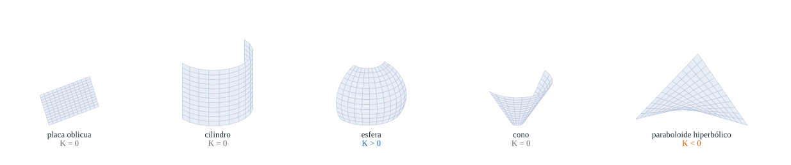

{#fig-bestiario .portada fig-alt="Cinco superficies dibujadas con malla: una placa plana oblicua, un cilindro, una esfera, un cono y un paraboloide hiperbólico, con el signo de su curvatura"}

::: {.pregunta-guia}
Cómo son, con números, las superficies más sencillas con las que se comprueban las fórmulas, y en qué se diferencian
:::

## Objetivos y prerrequisitos {.unnumbered}

**Objetivos.** Al terminar el tema sabrás:

- calcular $a_{\alpha\beta}$, $b_{\alpha\beta}$, $K$, $H$ y los símbolos de Christoffel de la **placa oblicua**, el **cilindro**, la **esfera** y el **cono**;
- reconocer una superficie **desarrollable** ($K=0$) y desarrollarla en un plano;
- usar estas superficies como **banco de pruebas** de cualquier fórmula nueva;
- situar el paraboloide hiperbólico en esa familia.

**Prerrequisitos.** [Curvaturas de una superficie](C3-curvaturas.qmd), [Geodésicas y compatibilidad](C4-geodesicas.qmd).

**Secciones del tema**

- **@sec-placa** · La placa oblicua · **@sec-tabla** · La tabla de superficies tipo
- **@sec-cono** · El cono y el desarrollo · **@sec-julia-c6** · Práctica guiada

## La placa oblicua: una superficie plana con coordenadas no ortogonales {#sec-placa}

La **placa oblicua** (un paralelogramo) es plana, pero sus coordenadas naturales forman un ángulo $\varphi$. Es el mejor ejemplo de métrica **no ortogonal** y de base recíproca distinta de la covariante, justo lo que tendrá una lámina real (por ejemplo, el paraboloide).

::: {#exm-placa-oblicua}
## Ejemplo resuelto: la placa oblicua paso a paso
Con $\mathbf{r}=(\theta^1+\theta^2\cos\varphi,\ \theta^2\sin\varphi,\ 0)$:
$$
\mathbf{a}_1=(1,0,0),\qquad \mathbf{a}_2=(\cos\varphi,\sin\varphi,0),\qquad a_{\alpha\beta}=\begin{pmatrix}1&\cos\varphi\\\cos\varphi&1\end{pmatrix},\qquad a=\sin^2\varphi .
$$
La inversa es $a^{\alpha\beta}=\dfrac1{\sin^2\varphi}\begin{pmatrix}1&-\cos\varphi\\-\cos\varphi&1\end{pmatrix}$ y la base recíproca,
$$
\mathbf{a}^1=\bigl(1,-\cot\varphi,0\bigr),\qquad \mathbf{a}^2=\Bigl(0,\frac1{\sin\varphi},0\Bigr),
$$
como se comprueba: $\mathbf{a}^1\cdot\mathbf{a}_2=\cos\varphi-\cot\varphi\sin\varphi=0$ y $\mathbf{a}^2\cdot\mathbf{a}_2=1$. La normal es $\hat{\mathbf{a}}_3=(0,0,1)$ y $b_{\alpha\beta}=0$, $\bar\Gamma=0$: **la placa es plana** y su métrica, constante, aunque no sea la identidad. Para $\varphi=60^\circ$ se recuperan los números del tema de bases ($a_{12}=\tfrac12$, $a=\tfrac34$).
:::

::: {.callout-warning title="Dos puntos que suelen confundir"}
- **Plana no significa «cartesiana»**: la placa oblicua es un plano ($K=0$, $b_{\alpha\beta}=0$) y sin embargo $a_{\alpha\beta}\neq\delta_{\alpha\beta}$ y $\mathbf{a}^\alpha\neq\mathbf{a}_\alpha$.
- **Métrica no ortogonal no implica curvatura.** La ortogonalidad es una propiedad de las coordenadas; la curvatura, de la superficie.
:::

**Pon a prueba lo anterior.** Los ejercicios se corrigen en tu navegador y no envían nada a ningún sitio.

::: {.ejercicio tipo="numerico" id="c6-a12inv" respuesta="-0.667" tol="1%"}
En la placa oblicua con $\varphi=60^\circ$, ¿cuánto vale $a^{12}$?

::: {.pista}
$a^{12}=-\cos\varphi/\sin^2\varphi$.
:::

::: {.solucion}
$a^{12}=-0{,}5/0{,}75=-0{,}667$.
:::
:::

## La tabla de superficies tipo {#sec-tabla}

Estas cuatro superficies bastan para comprobar casi todas las fórmulas del bloque.

| Superficie | Parametrización | $a_{\alpha\beta}$ | $b_{\alpha\beta}$ | $K$ | $H$ | $\bar\Gamma$ no nulos |
|---|---|---|---|---|---|---|
| **Placa oblicua** | $(\theta^1+\theta^2\cos\varphi,\ \theta^2\sin\varphi,\ 0)$ | $\begin{pmatrix}1&\cos\varphi\\\cos\varphi&1\end{pmatrix}$ | $0$ | $0$ | $0$ | ninguno |
| **Cilindro** radio $R$ | $(R\cos\theta^1,R\sin\theta^1,\theta^2)$ | $\operatorname{diag}(R^2,1)$ | $\operatorname{diag}(-R,0)$ | $0$ | $-\dfrac1{2R}$ | ninguno |
| **Esfera** radio $R$ | $R(\sin\theta^1\cos\theta^2,\ \sin\theta^1\sin\theta^2,\ \cos\theta^1)$ | $\operatorname{diag}(R^2,R^2\sin^2\theta^1)$ | $-\dfrac1R\,a_{\alpha\beta}$ | $\dfrac1{R^2}$ | $-\dfrac1R$ | $\Gamma^1_{22}=-\sin\theta^1\cos\theta^1$, $\Gamma^2_{12}=\cot\theta^1$ |
| **Cono** semiángulo $\alpha$ | $t(\sin\alpha\cos\theta^1,\ \sin\alpha\sin\theta^1,\ \cos\alpha)$ con $\theta^2=t$ | $\operatorname{diag}(t^2\sin^2\alpha,1)$ | $\operatorname{diag}(-t\sin\alpha\cos\alpha,0)$ | $0$ | $-\dfrac{\cot\alpha}{2t}$ | $\Gamma^1_{12}=\dfrac1t$, $\Gamma^2_{11}=-t\sin^2\alpha$ |

La normal es $\mathbf{a}_1\times\mathbf{a}_2/\|\cdot\|$ con el orden de coordenadas indicado (saliente en la esfera y el cilindro). **Todas estas filas se comprueban con `Geometria`** (conjunto de tests «Bestiario de láminas»). El paraboloide hiperbólico, con $K<0$, está en su [propio tema](C5-paraboloide.qmd).

::: {.callout-tip .idea-clave title="Idea clave"}
Con $K$ y $H$ se reconocen las superficies: **plano** ($K=H=0$), **desarrollables** ($K=0$, $H\neq0$: cilindro, cono), **elípticas** ($K>0$: esfera), **hiperbólicas** ($K<0$: silla). Esta clasificación determina cómo trabaja la lámina (bloques siguientes).
:::

## El cono y el desarrollo en un plano {#sec-cono}

Una superficie con $K=0$ se puede **desarrollar** (aplanar sin estirar). Con el cono se ve de forma explícita:

::: {#exm-cono}
## Ejemplo resuelto: desarrollo del cono
La métrica del cono es $ds^2=t^2\sin^2\alpha\,d\varphi^2+dt^2$. Compárala con el plano en polares, $ds^2=dr^2+r^2d\psi^2$: coinciden con $r=t$ y $d\psi=\sin\alpha\,d\varphi$. El ángulo $\varphi$ recorre $2\pi$, luego el plano se recorre un ángulo
$$
\Delta\psi=2\pi\sin\alpha :
$$
el cono se desarrolla en un **sector circular** de ángulo $2\pi\sin\alpha$. Con $\alpha=30^\circ$ ($\sin\alpha=\tfrac12$), el sector es un semicírculo ($\pi$ rad). Esta transformación **conserva longitudes y ángulos** (es una isometría local), de ahí $K=0$ (*Theorema Egregium*).
:::

**Pon a prueba lo anterior.**

::: {.ejercicio tipo="numerico" id="c6-sector" respuesta="3.1416" tol="0.1%" unidad="rad"}
Un cono de semiángulo $\alpha=30^\circ$ se desarrolla en un sector circular. ¿Cuántos radianes mide ese sector?

::: {.solucion}
$\Delta\psi=2\pi\sin30^\circ=\pi=3{,}1416$ rad (un semicírculo).
:::
:::

::: {.ejercicio tipo="opcion" id="c6-desarrollable" respuesta="d"}
¿Cuál de estas superficies **no** se puede desarrollar sobre un plano sin estirarla?

::: {.opciones}
- El cilindro
- El cono
- La placa oblicua
- La esfera
:::

::: {.solucion}
La **esfera**, porque $K=1/R^2\neq0$ y la curvatura de Gauss es un invariante de las isometrías (*Theorema Egregium*).
:::
:::

::: {.callout-note .historia icon=false title="Un poco de historia: las superficies desarrollables de Monge"}
Las superficies que se pueden aplanar sin estirarse, como el cilindro y el cono, las estudió Monge de forma sistemática: en 1771 presentó (y en 1785 publicó) un trabajo sobre curvas del espacio donde ya aparecen las superficies **desarrollables**, definidas por el comportamiento de sus planos tangentes, y las describió de dos maneras equivalentes: como la superficie barrida por una recta tangente a una curva (su arista de retroceso) o como la envolvente de una familia de planos. Su *Application de l'analyse à la géométrie* (1807) reúne esta obra.

<span class="fuentes-caja">Fuentes (secundarias): [Gaspard Monge, Encyclopædia Universalis](https://www.universalis.fr/encyclopedie/gaspard-monge/2-l-oeuvre-scientifique/); [Developable surfaces: their history and application, Middlesex Univ.](https://repository.mdx.ac.uk/item/88wvz). Consultado el 21-10-2026.</span>
:::

## Práctica guiada en Julia {#sec-julia-c6}

::: {.callout-tip title="Ejemplo computacional"}
<span class="etiqueta-resultado calculado">calculado</span> Se reproduce la tabla de superficies tipo en un punto de cada una.
:::

```{julia}
using Geometria, LinearAlgebra

R, α, φ = 1.8, 0.6, π / 3
casos = [("placa oblicua", placa_oblicua(φ), [0.4, 0.2]),
         ("cilindro", cilindro(R), [0.7, 0.4]),
         ("esfera", esfera(R), [1.0, 0.4]),
         ("cono", cono(α), [0.5, 2.0])]

[(nombre,
  a = round.(metrica_superficie(r, t); digits = 3),
  K = round(curvaturas_principales(metrica_superficie(r, t), segunda_forma(r, t)).K; digits = 5),
  H = round(curvaturas_principales(metrica_superficie(r, t), segunda_forma(r, t)).H; digits = 5))
 for (nombre, r, t) in casos]
```

```{julia}
# Base recíproca de la placa oblicua: a¹ = (1, −cot φ), a² = (0, 1/sen φ)
A = base_superficie(placa_oblicua(φ), [0.4, 0.2])[1:2, :]
Ar = base_reciproca(A)
(a1 = Ar[:, 1], esperado1 = [1, -cot(φ)], a2 = Ar[:, 2], esperado2 = [0, 1 / sin(φ)])
```

## Ejercicios {#sec-ejercicios-c6}

1. **Cono.** Comprueba con `Geometria` que $K=0$ y que $H=-\cot\alpha/(2t)$ para el cono de semiángulo $\alpha$ en un punto cualquiera.

   ::: {.callout-note collapse="true" title="Solución"}
   `curvaturas_principales(metrica_superficie(cono(α), t), segunda_forma(cono(α), t))` da $K\approx0$ y $H\approx-\cos\alpha/(2t\sin\alpha)=-\cot\alpha/(2t)$.
   :::

2. **Cilindro y plano.** Demuestra que el cilindro y el plano son localmente isométricos y que, sin embargo, $b_{\alpha\beta}$ no coincide.

   ::: {.callout-note collapse="true" title="Solución"}
   Con $x=R\theta^1$, $y=\theta^2$ la métrica del cilindro es $dx^2+dy^2$, como la del plano. Pero $b_{11}=-R\ne0$ mientras que $b_{\alpha\beta}=0$ en el plano: la segunda forma no es intrínseca.
   :::

3. **Esfera.** Verifica la tabla de la esfera: $b_{\alpha\beta}=-a_{\alpha\beta}/R$ y $\Gamma^2_{12}=\cot\theta^1$ en $\theta^1=1$.

   ::: {.callout-note collapse="true" title="Solución"}
   `cristoffel_superficie(esfera(R), [1.0, 0.4])[2,1,2]` $=\cot1=0{,}642$ y `segunda_forma(...) ≈ -metrica_superficie(...)/R`.
   :::

4. **Plana con otro ángulo.** Repite el @exm-placa-oblicua para $\varphi=45^\circ$ y calcula $\mathbf{a}^1$ y $\mathbf{a}^2$.

   ::: {.callout-note collapse="true" title="Solución"}
   $\mathbf{a}^1=(1,-1,0)$ y $\mathbf{a}^2=(0,\sqrt2,0)$.
   :::

## La doy por superada si… {.unnumbered}

- Calculo $a_{\alpha\beta}$, $b_{\alpha\beta}$, $K$, $H$ y $\bar\Gamma$ de la placa oblicua, el cilindro, la esfera y el cono.
- Reconozco las superficies desarrollables ($K=0$) y desarrollo el cono en un sector.
- Sé por qué una métrica no ortogonal no implica curvatura.
- Uso estas superficies como banco de pruebas de una fórmula nueva.

::: {.callout-note collapse="true" title="Fuentes, correcciones y qué queda pendiente"}
**Fuentes.** Texto autónomo, resultados estándar de geometría diferencial de superficies [@DoCarmo; @Struik; @Lipschultz; @Costaejercicios]. La tabla se verifica con `Geometria` (tests «Bestiario de láminas»).

**Qué queda pendiente.** Figura con revisión visual pendiente; nota histórica de fuentes secundarias; referencias no leídas línea a línea.
:::
