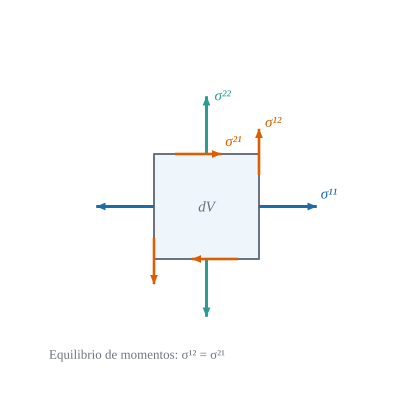

{#fig-deformacion .portada fig-alt="Un cuadrado de referencia y el paralelogramo en que se transforma, con las bases antes y después y los desplazamientos de las esquinas"}

::: {.pregunta-guia}
Cómo se mide cuánto se ha deformado un sólido de forma que un giro rígido no cuente, y qué ecuación gobierna sus tensiones en equilibrio
:::

## Objetivos y prerrequisitos {.unnumbered}

**Objetivos.** Al terminar el tema sabrás:

- describir la **configuración deformada** con la base $\mathbf{G}_i=\partial\mathbf{R}/\partial\theta^i$ y el gradiente de deformación;
- calcular la deformación de **Green–Lagrange** $E_{ij}=\tfrac12(G_{ij}-g_{ij})$ y su límite de **pequeñas deformaciones** $\varepsilon_{ij}$;
- explicar por qué un **giro rígido** no produce deformación;
- definir la **tensión de Cauchy** y escribir el **equilibrio** $\sigma^{ij}{}_{\|j}+b^i=0$ en coordenadas curvilíneas;
- comprobar todo en Julia con polares.

**Prerrequisitos.** [Álgebra y análisis tensorial en curvilíneas](../B-tensorial/B5-analisis-tensorial.qmd) (divergencia y teorema de la divergencia) y [Símbolos de Christoffel](../B-tensorial/B4-christoffel.qmd).

**Secciones del tema**

- **@sec-config-d1** · Configuración y desplazamiento · **@sec-medidas-def** · Medidas de deformación
- **@sec-cauchy-d1** · Tensión de Cauchy y equilibrio · **@sec-julia-d1** · Práctica guiada en Julia

## Configuración y desplazamiento {#sec-config-d1}

Un sólido ocupa una región de referencia, descrita con coordenadas materiales $\theta^i$ que **viajan con las partículas**. El vector de posición de una partícula es $\mathbf{r}(\theta)$ antes de deformarse y $\mathbf{R}(\theta)=\mathbf{r}(\theta)+\mathbf{u}(\theta)$ después, con $\mathbf{u}$ el **desplazamiento**. Cada configuración tiene su base natural:
$$
\mathbf{g}_i=\frac{\partial\mathbf{r}}{\partial\theta^i},\qquad
\mathbf{G}_i=\frac{\partial\mathbf{R}}{\partial\theta^i}=\mathbf{g}_i+\frac{\partial\mathbf{u}}{\partial\theta^i},
\qquad g_{ij}=\mathbf{g}_i\cdot\mathbf{g}_j,\quad G_{ij}=\mathbf{G}_i\cdot\mathbf{G}_j .
$$ {#eq-bases-def}

El **gradiente de deformación** $\mathbf{F}=\mathbf{G}_i\otimes\mathbf{g}^i$ lleva cada vector material $\mathbf{g}_i$ a su transformado $\mathbf{G}_i$: $\mathbf{F}\,\mathbf{g}_i=\mathbf{G}_i$ (@fig-deformacion). Un elemento de línea $d\mathbf{r}$ pasa a $d\mathbf{R}=\mathbf{F}\,d\mathbf{r}$.

## Medidas de deformación {#sec-medidas-def}

La longitud de un elemento de línea cambia de $d\ell^2=g_{ij}\,d\theta^id\theta^j$ a $dL^2=G_{ij}\,d\theta^id\theta^j$. La diferencia es lo que mide la deformación.

::: {#def-green-lagrange}
## Deformación de Green–Lagrange
$$
E_{ij}=\tfrac12\bigl(G_{ij}-g_{ij}\bigr),\qquad
\frac{dL^2-d\ell^2}{2\,d\ell^2}=E_{ij}\,\frac{d\theta^i}{d\ell}\frac{d\theta^j}{d\ell} .
$$ {#eq-green-lagrange}
Es un tensor covariante simétrico (seis componentes en 3D). En términos de $\mathbf{F}$, el tensor de **Cauchy–Green** derecho es $C=F^{\mathsf T}F$ y $E=\tfrac12(C-I)$ en una base cartesiana.
:::

::: {#prp-green-u}
## Green–Lagrange en función del desplazamiento
Con $u_i=\mathbf{u}\cdot\mathbf{g}_i$ las componentes covariantes del desplazamiento y $u_{i\|j}=\partial_ju_i-\Gamma^k_{ij}u_k$ su derivada covariante,
$$
E_{ij}=\tfrac12\bigl(u_{i\|j}+u_{j\|i}+u^k{}_{\|i}\,u_{k\|j}\bigr),\qquad u^k{}_{\|i}=g^{kl}u_{l\|i} .
$$ {#eq-green-u}
:::

::: {.callout-note .demostracion collapse="true"}
## Demostración de @prp-green-u
$\mathbf{G}_i=\mathbf{g}_i+\mathbf{u}_{,i}$ y $\mathbf{u}_{,i}=u_{k\|i}\,\mathbf{g}^k$ (derivada de $\mathbf{u}=u_k\mathbf{g}^k$ con @eq-christoffel-def y $\mathbf{g}^k_{,i}=-\Gamma^k_{ij}\mathbf{g}^j$). Entonces $G_{ij}=g_{ij}+\mathbf{g}_i\cdot\mathbf{u}_{,j}+\mathbf{g}_j\cdot\mathbf{u}_{,i}+\mathbf{u}_{,i}\cdot\mathbf{u}_{,j}=g_{ij}+u_{i\|j}+u_{j\|i}+u_{k\|i}u_{l\|j}g^{kl}$. Dividiendo por dos se obtiene @eq-green-u. $\blacksquare$
:::

::: {#def-pequena}
## Pequeñas deformaciones
Si $\|\nabla\mathbf{u}\|\ll1$ se desprecia el término cuadrático:
$$
\varepsilon_{ij}=\tfrac12\bigl(u_{i\|j}+u_{j\|i}\bigr) .
$$ {#eq-peq-def}
$\varepsilon_{ij}$ es el **tensor de deformación lineal**. El error de @eq-peq-def respecto de $E_{ij}$ es de orden $\|\nabla\mathbf{u}\|^2$.
:::

::: {#exm-cizalla}
## Ejemplo resuelto: cizalla simple y giro rígido
**Cizalla.** $\mathbf{u}=(\gamma y,0)$ en cartesianas: $F=\begin{pmatrix}1&\gamma\\0&1\end{pmatrix}$, $C=F^{\mathsf T}F=\begin{pmatrix}1&\gamma\\\gamma&1+\gamma^2\end{pmatrix}$ y
$$
E=\tfrac12(C-I)=\begin{pmatrix}0&\gamma/2\\\gamma/2&\gamma^2/2\end{pmatrix},\qquad
\varepsilon=\begin{pmatrix}0&\gamma/2\\\gamma/2&0\end{pmatrix}.
$$
Para $\gamma=0{,}2$: $E_{12}=0{,}1$ y $E_{22}=0{,}02$ (que $\varepsilon$ ignora). La **deformación angular de ingeniería** es $\gamma_{12}=2\varepsilon_{12}=\gamma$ (el cambio del ángulo recto).

**Giro rígido.** Con $\mathbf{u}$ una rotación finita de ángulo $\alpha$, $F=\begin{pmatrix}\cos\alpha&-\sin\alpha\\\sin\alpha&\cos\alpha\end{pmatrix}\neq I$ pero $C=F^{\mathsf T}F=I$ y $E=0$: **Green–Lagrange no «ve» los giros rígidos**. (La deformación lineal $\varepsilon$ sí los ve a segundo orden, por eso solo vale para giros pequeños.)
:::

::: {.callout-warning title="Errores frecuentes"}
- **$\nabla\mathbf{u}\neq0$ no implica deformación**: un giro rígido tiene $\nabla\mathbf{u}\neq0$ y $E=0$.
- **$\gamma_{12}$ de ingeniería no es $\varepsilon_{12}$**: $\gamma_{12}=2\varepsilon_{12}$ (por eso las matrices de rigidez usan el vector $(\varepsilon_{11},\varepsilon_{22},2\varepsilon_{12})$).
- **Las componentes $E_{ij}$ covariantes no son «físicas»**: en polares, $E_{22}$ lleva el factor $r^2$.
:::

**Pon a prueba lo anterior.** Los ejercicios se corrigen en tu navegador y no envían nada a ningún sitio.

::: {.ejercicio tipo="numerico" id="d1-e11" respuesta="0.16125" tol="0.5%"}
Con $F=\begin{pmatrix}1{,}15&0{,}25\\0&0{,}95\end{pmatrix}$, ¿cuánto vale $E_{11}=\tfrac12(C_{11}-1)$?

::: {.pista}
$C_{11}=F_{11}^2+F_{21}^2$.
:::

::: {.solucion}
$C_{11}=1{,}15^2=1{,}3225$ y $E_{11}=0{,}16125$.
:::
:::

::: {.ejercicio tipo="numerico" id="d1-e12" respuesta="0.1" tol="abs:0.002"}
En una cizalla simple $\mathbf{u}=(\gamma y,0)$ con $\gamma=0{,}2$, ¿cuánto vale $E_{12}$?

::: {.solucion}
$E_{12}=\gamma/2=0{,}1$.
:::
:::

::: {.ejercicio tipo="vf" id="d1-giro" respuesta="verdadero"}
Un giro rígido de cualquier ángulo tiene deformación de Green–Lagrange nula.

::: {.solucion}
**Verdadero.** $C=F^{\mathsf T}F=I$ para toda rotación, luego $E=\tfrac12(C-I)=0$.
:::
:::

::: {.callout-note .historia icon=false title="Un poco de historia: la tensión de Cauchy"}
El concepto moderno de **tensión** se debe a Augustin-Louis Cauchy, que presentó en 1822 a la Academia de París (publicado en 1823) un trabajo en el que introdujo el **vector tracción** sobre un elemento de superficie y argumentó, con el razonamiento del tetraedro, que las tracciones sobre cualquier orientación se obtienen de un tensor (el que hoy llamamos tensor de tensiones). En memorias posteriores (1827–1828) desarrolló las ecuaciones de equilibrio. Su teoría del continuo competía entonces con enfoques moleculares como el de Navier.

<span class="fuentes-caja">Fuentes (secundarias): [Cauchy, Structurae](https://structurae.net/en/persons/augustin-cauchy); [Foce (1995), La teoría de la elasticidad entre lo molecular y el continuo](https://architettura.unige.it/bma/PDF/Foce%201995_The%20theory%20of%20elasticity%20between%20molecular%20and%20continuum%20approach.pdf); [Azadi, arXiv:1706.08518](https://export.arxiv.org/abs/1706.08518). No se consultó el texto original de 1823. Consultado el 21-10-2026.</span>
:::

## Tensión de Cauchy y equilibrio {#sec-cauchy-d1}

Sobre una superficie interior de normal unitaria $\mathbf{n}$ actúa por unidad de área una **tracción** $\mathbf{t}$. Cauchy probó que depende linealmente de $\mathbf{n}$: $\mathbf{t}=\boldsymbol{\sigma}\,\mathbf{n}$, con $\boldsymbol{\sigma}$ el **tensor de tensiones**, de componentes contravariantes $\sigma^{ij}$ (@fig-tensiones-d1 de la sección siguiente).

::: {#prp-equilibrio}
## Ecuación de equilibrio
Para pequeñas deformaciones, si sobre cada elemento actúan fuerzas de volumen $\mathbf{b}$ por unidad de volumen, el equilibrio de fuerzas y de momentos equivale a
$$
\sigma^{ij}{}_{\|j}+b^i=0,\qquad \sigma^{ij}=\sigma^{ji},
$$ {#eq-equilibrio}
con la divergencia covariante $\sigma^{ij}{}_{\|j}=\dfrac1{\sqrt g}\partial_j\bigl(\sqrt g\,\sigma^{ij}\bigr)+\Gamma^i_{jk}\sigma^{jk}$.
:::

::: {.callout-note .demostracion collapse="true"}
## Demostración de @prp-equilibrio
El equilibrio de fuerzas de una porción $\Omega$ es $\oint_{\partial\Omega}\boldsymbol{\sigma}\mathbf{n}\,dS+\int_\Omega\mathbf{b}\,dV=\mathbf{0}$. Con el teorema de la divergencia (@thm-divergencia) aplicado a cada componente, $\int_\Omega(\nabla\!\cdot\!\boldsymbol{\sigma}+\mathbf{b})\,dV=\mathbf{0}$ para todo $\Omega$, luego $\nabla\!\cdot\!\boldsymbol{\sigma}+\mathbf{b}=\mathbf{0}$ punto a punto. La expresión en componentes es la divergencia covariante de un tensor de orden dos. La simetría sale del equilibrio de momentos de un elemento diferencial (sin pares distribuidos). $\blacksquare$
:::

::: {#exm-equilibrio-polar}
## Ejemplo resuelto: una tensión uniforme está en equilibrio
Sea $\boldsymbol{\sigma}=\begin{pmatrix}2&0{,}5\\0{,}5&-1\end{pmatrix}$ uniforme en cartesianas, sin fuerzas de volumen. Su divergencia es evidentemente nula. Visto en polares, $\sigma^{ij}(r,\theta)$ **varía** de punto a punto (se transforma con $J$), y aun así @eq-equilibrio da cero: los términos $\partial_j(\sqrt g\sigma^{ij})/\sqrt g$ y $\Gamma^i_{jk}\sigma^{jk}$ se compensan. Es la misma lección del tema de Christoffel: **descontar el giro de la base**.
:::

{#fig-tensiones-d1 fig-alt="Elemento diferencial con las tensiones normales y tangenciales sobre las cuatro caras" width="55%"}

**Pon a prueba lo anterior.**

::: {.ejercicio tipo="opcion" id="d1-equilibrio" respuesta="b"}
¿Qué expresa $\sigma^{ij}{}_{\|j}+b^i=0$?

::: {.opciones}
- La ley de Hooke
- El equilibrio de fuerzas de cada elemento
- La compatibilidad de las deformaciones
- La conservación de la energía
:::

::: {.solucion}
El **equilibrio de fuerzas**: la divergencia de las tensiones más las fuerzas de volumen es nula. Hooke relaciona tensión y deformación; la compatibilidad, deformaciones y desplazamientos.
:::
:::

## Práctica guiada en Julia {#sec-julia-d1}

::: {.callout-tip title="Ejemplo computacional"}
<span class="etiqueta-resultado calculado">calculado</span> Se comprueban Green–Lagrange (fórmula con derivadas covariantes frente a la métrica deformada), el giro rígido y el equilibrio de un tensor uniforme en polares.
:::

```{julia}
using Geometria, LinearAlgebra

F = [1.15 0.25; 0.0 0.95]
(C = cauchy_green(F), E = green_lagrange(Matrix(1.0I, 2, 2), cauchy_green(F)))
```

```{julia}
# Green–Lagrange en polares: fórmula (derivadas covariantes) frente a la métrica deformada
base(t) = base_polar(t[1], t[2]); t0 = [1.4, 0.7]
ucart(x) = [0.05 * x[1] * x[2], 0.02 * x[1]^2 - 0.03 * x[2]]
xcart(t) = [t[1] * cos(t[2]), t[1] * sin(t[2])]
udn(t) = transpose(base(t)) * ucart(xcart(t))
R(t) = xcart(t) + ucart(xcart(t))
G = metrica(jacobiana_numerica(R, t0))
(directa = green_lagrange(metrica(base(t0)), G), formula = green_lagrange_desde_u(base, udn, t0),
 lineal = deformacion_pequena(base, udn, t0))
```

```{julia}
# Un tensor uniforme: su divergencia es nula también en componentes polares
S = [2.0 0.5; 0.5 -1.0]
σpol(t) = (J = inv(base_polar(t[1], t[2])); J * S * J')
(σ_en_polares = σpol(t0), divergencia = divergencia_tensor(base, σpol, t0))
```

Las identidades están en `julia/test/runtests.jl` (conjuntos «Elasticidad del sólido» y «Green–Lagrange en curvilíneas»).

## Ejercicios {#sec-ejercicios-d1}

1. **Estiramiento.** Con el gradiente del @exm-cizalla, calcula el estiramiento $\lambda=\sqrt{G_{11}/g_{11}}$ en la dirección $\mathbf{g}_1$ para $F$ de la portada.

   ::: {.callout-note collapse="true" title="Solución"}
   $G_{11}=1{,}3225$, $g_{11}=1$: $\lambda=1{,}15$, y $E_{11}=\tfrac12(\lambda^2-1)=0{,}161$ ✓.
   :::

2. **Tracción uniaxial.** Para $\mathbf{u}=(\varepsilon x,0)$ calcula $E_{11}$ y $\varepsilon_{11}$ y compara.

   ::: {.callout-note collapse="true" title="Solución"}
   $E_{11}=\varepsilon+\varepsilon^2/2$, $\varepsilon_{11}=\varepsilon$: el término cuadrático es el error de la teoría lineal.
   :::

3. **Polares.** Demuestra que para $u^r=\alpha r$, $u^\theta=0$ (expansión uniforme) $\varepsilon_{rr}=\alpha$ y $\varepsilon_{\theta\theta}=\alpha r^2$ (componente covariante).

   ::: {.callout-note collapse="true" title="Solución"}
   $u_r=\alpha r$ y $u_\theta=0$; $\varepsilon_{rr}=\partial_ru_r=\alpha$; $\varepsilon_{\theta\theta}=\partial_\theta u_\theta-\Gamma^r_{\theta\theta}u_r=-(-r)(\alpha r)=\alpha r^2$.
   :::

4. **Equilibrio.** Comprueba con `divergencia_tensor` que $\sigma^{rr}=A/r^2$, $\sigma^{\theta\theta}=-A/r^4$, $\sigma^{r\theta}=0$ está en equilibrio (problema de Lamé sin fuerzas de volumen).

   ::: {.callout-note collapse="true" title="Solución"}
   `σ(t) = [A/t[1]^2 0; 0 -A/t[1]^4]` y `divergencia_tensor(base, σ, t) ≈ [0, 0]`: la componente radial vale $\partial_r(r\sigma^{rr})/r+\Gamma^r_{\theta\theta}\sigma^{\theta\theta}=-A/r^3+(-r)(-A/r^4)=0$.
   :::

## La doy por superada si… {.unnumbered}

- Escribo $\mathbf{G}_i=\mathbf{g}_i+\mathbf{u}_{,i}$ y calculo $E_{ij}=\tfrac12(G_{ij}-g_{ij})$.
- Sé que Green–Lagrange no se altera por giros rígidos y que $\varepsilon_{ij}$ es su límite lineal.
- Calculo $u_{i\|j}$ y $\varepsilon_{ij}$ con los símbolos de Christoffel.
- Defino la tensión de Cauchy y escribo $\sigma^{ij}{}_{\|j}+b^i=0$.
- Distingo $\gamma_{12}$ de ingeniería de $\varepsilon_{12}$.

::: {.callout-note collapse="true" title="Fuentes, correcciones y qué queda pendiente"}
**Fuentes.** Texto autónomo, resultados estándar de mecánica del continuo [@Flugge; @Romano; @Novozhilov]. Las identidades se comprueban con `Geometria` (tests citados).

**Qué queda pendiente.** El equilibrio se demuestra para pequeñas deformaciones (la distinción entre tensiones de Cauchy y de Piola–Kirchhoff en grandes deformaciones no se trata); notas históricas con fuentes secundarias; figuras con revisión visual pendiente; referencias no leídas línea a línea.
:::
