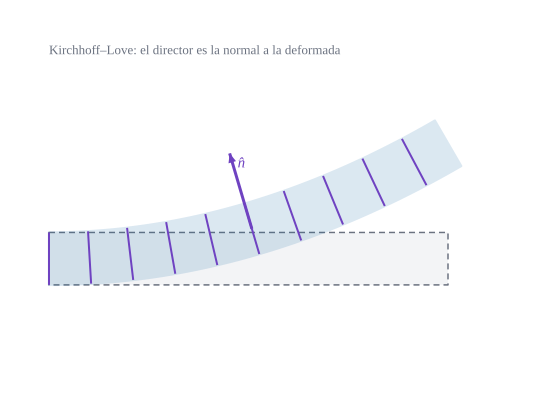

{#fig-kirchhoff .portada fig-alt="Sección de una lámina que se curva; los segmentos del espesor permanecen perpendiculares a la superficie media deformada y conservan su longitud"}

::: {.pregunta-guia}
Qué se gana y qué se pierde al exigir que las fibras del espesor sigan siendo perpendiculares a la superficie
:::

## Objetivos y prerrequisitos {.unnumbered}

**Objetivos.** Al terminar el tema sabrás:

- enunciar las **tres hipótesis** de Kirchhoff–Love y sus consecuencias en $\gamma_{\alpha3}$ y $\gamma_{33}$;
- deducir que la flexión es el **cambio de la segunda forma fundamental**, $\gamma^1_{\alpha\beta}=-(B_{\alpha\beta}-b_{\alpha\beta})$;
- particularizar a una **placa plana**: $\gamma^1_{\alpha\beta}=-u_{3,\alpha\beta}$;
- razonar cuándo es razonable la hipótesis (láminas delgadas) y cuándo no;
- comprobarlo con `Laminas.jl`.

**Prerrequisitos.** [Cinemática de la lámina](D3-cinematica-lamina.qmd) y [Formas fundamentales](../C-superficies/C2-formas-fundamentales.qmd).

**Secciones del tema**

- **@sec-kl-d4** · Las tres hipótesis · **@sec-flexion-kl** · La flexión como cambio de curvatura
- **@sec-placa-kl** · El caso de la placa · **@sec-limites-kl** · Cuándo falla · **@sec-julia-d4** · Práctica guiada

::: {.callout-note title="Notación y convenciones de este tema"}
| Símbolo | Significado |
|---|---|
| $\hat{\mathbf{A}}_3$ | normal unitaria a la superficie deformada $\mathbf{R}_0$ |
| $B_{\alpha\beta}=\hat{\mathbf{A}}_3\cdot\mathbf{R}_{0,\alpha\beta}$ | segunda forma fundamental de la superficie deformada |
| $u_3$ | desplazamiento normal de la superficie media |
| $\kappa_{\alpha\beta}=-\gamma^1_{\alpha\beta}$ | cambio de curvatura (flexión) |
:::

## Las tres hipótesis {#sec-kl-d4}

La teoría de **Kirchhoff–Love** (KL) añade tres hipótesis a la cinemática de D3:

1. las líneas normales siguen siendo **rectas** (ya incluida en @eq-hipotesis);
2. permanecen **inextensibles**: $|\mathbf{A}_3|=1$;
3. permanecen **normales** a la superficie media deformada: $\mathbf{A}_3=\hat{\mathbf{A}}_3=\dfrac{\mathbf{R}_{0,1}\times\mathbf{R}_{0,2}}{|\mathbf{R}_{0,1}\times\mathbf{R}_{0,2}|}$.

::: {#prp-kl-nulas}
## Deformaciones nulas en KL
Con las tres hipótesis, $\gamma_{33}=\tfrac12(|\mathbf{A}_3|^2-1)=0$ (por 2) y, en @eq-gl-lamina, $\mathbf{R}_{0,\alpha}\cdot\mathbf{A}_3=0$ (por 3: $\mathbf{R}_{0,\alpha}$ es tangente a la superficie deformada y $\mathbf{A}_3$ perpendicular a ella), $\mathbf{a}_\alpha\cdot\hat{\mathbf{a}}_3=0$, y $\mathbf{A}_{3,\alpha}\cdot\mathbf{A}_3=0=\hat{\mathbf{a}}_{3,\alpha}\cdot\hat{\mathbf{a}}_3$ por ser vectores unitarios; luego $\gamma_{\alpha3}=0$. No hay **ni cortante transversal ni estiramiento del espesor**.
:::

Solo quedan las deformaciones del plano, $\gamma_{\alpha\beta}=\gamma^0_{\alpha\beta}+\theta^3\gamma^1_{\alpha\beta}+(\theta^3)^2\gamma^2_{\alpha\beta}$, que dependen únicamente de $\mathbf{R}_0$: **la lámina KL tiene tres grados de libertad por punto**.

::: {.callout-tip .idea-clave title="Idea clave"}
KL dice: *el giro de la fibra no es una incógnita, lo determina la superficie*. El director es la normal, y la normal depende de la derivada de $\mathbf{R}_0$.
:::

## La flexión como cambio de curvatura {#sec-flexion-kl}

::: {#prp-flexion-kl}
## Flexión de Kirchhoff–Love
Si $\mathbf{A}_3=\hat{\mathbf{A}}_3$ es la normal de la superficie deformada, la parte lineal en $\theta^3$ de la deformación es
$$
\gamma^1_{\alpha\beta}=-\bigl(B_{\alpha\beta}-b_{\alpha\beta}\bigr),
$$ {#eq-flexion-kl}
con $b_{\alpha\beta}$ y $B_{\alpha\beta}$ las segundas formas fundamentales antes y después. La flexión **es** el cambio de curvatura.
:::

::: {.callout-note .demostracion collapse="true"}
## Demostración de @prp-flexion-kl
De @eq-gl-partes, $\gamma^1_{\alpha\beta}=\tfrac12(\mathbf{R}_{0,\alpha}\cdot\hat{\mathbf{A}}_{3,\beta}+\mathbf{R}_{0,\beta}\cdot\hat{\mathbf{A}}_{3,\alpha})+b_{\alpha\beta}$. Como $\hat{\mathbf{A}}_3\perp\mathbf{R}_{0,\alpha}$, derivando $\mathbf{R}_{0,\alpha}\cdot\hat{\mathbf{A}}_3=0$ respecto de $\theta^\beta$ resulta $\mathbf{R}_{0,\alpha}\cdot\hat{\mathbf{A}}_{3,\beta}=-\mathbf{R}_{0,\alpha\beta}\cdot\hat{\mathbf{A}}_3=-B_{\alpha\beta}$ (que es simétrico). Sustituyendo, $\gamma^1_{\alpha\beta}=-B_{\alpha\beta}+b_{\alpha\beta}$. $\blacksquare$
:::

Verificado en Julia con campos de desplazamiento arbitrarios sobre el paraboloide: `Laminas.jl` y la comparación exacta coinciden con $b-B$ hasta $2\cdot10^{-6}$.

## El caso de la placa {#sec-placa-kl}

En una placa plana inicialmente ($b_{\alpha\beta}=0$) con desplazamiento transversal $w=u_3(\theta^1,\theta^2)$ y sin desplazamientos en el plano, a orden lineal $B_{\alpha\beta}=w_{,\alpha\beta}$ y
$$
\gamma^1_{\alpha\beta}=-w_{,\alpha\beta},\qquad \gamma_{\alpha\beta}\approx-\theta^3\,w_{,\alpha\beta},
$$ {#eq-placa-kl}
es decir, la deformación varía **linealmente** en el espesor y es nula en la superficie media: la clásica «las fibras exteriores se estiran y las interiores se acortan».

::: {#exm-viga-sen}
## Ejemplo resuelto: una tira flexada
Una tira de placa de $L=1000$ mm de luz y espesor $t=20$ mm se flexa con $w(x)=w_0\sin(\pi x/L)$, $w_0=5$ mm. La curvatura es $-w''=w_0(\pi/L)^2\sin(\pi x/L)$, máxima en el centro: $\kappa_{\max}=5\,(\pi/1000)^2=4{,}93\cdot10^{-5}\ \text{mm}^{-1}$. La deformación en la fibra extrema ($\theta^3=t/2=10$ mm) es
$$
\varepsilon_{\max}=\kappa_{\max}\,\frac t2=4{,}93\cdot10^{-4}.
$$
(Pequeña frente a la deformación de fluencia del acero, $\sim10^{-3}$: la flecha de 5 mm en 1 m se ha elegido moderada.)
:::

**Pon a prueba lo anterior.**

::: {.ejercicio tipo="numerico" id="d4-fibra-extrema" respuesta="0.000493" tol="0.5%" unidad=""}
En el @exm-viga-sen, ¿cuál es la deformación de la fibra extrema ($\theta^3=10$ mm) en el centro de la luz?

::: {.pista}
$\varepsilon=\kappa\,\theta^3$ con $\kappa=w_0(\pi/L)^2$.
:::

::: {.solucion}
$\varepsilon=5\,(\pi/1000)^2\cdot10=4{,}93\cdot10^{-4}$. Si el espesor se duplicase (misma flecha y luz), la fibra extrema pasaría a $9{,}87\cdot10^{-4}$, porque $\kappa$ no depende del espesor.
:::
:::

::: {.ejercicio tipo="vf" id="d4-cortante" respuesta="verdadero"}
En Kirchhoff–Love las deformaciones de cortante transversal $\gamma_{\alpha3}$ son nulas.

::: {.solucion}
**Verdadero**, por construcción: el director es perpendicular a la superficie y por tanto a $\mathbf{R}_{0,\alpha}$. (Eso no significa que el esfuerzo cortante sea nulo: se obtiene por equilibrio.)
:::
:::

::: {.callout-warning title="Errores frecuentes"}
- **«Cortante nulo» no es «esfuerzo cortante nulo»**: en KL, $\gamma_{\alpha3}=0$ pero $Q^\alpha\neq0$; se recupera del equilibrio de momentos (su valor «reactivo», no constitutivo).
- **$w_{,\alpha\beta}$ es un tensor sólo en cartesianas**: en curvilíneas hay que usar la derivada covariante $w_{\|\alpha\beta}$ (Christoffel).
:::

::: {.callout-note .historia icon=false title="Un poco de historia: de la placa a la lámina"}
La teoría clásica de placas delgadas se atribuye a Gustav Kirchhoff (cuyas hipótesis se citan desde su trabajo de 1850 sobre el equilibrio y el movimiento de un disco elástico) y la de láminas a Augustus Love, que en 1888 publicó «The small free vibrations and deformation of a thin elastic shell» usando las hipótesis de Kirchhoff. Las tres hipótesis de arriba son las que se conocen hoy como de Kirchhoff–Love; el trabajo de Love provocó una controversia científica con Lord Rayleigh y otros.

<span class="fuentes-caja">Fuentes (secundarias): [Kirchhoff–Love plate theory, Wikipedia](https://en.wikipedia.org/wiki/Kirchhoff%E2%80%93Love_plate_theory); [Augustus Love, Structurae](https://structurae.net/en/persons/augustus-love). No se ha leído el artículo de Kirchhoff de 1850 ni el de Love. Consultado el 21-10-2026.</span>
:::

## Cuándo falla {#sec-limites-kl}

La hipótesis ignora la deformación por cortante, cuyo efecto relativo crece con $(t/L)^2$ (donde $L$ es la longitud de onda característica de la deformación). Por eso KL es **excelente** para láminas delgadas ($t/L\lesssim1/20$), **imprecisa** para láminas gruesas, modos de alta frecuencia o materiales con baja rigidez a cortante (sándwich, laminados). Para esos casos se relaja la hipótesis 3: Reissner–Mindlin (@sec-rm-d5).

## Práctica guiada en Julia {#sec-julia-d4}

::: {.callout-tip title="Ejemplo computacional"}
<span class="etiqueta-resultado calculado">calculado</span> Se evalúa la flexión de la tira del @exm-viga-sen con `deformacion_lamina_lineal` y se comprueba que el cortante es nulo cuando el giro es el de Kirchhoff.
:::

```{julia}
using Geometria, LinearAlgebra

L, t, w0 = 1000.0, 20.0, 5.0
plana = placa_oblicua(π / 2)                            # plano cartesiano
w(θ)  = w0 * sin(π * θ[1] / L)
φ(θ)  = [-w0 * π / L * cos(π * θ[1] / L), 0.0]          # φ = −∇w  (Kirchhoff)
θ0 = [L / 2, 0.0]
γ0, γ1, γS = deformacion_lamina_lineal(plana, θ -> [0.0, 0.0], w, φ, θ0)
(γ1_11 = γ1[1, 1], formula = w0 * (π / L)^2, ε_extrema = γ1[1, 1] * t / 2, γS = γS)
```

```{julia}
# Sobre un paraboloide, con el giro de Kirchhoff φα = −(u₃,α + bᵅρ uρ), el cortante se anula
r = paraboloide_curvo(3.0, -2.0); θ = [0.7, -0.4]
udn(t) = [0.30 * sin(t[1]) + 0.1 * t[2], 0.20 * cos(t[2]) - 0.05 * t[1]]
u3(t)  = 0.25 * t[1] * t[2] + 0.1 * cos(t[1])
function φkl(t)
    h = 1e-5; bm = tensor_curvatura_mixto(metrica_superficie(r, t), segunda_forma(r, t))
    du3 = [(u3(t .+ h .* (1:2 .== α)) - u3(t .- h .* (1:2 .== α))) / 2h for α in 1:2]
    -(du3 .+ [sum(bm[ρ, α] * udn(t)[ρ] for ρ in 1:2) for α in 1:2])
end
_, _, γS = deformacion_lamina_lineal(r, udn, u3, φkl, θ)
γS
```

## Ejercicios {#sec-ejercicios-d4}

1. **Contar grados de libertad.** ¿Cuántos tiene una lámina KL por punto de la superficie media? ¿Y qué problema práctico trae para los elementos finitos?

   ::: {.callout-note collapse="true" title="Solución"}
   Tres ($u_1,u_2,u_3$). Pero $B_{\alpha\beta}$ contiene **segundas** derivadas de $u_3$, así que la formulación débil necesita funciones de forma $C^1$ (continuidad de la derivada), que son difíciles de construir en 2D; Reissner–Mindlin sólo pide $C^0$.
   :::

2. **Signo de la flexión.** En una placa con $w=-a(x^2)/2$ (con $a>0$), ¿en qué cara hay tracción?

   ::: {.callout-note collapse="true" title="Solución"}
   $\gamma^1_{11}=-w''=a>0$: $\gamma_{11}=a\theta^3$ es positivo para $\theta^3>0$, es decir, tracción en la cara de $\theta^3>0$ (la que mira hacia $+\hat{\mathbf{a}}_3$).
   :::

3. **Cilindro.** Con la deformación del cilindro que se hincha de D3, ¿se cumple @eq-flexion-kl?

   ::: {.callout-note collapse="true" title="Solución"}
   Sí: allí el director es la normal de la superficie deformada y $\gamma^1_{\varphi\varphi}=(R+u)-R=u$; con $b_{\varphi\varphi}=-R$ y $B_{\varphi\varphi}=-(R+u)$ resulta $-(B-b)=u$ ✓.
   :::

## La doy por superada si… {.unnumbered}

- Enuncio las tres hipótesis de KL y sé que anulan $\gamma_{\alpha3}$ y $\gamma_{33}$.
- Expreso la flexión como cambio de la segunda forma fundamental y demuestro @eq-flexion-kl.
- Calculo la deformación en la fibra extrema de una placa con $-\theta^3 w''$.
- Explico por qué KL pide elementos $C^1$ y cuándo deja de ser válida.

::: {.callout-note collapse="true" title="Fuentes, correcciones y qué queda pendiente"}
**Fuentes.** Texto autónomo, resultados estándar de la teoría clásica de láminas [@Novozhilov; @Flugge]. @eq-flexion-kl y el cortante nulo se comprueban numéricamente en el conjunto «Cinemática de láminas» de los tests de Julia.

**Correcciones.** El signo de $\gamma^1$ (flexión $=-(B-b)$) depende del convenio de $b_{\alpha\beta}$; con $b_{\alpha\beta}=\hat{\mathbf{a}}_3\cdot\mathbf{a}_{\alpha,\beta}$ es el de arriba. Una discrepancia de signo en una fuente de partida se considera error de transcripción de la fuente.

**Qué queda pendiente.** El giro de la normal en componentes físicas (convenio por confirmar); la historia se apoya en fuentes secundarias; figuras con revisión visual pendiente.
:::
