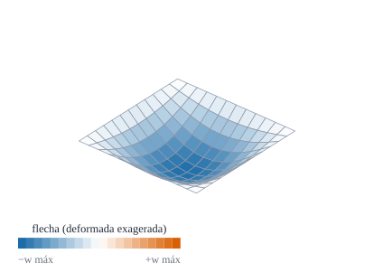
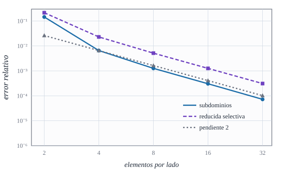
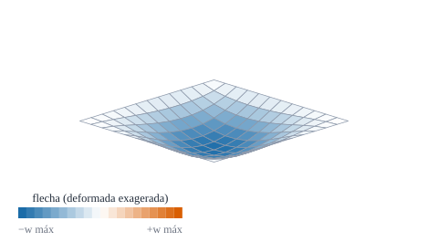

{#fig-placa-flecha .portada fig-alt="Una placa cuadrada vista en perspectiva, hundida en el centro, con una malla de elementos y colores más intensos donde la flecha es mayor"}

::: {.pregunta-guia}
Cómo se demuestra que un elemento finito da la solución correcta, y no sólo un número que parece razonable
:::

## Objetivos y prerrequisitos {.unnumbered}

**Objetivos.** Al terminar el tema sabrás:

- distinguir **verificación** (¿resuelvo bien las ecuaciones?) de **validación** (¿resuelvo las ecuaciones correctas?);
- plantear y comprobar un **patch test** de membrana y de flexión;
- comparar la flecha de una placa simplemente apoyada con la **solución de Navier** y medir el **orden de convergencia**;
- reproducir la flecha de una placa **empotrada** y estudiar una placa **oblicua**;
- decidir cuándo un resultado numérico es fiable.

**Prerrequisitos.** [E9](../E-elementos-finitos/E9-ensamblaje-autovalores.qmd) y [E5](../E-elementos-finitos/E5-bloqueo.qmd).

**Secciones del tema**

- **@sec-validar-f1** · Verificar y validar · **@sec-patch-f1** · Patch test · **@sec-navier-f1** · Placa simplemente apoyada
- **@sec-empotrada-f1** · Placa empotrada · **@sec-oblicua-f1** · Placa oblicua · **@sec-julia-f1** · Práctica guiada

::: {.callout-note title="Notación y convenciones de este tema"}
| Símbolo | Significado |
|---|---|
| $D=Et^3/\bigl(12(1-\nu^2)\bigr)$ | rigidez a flexión de la placa |
| $q,\ L$ | carga uniforme por unidad de superficie y lado de la placa |
| $\alpha=w_{\text{centro}}\,D/(qL^4)$ | coeficiente adimensional de la flecha central |
| $n$ | elementos por lado de la malla |
| *simplemente apoyada* | apoyo «duro»: $u_3=0$ y giro tangente nulo en el borde |
:::

::: {.callout-note .ingenieros title="Explicación para ingenieros: el parche de tela y la balanza calibrada"}
Un **patch test** es como **tirar uniformemente de un parche de tela** cosido con distintos retales: si el tirón es uniforme, **todos los retales deben estirarse por igual**, da igual cómo estén cortados. Si el programa no consigue eso, tiene un error de base, y ninguna malla fina lo arreglará. La **comparación con Navier** es la balanza calibrada: se le pone al programa un caso del que se conoce la respuesta exacta y se ve si marca el peso correcto. Un programa que pasa las dos pruebas **merece confianza** en problemas parecidos, pero no en los muy distintos: por eso en los temas siguientes se repite con cilindros y con el paraboloide.
:::

## Verificar y validar {#sec-validar-f1}

- **Verificación**: comprobar que el programa **resuelve correctamente el modelo matemático** (sin errores de código, con la convergencia esperada). Se hace comparando con soluciones analíticas o con otras soluciones numéricas conocidas.
- **Validación**: comprobar que **el modelo describe la realidad** (que la hipótesis de Reissner–Mindlin o la de Kirchhoff–Love es adecuada, que el material es el correcto). Se hace con experimentos.

Este libro, en los temas F1–F3, **verifica**. Para cada caso se da la referencia y su procedencia: *analítica* (se deduce y se calcula), *de la literatura* (con cita) o *calculada con malla fina* (sin referencia externa).

## Patch test {#sec-patch-f1}

::: {#def-patch-f1}
## Patch test
Se toma un grupo («parche») de elementos de forma irregular y se imponen en el **contorno** los valores nodales de un campo de **deformación constante** (en membrana) o de **curvatura constante** (en flexión). El elemento supera el test si los **nodos interiores** y las deformaciones del interior reproducen **exactamente** ese campo.
:::

Es una condición **necesaria** de convergencia (el elemento es *consistente*): si no reproduce estados constantes, al refinar no tiende a la solución. No es **suficiente** por sí sola (también hace falta estabilidad, es decir, no tener modos espurios, tema E5).

::: {#exm-patch-f1}
## Ejemplo resuelto: campos del patch test
Sobre un parche de $4\times4$ elementos rectangulares **no uniformes** en el plano paramétrico:

- *Membrana:* $u=10^{-3}x+5\cdot10^{-4}y$, $v=-3\cdot10^{-4}x+8\cdot10^{-4}y$ (deformación constante).
- *Flexión:* $w=\tfrac12\bigl(x^2+\tfrac12xy+\tfrac45y^2\bigr)$ con $\varphi_\alpha=-w_{,\alpha}$: curvatura constante $\kappa_{xx}=-1$, $\kappa_{yy}=-0{,}8$, $\kappa_{xy}=-0{,}25$ y **cortante nulo**.

Se fijan los nodos del borde a esos valores, se resuelve el parche sin carga y se mide la **fuerza residual** en los nodos interiores: $\|\mathbf K\mathbf d\|_{\text{libres}}/\|\mathbf K\mathbf d\|_{\text{fijos}}$. Con la formulación de subdominios, el residuo es $\sim10^{-9}$ (ruido de las derivadas numéricas de la geometría); con la de desplazamientos, $\sim1$. Resultado *calculado*: lo reproduce la práctica de Julia.
:::

::: {.ejercicio tipo="vf" id="f1-patch-suficiente" respuesta="falso"}
Si un elemento pasa el patch test, queda garantizado que converge a la solución correcta al refinar la malla.

::: {.solucion}
**Falso.** Pasar el patch test es condición **necesaria** (consistencia), pero hace falta además **estabilidad** (ausencia de modos espurios): existen elementos que lo pasan y no convergen.
:::
:::

::: {.callout-warning title="Dos puntos que suelen confundir"}
- **El patch test no mide precisión**, sólo comprueba que la formulación no tiene fallos de base. La precisión se mide con la convergencia (@sec-navier-f1).
- **El parche debe ser irregular.** Con una malla uniforme y ordenada pasan el test elementos que fallan con mallas distorsionadas.
:::

## Placa simplemente apoyada: la solución de Navier {#sec-navier-f1}

Una placa cuadrada de lado $L$ con carga uniforme $q$ y los cuatro bordes simplemente apoyados tiene, en la teoría de Kirchhoff, la solución en **serie doble de senos**:

$$
w(x,y)=\frac{16\,q}{\pi^6D}\sum_{m,n=1,3,5,\dots}\frac{\sin\frac{m\pi x}L\,\sin\frac{n\pi y}L}{m\,n\,\bigl(\frac{m^2}{L^2}+\frac{n^2}{L^2}\bigr)^2},\qquad w_{\text{centro}}=\alpha\,\frac{qL^4}D,\ \ \alpha\simeq0{,}00406 .
$$ {#eq-navier-f1}

El coeficiente $\alpha$ se obtiene sumando la serie, que converge muy deprisa ($\sim1/(mn)^5$). Es un resultado *analítico* (calculado numéricamente: $\alpha=0{,}004062$).

::: {.ejercicio tipo="numerico" id="f1-navier" respuesta="0.00406" tol="0.5%" unidad=""}
Suma la serie @eq-navier-f1 (basta $m,n\le9$) y da el coeficiente $\alpha=w_{\text{centro}}D/(qL^4)$ de la placa cuadrada simplemente apoyada.

::: {.pista}
En el centro $\sin\frac{m\pi}2\sin\frac{n\pi}2=\pm1$ con signo $(-1)^{(m+n)/2-1}$; el primer término ($m=n=1$) vale $16/(\pi^6\cdot4)=0{,}00416$.
:::

::: {.solucion}
Suma de la serie con $m,n\le9$ (impares): $\alpha=0{,}004062$. El primer término ya da $0{,}00416$ (2,4 % de error): la serie converge muy deprisa.
:::
:::

El elemento de este libro, con $t/L=0{,}001$ y mallas de $2,4,8,16$ y $32$ elementos por lado, tiene un error de la flecha central que **baja con pendiente $2$** en escala logarítmica (@fig-placa-conv): es el orden esperado de un elemento bilineal. Con $t/L=0{,}01$ la solución se estanca en $+0{,}03\,\%$: es la **deformación por cortante** de Reissner–Mindlin, que Navier (Kirchhoff) no recoge.

{#fig-placa-conv fig-alt="Gráfica logarítmica del error frente al número de elementos por lado con dos curvas descendentes paralelas a una recta de pendiente dos"}

::: {.callout-tip .aplicacion title="Aplicación real: losas, forjados y huesos planos"}
<span class="etiqueta-resultado ilustrativo">ilustrativo</span> **Obra civil.** Una losa de forjado apoyada en todo su contorno y cargada de forma uniforme es, casi literalmente, el problema de Navier; los reglamentos y programas de cálculo de losas se contrastan con estas soluciones. **Biomecánica.** Los huesos planos (calota craneal, escápula) se idealizan a veces como placas o láminas delgadas con presión uniforme. *Idea de aplicación sin fuente verificada: es una orientación, no una cita.*
:::

## Placa empotrada {#sec-empotrada-f1}

Con los cuatro bordes **empotrados** ($u_3=\varphi_1=\varphi_2=0$) la placa es más rígida. La solución de la teoría de placas para la placa cuadrada uniformemente cargada se da en tablas del tipo $w_{\text{centro}}=\alpha\,qL^4/D$ con $\alpha\approx0{,}00126$ (valor que se recuerda de la literatura clásica de placas [@TimoshenkoWK]; **sin verificar en la edición**). El elemento da $\alpha=0{,}001267$ con $24\times24$ elementos (@sec-julia-f1), coherente con ese valor.

## Placa oblicua {#sec-oblicua-f1}

Una **placa oblicua** (un paralelogramo) tiene un sistema de coordenadas no ortogonal: su métrica es $a_{12}\ne0$ y las componentes covariantes de los desplazamientos no son las físicas. Es el caso que justifica todo el cálculo tensorial del libro. Con un ángulo de $60^\circ$, simplemente apoyada y $q=L=1$, los coeficientes $\alpha$ de $4,8,16$ y $24$ elementos por lado son $0{,}002354$, $0{,}002485$, $0{,}002530$ y $0{,}002542$: la secuencia **converge monótonamente** a $\alpha\approx0{,}0025$, algo más de la mitad que la cuadrada.

{#fig-placa-oblicua fig-alt="Un paralelogramo en perspectiva hundido en el centro con una malla de paralelogramos y colores según la flecha"}

::: {.callout-warning title="Sin referencia externa verificada"}
Para la placa oblicua no se ha verificado ningún valor de la literatura (el caso de referencia habitual, por ejemplo con un ángulo de $30^\circ$, no se ha podido contrastar). Lo que se afirma aquí es **convergencia con la malla** y plausibilidad física (menor flecha que la cuadrada). *Calculado*, sin comparación externa.
:::

## Un poco de historia {#sec-historia-f1}

::: {.callout-note .historia icon=false title="Un poco de historia: Navier, Lévy y el patch test"}
La ecuación de la placa fue obtenida por Lagrange en 1811 al corregir el trabajo de Sophie Germain. Navier resolvió después la placa simplemente apoyada con una **serie trigonométrica doble** (las fuentes dan 1820 o 1823), y Lévy (1899, según la fuente más citada) propuso una serie simple para placas con dos bordes opuestos apoyados. El **patch test** nació en los años sesenta con el grupo de Bruce Irons: Bazeley, Cheung, Irons y Zienkiewicz (1966) lo emplearon para placas triangulares, e Irons y Razzaque (1972) lo describieron con detalle; más tarde se demostró que es necesario, pero no suficiente, para la convergencia (Stummel dio contraejemplos en 1980).

<span class="fuentes-caja">Fuentes (secundarias): [A review of the analytical solution methods for the eigenvalue problems of rectangular plates (ScienceDirect)](https://www.sciencedirect.com/science/article/abs/pii/S0020740322000960); [Analysis of Isotropic Rectangular Kirchhoff Plates… Modified Lévy Solution (Preprints)](https://www.preprints.org/manuscript/202305.2121/v1); [Experience with the patch test for convergence of finite elements (Semantic Scholar)](https://www.semanticscholar.org/paper/EXPERIENCE-WITH-THE-PATCH-TEST-FOR-CONVERGENCE-OF-Irons-Razzaque/ec66c183738743475e5f0a63c98767bf0f30436c); [Note on the Necessity of the Patch Test](https://www.academia.edu/72877178/Note_on_the_Necessity_of_the_Patch_Test). Las fechas de Navier y de Lévy difieren entre fuentes; no se leyeron los originales. Consultado el 23-10-2026.</span>
:::

## Práctica guiada en Julia {#sec-julia-f1}

::: {.callout-tip title="Ejemplo computacional"}
<span class="etiqueta-resultado calculado">calculado</span> (1) El patch test mixto del @exm-patch-f1 con las dos formulaciones, para la placa cuadrada y la oblicua. (2) La convergencia frente a Navier ($t/L=0{,}001$). (3) Los coeficientes de la placa empotrada y de la oblicua.
:::

```{julia}
using Geometria, LinearAlgebra

function residuo_patch(geom, modo)
    L = 1.0; E, ν, t = 1.0e4, 0.3, 0.01
    xs = [0, 0.18, 0.5, 0.62, 1.0]; ys = [0, 0.3, 0.41, 0.8, 1.0]          # malla no uniforme
    nodos = hcat([[x, y] for y in ys for x in xs]...); id(i, j) = (j - 1) * 5 + i
    conn = hcat([[id(i, j), id(i + 1, j), id(i + 1, j + 1), id(i, j + 1)] for j in 1:4 for i in 1:4]...)
    K, _, _ = ensamblar(geom, nodos, conn, E, ν, t; modo)
    ufun(p) = [1e-3 * p[1] + 5e-4 * p[2], -3e-4 * p[1] + 8e-4 * p[2], 0.0]
    wf(p) = 0.5 * (p[1]^2 + 0.5 * p[1] * p[2] + 0.8 * p[2]^2)
    gw(p) = [p[1] + 0.25 * p[2], 0.25 * p[1] + 0.8 * p[2], 0.0]
    nn = size(nodos, 2); d = zeros(5nn); fij = Int[]
    for k in 1:nn
        θ = nodos[:, k]; g = geometria_punto(geom, θ); p = geom(θ)
        d[gdl(k, 1):gdl(k, 2)] = g.A' * ufun(p)           # uα = u·aα (componentes covariantes)
        d[gdl(k, 3)] = wf(p)
        d[gdl(k, 4):gdl(k, 5)] = -(g.A' * gw(p))         # φα = −w,α  (Kirchhoff: cortante nulo)
        x, y = θ
        (x ≈ 0 || x ≈ L || y ≈ 0 || y ≈ L) && append!(fij, gdl(k, 1):gdl(k, 5))
    end
    lib = setdiff(1:5nn, fij); res = K * d
    norm(res[lib]) / norm(res[fij])
end

[(placa = nombre, subdominios = residuo_patch(g, :subdominios), desplazamientos = residuo_patch(g, :desplazamientos))
 for (nombre, g) in (("cuadrada", placa_oblicua(π / 2)), ("oblicua 60°", placa_oblicua(π / 3)))]
```

```{julia}
navier(a, q, D; N = 199) = 16q / (π^6 * D) * sum(sin(m * π / 2) * sin(n * π / 2) / (m * n * (m^2 + n^2)^2 / a^4) for m in 1:2:N, n in 1:2:N)

function placa(n, t, modo; E = 1.0e4, ν = 0.3, geom = placa_oblicua(π / 2), empotrada = false)
    nodos, conn = malla_rectangular((0, 1.0), (0, 1.0), n, n)
    K, _, F = ensamblar(geom, nodos, conn, E, ν, t; modo, f = θ -> [0, 0, -1.0])
    fij = Int[]
    for k in 1:size(nodos, 2)
        x, y = nodos[:, k]; append!(fij, [gdl(k, 1), gdl(k, 2)])
        borde = x ≈ 0 || x ≈ 1 || y ≈ 0 || y ≈ 1
        if empotrada
            borde && append!(fij, gdl(k, 3):gdl(k, 5))
        else
            borde && push!(fij, gdl(k, 3))
            (x ≈ 0 || x ≈ 1) && push!(fij, gdl(k, 5)); (y ≈ 0 || y ≈ 1) && push!(fij, gdl(k, 4))
        end
    end
    u = resolver_estatica(K, F, unique(fij))
    c = argmin([norm(nodos[:, k] .- [0.5, 0.5]) for k in 1:size(nodos, 2)])
    -u[gdl(c, 3)]
end

E, ν, t = 1.0e4, 0.3, 0.001; D = E * t^3 / (12 * (1 - ν^2))
wref = navier(1.0, 1.0, D)
tabla = [(n = n, error_relativo = abs(placa(n, t, :subdominios) / wref - 1)) for n in (2, 4, 8, 16)]
(α_Navier = wref * D, tabla = tabla,
 orden_observado = [log(tabla[i].error_relativo / tabla[i+1].error_relativo) / log(2) for i in 1:3])
```

```{julia}
# Empotrada y oblicua (t/L = 0.01): coeficientes α = w·D/(q L⁴)
t = 0.01; D = 1.0e4 * t^3 / (12 * (1 - 0.3^2))
(α_empotrada = [placa(n, t, :subdominios; empotrada = true) * D for n in (8, 16, 24)],
 α_oblicua_60 = [placa(n, t, :subdominios; geom = placa_oblicua(π / 3)) * D for n in (4, 8, 16, 24)])
```

## Ejercicios {#sec-ejercicios-f1}

1. **Orden de convergencia.** Si el error pasa de $6{,}1\cdot10^{-3}$ ($n=4$) a $8{,}3\cdot10^{-4}$ ($n=8$), ¿qué orden se observa?

   ::: {.callout-note collapse="true" title="Solución"}
   $\log_2(6{,}1\cdot10^{-3}/8{,}3\cdot10^{-4})=\log_2(7{,}35)\approx2{,}9$: algo por encima de 2 (régimen preasintótico). Con mallas más finas se estabiliza cerca de 2.
   :::

2. **Estancamiento.** ¿Por qué con $t/L=0{,}01$ el error frente a Navier se estanca en $+0{,}03\,\%$ y no sigue bajando?

   ::: {.callout-note collapse="true" title="Solución"}
   Porque el elemento (Reissner–Mindlin) incluye la deformación por cortante y Navier (Kirchhoff) no: la solución *exacta* de Reissner–Mindlin es algo mayor, y el elemento converge a ésa. El efecto crece como $(t/L)^2$ y desaparece al adelgazar la placa.
   :::

3. **Diseñar un patch test.** ¿Qué campo se impondría para comprobar el **cortante**?

   ::: {.callout-note collapse="true" title="Solución"}
   Un giro **constante** $\varphi_1=\bar\varphi$ con $w=-\bar\varphi\,x$ (inclinación rígida): $\gamma_1=\varphi_1+w_{,1}=0$ y curvatura nula; basta que el parche lo reproduzca sin esfuerzos. Para cortante constante no nulo, $w=\bar\gamma x$ con $\varphi_1=0$.
   :::

## La doy por superada si… {.unnumbered}

- Distingo verificar de validar y digo cuál de las dos hace este tema.
- Planteo el patch test de membrana y de flexión y sé qué prueba y qué no.
- Calculo la flecha de Navier y el coeficiente $0{,}00406$.
- Mido el orden de convergencia a partir de dos mallas.
- Reconozco que la placa oblicua no tiene referencia verificada y qué se afirma sobre ella.

::: {.callout-note collapse="true" title="Fuentes, correcciones y qué queda pendiente"}
**Fuentes.** Texto autónomo; la solución de Navier y los coeficientes de placas son clásicos [@TimoshenkoWK] (datos editoriales sin verificar); el patch test, en [@Bathe; @Hughes; @ZienkiewiczTaylor]. El coeficiente de Navier y los de la placa empotrada y oblicua son *calculados*; el de la empotrada no se ha contrastado con la tabla original.

**Qué queda pendiente.** Referencia verificada de la placa oblicua (por ejemplo, el caso de $30^\circ$) y de la empotrada; momentos flectores (sólo se estudia la flecha); la nota histórica y la «Aplicación real» usan fuentes secundarias o ninguna; figuras con revisión visual pendiente.
:::
