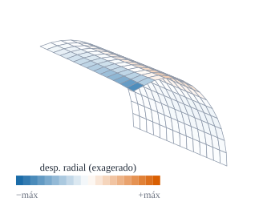

{#fig-scordelis .portada fig-alt="Un cuarto de un techo cilíndrico alargado visto en perspectiva, con una malla de elementos y el borde libre coloreado en azul oscuro por ser donde mayor es el descenso"}

::: {.pregunta-guia}
Qué problemas se resuelven siempre antes de fiarse de un elemento de lámina curva, y qué resultado debe dar
:::

## Objetivos y prerrequisitos {.unnumbered}

**Objetivos.** Al terminar el tema sabrás:

- comprobar un cilindro **a presión** con la solución de membrana (*analítica*);
- plantear el **techo de Scordelis–Lo** y el **cilindro pinzado** con sus apoyos y simetrías;
- explicar por qué se modela **un cuarto** o **un octavo** y qué condición pone cada plano de simetría;
- comparar el resultado con la referencia de la literatura y medir el error con la malla;
- reconocer el **bloqueo de membrana** en el resultado de la formulación de desplazamientos.

**Prerrequisitos.** [F1](F1-validacion-placa.qmd) y [E9](../E-elementos-finitos/E9-ensamblaje-autovalores.qmd) (condiciones de contorno).

**Secciones del tema**

- **@sec-presion-f2** · Cilindro a presión · **@sec-scordelis-f2** · Scordelis–Lo · **@sec-pinzado-f2** · Cilindro pinzado
- **@sec-lectura-f2** · Cómo leer los resultados · **@sec-julia-f2** · Práctica guiada

::: {.callout-note title="Notación y convenciones de este tema"}
| Símbolo | Significado |
|---|---|
| $r(\theta^1,\theta^2)=(x,\ R\sin\varphi,\ R\cos\varphi)$ | cilindro de eje $x$, con $\theta^1=x$ y $\theta^2=\varphi$ (normal **exterior**) |
| $R,\ L,\ t$ | radio, longitud y espesor |
| diafragma | extremo que impide los desplazamientos en su plano ($u_2=u_3=0$) pero deja libre el axial |
| simetría en $x=L/2$ | $u_1=0$, $\varphi_1=0$ |
| simetría en $\varphi=\text{cte}$ | $u_2=0$, $\varphi_2=0$ |
:::

::: {.callout-note .ingenieros title="Explicación para ingenieros: ¿por qué un cuarto o un octavo?"}
Un techo con peso simétrico se comporta igual a la izquierda que a la derecha, y por delante que por detrás. **Cortarlo por los planos de simetría** y calcular sólo un cuarto da el mismo resultado con **una cuarta parte del trabajo**, siempre que en cada plano de corte se impida lo que la mitad ausente impediría: no se puede **cruzar** el plano (desplazamiento perpendicular nulo) ni **girar la sección** (giro nulo alrededor de la normal al plano). Si se olvida un giro, el modelo del cuarto es más flexible que el entero y la flecha sale mayor.
:::

## Cilindro a presión {#sec-presion-f2}

Un cilindro **largo**, con el desplazamiento axial impedido ($\varepsilon_x=0$) y presión interior $p$, tiene una solución de membrana sencilla: la tensión de aro $N_\varphi=pR$ produce $\varepsilon_\varphi=u_3/R$ y, con $N_\varphi=Et\,\varepsilon_\varphi/(1-\nu^2)$,

$$
u_3=\frac{p\,R^2\,(1-\nu^2)}{E\,t}.
$$ {#eq-presion-f2}

::: {#exm-presion-f2}
## Ejemplo resuelto: tubo de acero a presión
Tubo de acero ($E=210$ GPa, $\nu=0{,}3$) con $R=500$ mm, $t=5$ mm y $p=0{,}5$ MPa. Con @eq-presion-f2:
$$
u_3=\frac{0{,}5\cdot500^2\cdot0{,}91}{210\,000\cdot5}=\frac{113\,750}{1\,050\,000}=\mathbf{0{,}1083}\ \text{mm}.
$$
Es una prueba de **sólo membrana**: no depende de la flexión y la debe reproducir cualquier elemento correcto (la práctica la comprueba con un error relativo de $10^{-5}$). Resultado *analítico*.
:::

::: {.ejercicio tipo="numerico" id="f2-presion" respuesta="0.1083" tol="0.5%" unidad="mm"}
En el @exm-presion-f2, ¿cuánto se hincha el radio del tubo ($u_3$)?

::: {.solucion}
$u_3=pR^2(1-\nu^2)/(Et)=0{,}5\cdot250\,000\cdot0{,}91/(210\,000\cdot5)=0{,}1083$ mm.
:::
:::

## El techo de Scordelis–Lo {#sec-scordelis-f2}

::: {#def-scordelis-f2}
## Techo de Scordelis–Lo
Cubierta cilíndrica de **radio $R=25$**, longitud $L=50$, espesor $t=0{,}25$, abertura $2\cdot40^\circ$, con $E=4{,}32\cdot10^8$, $\nu=0$, bajo peso propio $q=90$ por unidad de superficie (hacia abajo). Los dos extremos curvos tienen **diafragma** y los bordes longitudinales están libres.
:::

El valor de referencia es el **desplazamiento vertical del punto medio del borde libre**: $0{,}3024$, la cifra de uso general que proviene del conjunto de problemas de MacNeal y Harder [@MacNealHarder]; la solución original de Scordelis y Lo es $0{,}3086$, y otros trabajos dan $0{,}3006$. Se modela **un cuarto**: $x\in[0,L/2]$ y $\varphi\in[0,40^\circ]$, con diafragma en $x=0$, simetría en $x=L/2$ y simetría en $\varphi=0$.

| $n$ (elementos/lado) | 4 | 8 | 16 | 32 |
|---|---|---|---|---|
| Subdominios | 0,2690 | 0,2925 | 0,2988 | 0,3006 |
| Cociente respecto de 0,3024 | 0,889 | 0,967 | 0,988 | 0,994 |

*Calculado* con este elemento. El error baja del 11 % al 0,6 %.

::: {.callout-warning title="Tres referencias distintas"}
Hay tres valores en circulación: $0{,}3024$ (el más usado, de MacNeal–Harder), $0{,}3086$ (el de Scordelis y Lo) y $0{,}3006$ (otros trabajos). La diferencia (2 %) es de la misma magnitud que el error de un elemento de cuatro nodos con malla media: conviene **declarar con qué referencia se compara**. Aquí se usa $0{,}3024$ y se ve que el resultado **converge entre las tres**.
:::

## El cilindro pinzado {#sec-pinzado-f2}

::: {#def-pinzado-f2}
## Cilindro pinzado con diafragmas
Cilindro de $R=300$, $L=600$, $t=3$, $E=3\cdot10^6$, $\nu=0{,}3$, con **diafragmas** en los extremos y dos **cargas puntuales** radiales opuestas $P=1$ en el plano central. El valor de referencia es el **desplazamiento radial bajo la carga**: $1{,}8248\cdot10^{-5}$.
:::

Es un problema **muy exigente**: la carga puntual crea una concentración de flexión y la lámina trabaja casi sin estirarse (*inextensional*), de modo que el **bloqueo de membrana** se nota enseguida. Se modela **un octavo** ($x\in[0,L/2]$, $\varphi\in[0,90^\circ]$), con diafragma en $x=0$, simetría en $x=L/2$ y en $\varphi=0$ y $\varphi=90^\circ$, y la carga $P/4$ en el vértice.

{#fig-pinzado fig-alt="Un octavo de un tubo en perspectiva con una malla de elementos y un hundimiento en la esquina cercana al centro, coloreado en azul"}

| $n$ (elementos/lado) | 4 | 8 | 16 | 32 |
|---|---|---|---|---|
| Subdominios ($\times10^{-5}$) | 1,680 | 1,740 | 1,808 | 1,833 |
| Cociente respecto de $1{,}8248\cdot10^{-5}$ | 0,920 | 0,953 | 0,991 | 1,005 |

Con $32\times32$ el resultado **pasa** ligeramente de la referencia (+0,5 %): es normal en elementos de cuatro nodos y no es un error, sino una convergencia no monótona.

{#fig-cil-conv fig-alt="Cuatro curvas de convergencia en escala logarítmica: dos continuas próximas a uno y dos discontinuas muy por debajo, subiendo despacio"}

## Cómo leer los resultados {#sec-lectura-f2}

- La formulación de **desplazamientos puros** da, con $8\times8$, el **12 %** (Scordelis–Lo) y el **6 %** (pinzado) de la referencia: el bloqueo de membrana y de cortante del tema E5, a plena vista.
- La **integración reducida selectiva** (reducción del cortante a un punto) con $8\times8$ da el **22 %** y el **35 %**: no basta en láminas curvas y además introduce modos espurios.
- Los **subdominios** llegan al 97 % y 95 % con $8\times8$ y al 100 % con mallas finas.

::: {.ejercicio tipo="opcion" id="f2-simetria" respuesta="c"}
En el cuarto de techo de Scordelis–Lo, en el plano de simetría $x=L/2$, ¿qué g.d.l. se fijan?

::: {.opciones}
- $u_2$ y $u_3$ (el movimiento en el plano de la sección)
- $u_3$ y $\varphi_2$
- $u_1$ y $\varphi_1$
- Ninguno: es un borde libre
:::

::: {.solucion}
En un plano de simetría $x=\text{cte}$ el desplazamiento **perpendicular** al plano ($u_1$, axial) y el giro **alrededor de la normal al plano de corte** ($\varphi_1$) son nulos. Los de un diafragma ($u_2,u_3$) se fijan en el **extremo** $x=0$, no en el plano de simetría.
:::
:::

::: {.callout-tip .aplicacion title="Aplicación real: cubiertas en bóveda, tuberías y vasos sanguíneos"}
<span class="etiqueta-resultado ilustrativo">ilustrativo</span> **Obra civil.** El techo de Scordelis–Lo es una **bóveda cilíndrica de hormigón** de las que se usaron mucho en naves; el cilindro pinzado es un **tubo (conducto, tubería o depósito)** al que se aplica una carga concentrada, como un apoyo mal repartido o un golpe. **Biomecánica.** La pared de arterias y venas se modela como un cilindro de pared delgada; un pinzamiento localizado recuerda la compresión de un vaso por una estructura vecina o por una pinza quirúrgica. *Idea de aplicación sin fuente verificada: es una orientación, no una cita.*
:::

## Un poco de historia {#sec-historia-f2}

::: {.callout-note .historia icon=false title="Un poco de historia: el conjunto de problemas de MacNeal y Harder"}
En 1985 Richard MacNeal y Robert Harder publicaron *A proposed standard set of problems to test finite element accuracy*, un conjunto de problemas con solución conocida pensado para comparar elementos, entre ellos el **techo de Scordelis–Lo**, el **cilindro pinzado** y la **semiesfera con agujeros**. Desde entonces es la batería obligada de cualquier elemento de lámina. El valor $0{,}3024$ del Scordelis–Lo es el que figura en ese conjunto, aunque la solución analítica original de Scordelis y Lo (1964) era $0{,}3086$; el valor $1{,}8248\cdot10^{-5}$ del cilindro pinzado se atribuye a la línea de trabajo de Belytschko.

<span class="fuentes-caja">Fuentes (secundarias): [OS-V: 0730 Scordelis-Lo Roof (Altair)](https://help.altair.com/hwsolvers/os/topics/solvers/os/scordelis_lo_roof_verification_r.htm); [Benchmark Example No. 41 Linear Pinched Cylinder (SOFiSTiK)](https://docs.sofistik.com/2024/en/verification/_static/verification/pdf/be41.pdf); [@MacNealHarder]. El original de MacNeal y Harder no se leyó; la atribución a Belytschko procede de un resumen de búsqueda. Consultado el 23-10-2026.</span>
:::

## Práctica guiada en Julia {#sec-julia-f2}

::: {.callout-tip title="Ejemplo computacional"}
<span class="etiqueta-resultado calculado">calculado</span> (1) El tubo a presión del @exm-presion-f2. (2) El techo de Scordelis–Lo y el cilindro pinzado con las tres formulaciones y comparación con las referencias.
:::

```{julia}
using Geometria, LinearAlgebra

cil_x(R) = θ -> [θ[1], R * sin(θ[2]), R * cos(θ[2])]
nodo_en(nodos, p) = argmin([norm(nodos[:, k] .- p) for k in 1:size(nodos, 2)])

# (1) Tubo a presión (un cuarto de sección, u₁ = 0, simetrías en φ = 0 y π/2)
function presion(n; E = 210e3, ν = 0.3, R = 500.0, t = 5.0, p = 0.5)
    r = cil_x(R); nodos, conn = malla_rectangular((0, 100.0), (0, π / 2), 2, n)
    f = θ -> p .* [0, sin(θ[2]), cos(θ[2])]                              # presión hacia fuera: p·n̂
    K, _, F = ensamblar(r, nodos, conn, E, ν, t; f)
    fij = Int[]
    for k in 1:size(nodos, 2)
        _, φ = nodos[:, k]; append!(fij, [gdl(k, 1), gdl(k, 4)])
        (φ ≈ 0 || φ ≈ π / 2) && append!(fij, [gdl(k, 2), gdl(k, 5)])
    end
    u = resolver_estatica(K, F, unique(fij))
    u[gdl(nodo_en(nodos, [50.0, π / 4]), 3)]
end
(u3_FE = presion(8), u3_teoría = 0.5 * 500.0^2 * (1 - 0.3^2) / (210e3 * 5.0))
```

```{julia}
# (2) Scordelis–Lo (un cuarto) y cilindro pinzado (un octavo)
function scordelis(n; modo = :subdominios)
    R, L, t, E, ν = 25.0, 50.0, 0.25, 4.32e8, 0.0; φm = deg2rad(40); r = cil_x(R)
    nodos, conn = malla_rectangular((0, L / 2), (0, φm), n, n)
    K, _, F = ensamblar(r, nodos, conn, E, ν, t; modo, f = θ -> [0, 0, -90.0])
    fij = Int[]
    for k in 1:size(nodos, 2)
        x, φ = nodos[:, k]
        x ≈ 0 && append!(fij, [gdl(k, 2), gdl(k, 3)])                    # diafragma
        x ≈ L / 2 && append!(fij, [gdl(k, 1), gdl(k, 4)])                # simetría en x = L/2
        φ ≈ 0 && append!(fij, [gdl(k, 2), gdl(k, 5)])                    # simetría en φ = 0
    end
    u = resolver_estatica(K, F, unique(fij))
    desplazamiento_cartesiano(r, nodos, u, nodo_en(nodos, [L / 2, φm]))[3]       # borde libre, punto medio
end

function pinzado(n; modo = :subdominios)
    R, L, t, E, ν = 300.0, 600.0, 3.0, 3.0e6, 0.3; r = cil_x(R)
    nodos, conn = malla_rectangular((0, L / 2), (0, π / 2), n, n)
    K, _, _ = ensamblar(r, nodos, conn, E, ν, t; modo)
    nn = size(nodos, 2); F = zeros(5nn); c = nodo_en(nodos, [L / 2, 0.0]); F[gdl(c, 3)] = -0.25   # P/4 hacia dentro
    fij = Int[]
    for k in 1:nn
        x, φ = nodos[:, k]
        x ≈ 0 && append!(fij, [gdl(k, 2), gdl(k, 3)])
        x ≈ L / 2 && append!(fij, [gdl(k, 1), gdl(k, 4)])
        (φ ≈ 0 || φ ≈ π / 2) && append!(fij, [gdl(k, 2), gdl(k, 5)])
    end
    u = resolver_estatica(K, F, unique(fij)); u[gdl(c, 3)]
end

[(n = n, SL = abs(scordelis(n)) / 0.3024, pinzado = abs(pinzado(n)) / 1.8248e-5) for n in (4, 8, 16)]
```

```{julia}
# Mismas mallas (8×8) con las tres formulaciones: el bloqueo a la vista
[(modo = m, SL = abs(scordelis(8; modo = m)) / 0.3024, pinzado = abs(pinzado(8; modo = m)) / 1.8248e-5)
 for m in (:desplazamientos, :reducida_selectiva, :subdominios)]
```

## Ejercicios {#sec-ejercicios-f2}

1. **Otro material.** ¿Cómo cambia $u_3$ del @exm-presion-f2 si se duplica el espesor?

   ::: {.callout-note collapse="true" title="Solución"}
   Se reduce a la mitad: $u_3\propto1/t$. La tensión de aro $pR/t$ también se reduce a la mitad.
   :::

2. **Un giro olvidado.** Si en el plano de simetría $x=L/2$ se olvida fijar $\varphi_1$, ¿la flecha del modelo del cuarto será mayor o menor que la real?

   ::: {.callout-note collapse="true" title="Solución"}
   Mayor: la sección de simetría podría girar, y el modelo es más flexible que el entero, que no puede girar por simetría.
   :::

3. **Referencia.** Si un código da $0{,}3086$ en el Scordelis–Lo, ¿está bien o mal?

   ::: {.callout-note collapse="true" title="Solución"}
   Coincide con la solución original de Scordelis y Lo, pero difiere un 2 % de la referencia habitual (0,3024). Hay que decir con cuál se compara; un 2 % es un error típico de un elemento de cuatro nodos.
   :::

## La doy por superada si… {.unnumbered}

- Calculo el hinchado de un cilindro a presión con la solución de membrana.
- Planteo Scordelis–Lo y el cilindro pinzado con sus apoyos y simetrías.
- Digo qué g.d.l. se fijan en un diafragma y en un plano de simetría.
- Comparo con la referencia declarando cuál uso, y mido el error con la malla.
- Reconozco el bloqueo de membrana en la formulación de desplazamientos.

::: {.callout-note collapse="true" title="Fuentes, correcciones y qué queda pendiente"}
**Fuentes.** Texto autónomo; las referencias (0,3024 y 1,8248·10⁻⁵) y las geometrías proceden de las fuentes secundarias citadas [@MacNealHarder]; no se han contrastado con los artículos originales. El tubo a presión es *analítico*; el resto, *calculado*.

**Qué queda pendiente.** Verificación del valor de Belytschko y de los datos exactos de las cargas del pinzado frente a la publicación original; el tercer benchmark de MacNeal–Harder (semiesfera) no se aborda; la nota histórica y la «Aplicación real» emplean fuentes secundarias o ninguna; revisión visual de las figuras.
:::
