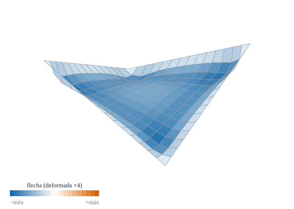

{#fig-hypar-def .portada fig-alt="Una superficie con forma de silla de montar de bordes rectos, vista en perspectiva, con malla y coloreada por la flecha que es mayor en el centro"}

::: {.pregunta-guia}
Por qué una cáscara de pocos centímetros de espesor y forma de silla de montar puede soportar una carga uniforme casi sin flectar
:::

## Objetivos y prerrequisitos {.unnumbered}

**Objetivos.** Al terminar el tema sabrás:

- deducir que un paraboloide hiperbólico $z=cxy$ bajo carga vertical uniforme soporta la carga con **cortante puro** $N^{12}=p/(2c)$ (teoría de membrana);
- explicar el reparto en **arcos y cables** a lo largo de las diagonales;
- comparar el resultado de elementos finitos con la membrana y medir la diferencia con la malla y el espesor;
- distinguir el efecto de los **bordes** (articulados o empotrados) de la solución de interior;
- calcular las **tensiones principales** de una cubierta real.

**Prerrequisitos.** [F2](F2-validacion-cilindro.qmd), [El paraboloide hiperbólico](../C-superficies/C5-paraboloide.qmd) (C5) y [Leyes constitutivas](../D-elasticidad/D7-leyes-constitutivas.qmd).

**Secciones del tema**

- **@sec-membrana-f3** · Teoría de membrana del hypar · **@sec-arcos-f3** · Arcos y cables · **@sec-fe-f3** · Elementos finitos
- **@sec-bordes-f3** · El efecto de los bordes · **@sec-julia-f3** · Práctica guiada

::: {.callout-note title="Notación y convenciones de este tema"}
| Símbolo | Significado |
|---|---|
| $z=c\,x\,y$ | superficie media (bordes rectos; $c$ en 1/longitud) |
| $p$ | carga vertical por unidad de superficie **en planta** |
| $N^{\alpha\beta}$ | resultantes de membrana (fuerza por unidad de longitud) |
| $b_{12}=\hat{\mathbf a}_3\cdot\mathbf a_{1,2}\simeq c$ | segunda forma fundamental (convenio del libro) |
| *rasante* (*shallow*) | superficie de pendiente pequeña ($c\,a\ll1$) |
:::

::: {.callout-note .ingenieros title="Explicación para ingenieros: dos arcos y dos cables cruzados"}
Una silla de montar tiene **dos diagonales distintas**: a lo largo de una la superficie se curva hacia arriba (forma de arco) y a lo largo de la otra hacia abajo (forma de cable colgado). Bajo una carga uniforme hacia abajo, **el «arco» trabaja a compresión y el «cable» a tracción**, con la **misma intensidad**. Como no hay nada que flecte, la lámina puede ser delgadísima. En cada punto, el estado de tensión es de **cortante puro**: si se gira la mirada $45^\circ$, son tracción y compresión iguales y perpendiculares. Por eso las cubiertas de Candela se pueden hacer de pocos centímetros de espesor.
:::

## Teoría de membrana del hypar {#sec-membrana-f3}

En la teoría de **membrana** se desprecia la flexión: sólo hay resultantes $N^{\alpha\beta}$ en el plano tangente. Las ecuaciones de equilibrio (tema D7) son las **tangenciales**, $N^{\alpha\beta}{}_{\|\beta}=0$, y la **normal**, $N^{\alpha\beta}b_{\alpha\beta}+\hat{\mathbf n}\cdot\mathbf f=0$, con $\mathbf f$ la carga por unidad de superficie. En un hypar *rasante* los símbolos de Christoffel son pequeños y la superficie tiene $b_{11}\simeq b_{22}\simeq0$, $b_{12}\simeq c$; si $N^{11}=N^{22}=0$, las ecuaciones tangenciales se reducen a $\partial N^{12}/\partial x=\partial N^{12}/\partial y=0$ (**$N^{12}$ constante**) y la normal queda $2c\,N^{12}-p=0$:

$$
N^{12}=\frac{p}{2c},\qquad N^{11}=N^{22}=0,\qquad \text{(carga vertical }p\text{ por unidad de planta).}
$$ {#eq-n12-f3}

La resultante es **uniforme en toda la lámina**. Para que exista hacen falta **bordes que la absorban**: en cada borde recto se necesita una fuerza de borde (de un elemento rígido, o de un arco o cable en el borde) que equilibre el cortante.

::: {#exm-hypar-real-f3}
## Ejemplo resuelto: una cubierta de $10\times10$ m
Cubierta $z=c\,x\,y$ en $[-5,5]^2$ m con $c=0{,}1$ m$^{-1}$ (la esquina $x=y=5$ queda a $z=2{,}5$ m), $t=50$ mm y carga $p=1{,}5$ kN/m² (peso propio y nieve, por unidad de planta). Con @eq-n12-f3:
$$
N^{12}=\frac{1{,}5}{2\cdot0{,}1}=7{,}5\ \text{kN/m}=7{,}5\ \text{N/mm},\qquad \sigma_{\text{cortante}}=\frac{N^{12}}t=\frac{7{,}5}{50}=0{,}15\ \text{MPa}.
$$
Las **tensiones principales** (giradas $45^\circ$) son $\pm\sigma_{\text{cortante}}=\pm\mathbf{0{,}15}$ MPa: una tracción y una compresión de 0,15 MPa, muy por debajo de la resistencia del hormigón. Resultado *analítico* (teoría de membrana rasante).
:::

::: {.ejercicio tipo="numerico" id="f3-tension" respuesta="0.15" tol="1%" unidad="MPa"}
En el @exm-hypar-real-f3, ¿cuánto vale la tensión principal (en valor absoluto) de la cubierta de $50$ mm de espesor?

::: {.solucion}
$N^{12}=p/(2c)=1{,}5/0{,}2=7{,}5$ N/mm; $\sigma=7{,}5/50=0{,}15$ MPa.
:::
:::

## Arcos y cables {#sec-arcos-f3}

Con $N^{12}$ constante y $N^{11}=N^{22}=0$, el tensor de resultantes en las diagonales $\xi=(x+y)/\sqrt2$ y $\zeta=(x-y)/\sqrt2$ es $N_{\xi\xi}=N^{12}$ y $N_{\zeta\zeta}=-N^{12}$: **tracción** a lo largo de una diagonal y **compresión** a lo largo de la otra (@eq-n12-f3 con $p>0$ hacia abajo: la diagonal que sube es el arco). La carga baja por **el sistema de arcos y cables** hasta los bordes.

::: {.callout-warning title="Dos puntos que suelen confundir"}
- **«Casi sin flexión» no es «sin flexión».** La membrana pura exige bordes ideales. En el borde real aparecen **momentos locales** (capa límite) que decaen en una distancia del orden de $\sqrt{Rt}$.
- **La fórmula es para láminas rasantes.** Si el hypar es muy empinado ($c\,a\gtrsim1$), $b_{11},b_{22}$ y los Christoffel ya no son despreciables y @eq-n12-f3 deja de ser exacta; en los casos calculados aquí ($c\le1$, $a=1$) la diferencia del centro sigue siendo del orden del 1 %.
:::

## Elementos finitos {#sec-fe-f3}

Se discretiza $z=cxy$ en $[-a,a]^2$ con $a=1$, $t=0{,}01$, $E=10^4$, $\nu=0{,}3$, $p=1$ y **bordes articulados** ($u_1=u_2=u_3=0$, giros libres: el apoyo compatible con la membrana). Se mide $N^{12}$ en el centro con las resultantes de los elementos centrales:

| $c$ | $n$ | $N^{12}$ (EF) | $p/(2c)$ | Diferencia |
|---|---|---|---|---|
| 0,25 | 16 | 2,0192 | 2,0 | $+1{,}0\,\%$ |
| 0,25 | 32 | 2,0097 | 2,0 | $+0{,}5\,\%$ |
| 0,5 | 16 | 0,9905 | 1,0 | $-0{,}9\,\%$ |
| 1,0 | 16 | 0,4978 | 0,5 | $-0{,}4\,\%$ |

*Calculado* con este elemento, como **media de los cuatro elementos que rodean el centro** (el valor de un solo elemento depende de su posición respecto del eje, como se ve en la @fig-hypar-n12, y puede alejarse un 2 % o más). El resultado coincide con la membrana en torno al 1 % y se acerca al refinar la malla. Si se adelgaza la lámina ($t=0{,}02$, $0{,}005$, $0{,}002$ con $c=0{,}5$, $n=16$) el valor oscila entre $1{,}020$, $0{,}996$ y $1{,}002$: la membrana domina más cuanto más delgada es.

{#fig-hypar-n12 fig-alt="Gráfica de la resultante de cortante frente a la posición en el eje central: dos curvas casi planas cerca de dos en el interior y descendiendo hacia los extremos, más la de bordes empotrados"}

::: {.ejercicio tipo="opcion" id="f3-membrana" respuesta="a"}
En un hypar rasante $z=cxy$ con carga uniforme $p$ por unidad de planta, ¿qué esfuerzos de membrana aparecen?

::: {.opciones}
- Sólo cortante $N^{12}=p/(2c)$, con $N^{11}=N^{22}=0$
- Tracciones $N^{11}=N^{22}=p/(2c)$ y cortante nulo
- Compresión uniforme isótropa
- Ninguno: la carga se soporta sólo por flexión
:::

::: {.solucion}
Con $b_{11}\simeq b_{22}\simeq0$ y $b_{12}\simeq c$, la ecuación normal $2cN^{12}=p$ se cumple con cortante puro. Es el estado que hace tan eficiente esta forma.
:::
:::

## El efecto de los bordes {#sec-bordes-f3}

La solución de membrana (@eq-n12-f3) vale en el **interior**; cerca de los bordes, el apoyo real no puede suministrar exactamente la reacción de membrana y aparece **flexión**. Con **bordes articulados** el efecto es pequeño y de poca extensión; con **bordes empotrados** es mayor (@fig-hypar-n12), porque se impide el giro y hay un momento de empotramiento. Dos consecuencias prácticas: (i) el espesor **crece hacia los bordes** en muchas cubiertas reales, y (ii) los elementos de borde (nervios, vigas, arcos) se dimensionan con la **reacción de membrana** más un término de flexión.

::: {.callout-tip .aplicacion title="Aplicación real: Félix Candela y el Oceanogràfic de Valencia"}
<span class="etiqueta-resultado ilustrativo">ilustrativo</span> **Obra civil.** El paraboloide hiperbólico es la forma de las cubiertas de Candela. En el **Oceanogràfic de Valencia** (Candela, proyecto de 1997, con los ingenieros Alberto Domingo y Carlos Lázaro) la cubierta del restaurante se compone de cuatro hypar que se intersecan y la de la entrada es un hypar equilátero de 30 m de luz; los textos técnicos lo describen como un caso de **acción de membrana**, con cargas transmitidas por esfuerzos en el plano. El espesor, según fuentes comerciales, ronda los 6 cm, aunque otra fuente indica 6 cm en los bordes y hasta unos 22 cm en la intersección de los nervios, y **no se ha verificado cuál describe cada estructura**.

<span class="fuentes-caja">Fuentes (secundarias): [L'Oceanogràfic (Wikipedia)](https://en.wikipedia.org/wiki/L'Oceanogr%C3%A0fic); [Shell structure at the entrance of the L'Oceanogràfic (ResearchGate)](https://www.researchgate.net/figure/Shell-structure-at-the-entrance-of-the-L-Oceanografic-at-Valencia-Spain-Candela_fig4_279761881); [Saddle roof (Wikipedia)](https://en.wikipedia.org/wiki/Saddle_roof). Los espesores son discordantes entre fuentes; no se consultaron planos de proyecto. Consultado el 23-10-2026.</span>
:::

## Un poco de historia {#sec-historia-f3}

::: {.callout-note .historia icon=false title="Un poco de historia: Candela y la lámina delgada"}
Félix Candela (1910–1997) construyó desde los años cincuenta cubiertas de hormigón de pocos centímetros de espesor con formas de paraboloide hiperbólico, como el restaurante *Los Manantiales* de Ciudad de México (1958), que se cita como precedente de las cubiertas del Oceanogràfic. Wikipedia atribuye al Oceanogràfic un proyecto de Candela con 87 años en 1997. Aquí no se ha podido verificar el resto de la cronología con una fuente especializada: se reproduce sólo lo que las fuentes secundarias coinciden en decir.

<span class="fuentes-caja">Fuentes (secundarias): [Saddle roof (Wikipedia)](https://en.wikipedia.org/wiki/Saddle_roof); [L'Oceanogràfic (Wikipedia)](https://en.wikipedia.org/wiki/L'Oceanogr%C3%A0fic). Las fechas de vida y de obra de Candela proceden de lo que resumen esas páginas; no se leyeron fuentes biográficas. Consultado el 23-10-2026.</span>
:::

## Práctica guiada en Julia {#sec-julia-f3}

::: {.callout-tip title="Ejemplo computacional"}
<span class="etiqueta-resultado calculado">calculado</span> (1) La cubierta del @exm-hypar-real-f3. (2) $N^{12}$ del centro de un hypar para varias pendientes y mallas. (3) El perfil de $N^{12}$ con bordes articulados y empotrados.
:::

```{julia}
using Geometria, LinearAlgebra

# (1) Cubierta real
c, p, t = 0.1, 1.5, 50.0              # 1/m, kN/m², mm
N12 = p / (2c)                         # kN/m = N/mm
(N12_kN_m = N12, tensión_principal_MPa = N12 / t)
```

```{julia}
function hypar_estatico(n, c; t = 0.01, E = 1.0e4, ν = 0.3, p = 1.0, a = 1.0, apoyo = :articulado)
    r = paraboloide_recto(c)
    nodos, conn = malla_rectangular((-a, a), (-a, a), n, n)
    f = θ -> [0.0, 0.0, -p / geometria_punto(r, θ).sa]               # p por unidad de planta
    K, _, F = ensamblar(r, nodos, conn, E, ν, t; f)
    fij = Int[]
    for k in 1:size(nodos, 2)
        x, y = nodos[:, k]
        if abs(x) ≈ a || abs(y) ≈ a
            append!(fij, [gdl(k, 1), gdl(k, 2), gdl(k, 3)])
            apoyo == :empotrado && append!(fij, [gdl(k, 4), gdl(k, 5)])
        end
    end
    (r, nodos, conn, resolver_estatica(K, F, unique(fij)))
end

# N¹² de los elementos centrales (media de los que están a ambos lados del eje y = 0)
function n12_centro(n, c; t = 0.01, E = 1.0e4, ν = 0.3, kw...)
    r, nodos, conn, u = hypar_estatico(n, c; t, E, ν, kw...)
    vals = Float64[]
    for e in axes(conn, 2)
        X = nodos[:, conn[:, e]]
        xc = (X[1, 1] + X[1, 2]) / 2; yc = (X[2, 1] + X[2, 4]) / 2
        (abs(xc) <= 1.0 / n * 1.001 && abs(yc) <= 1.0 / n * 1.001) && push!(vals, deformaciones_medias(r, nodos, conn, e, u, E, ν, t).N[3])
    end
    sum(vals) / length(vals)
end

[(c = c, n = n, N12_EF = n12_centro(n, c), teoría = 1 / (2c)) for (c, n) in ((0.25, 16), (0.25, 32), (0.5, 16), (1.0, 16))]
```

```{julia}
# (3) Efecto del espesor (c = 0.5): más delgada → más cerca de la membrana
[(t = t, N12 = n12_centro(16, 0.5; t = t)) for t in (0.02, 0.005, 0.002)]
```

## Ejercicios {#sec-ejercicios-f3}

1. **Cambio de carga.** Si la carga se duplica, ¿cómo cambia $N^{12}$ y la tensión?

   ::: {.callout-note collapse="true" title="Solución"}
   Se duplica ($N^{12}\propto p$). Con la cubierta de 50 mm, $0{,}30$ MPa.
   :::

2. **Más curvatura.** Si $c$ se duplica manteniendo $p$ y $t$, ¿qué ocurre con $N^{12}$?

   ::: {.callout-note collapse="true" title="Solución"}
   Se reduce a la mitad: una silla **más curvada** soporta la misma carga con menor esfuerzo (por eso las cubiertas reales no son planas). Pero deja de ser rasante y hay que revisar la fórmula.
   :::

3. **Bordes.** ¿Por qué un hypar sin elementos de borde no puede trabajar como membrana?

   ::: {.callout-note collapse="true" title="Solución"}
   Porque en un borde libre la lámina no puede transmitir fuerza: debería ser $N^{12}=0$ allí, y con $N^{12}=p/(2c)$ uniforme eso es imposible. Hace falta un **elemento de borde** (viga, arco o cable) que reciba la fuerza tangencial que la lámina le entrega y la lleve a los apoyos.
   :::

## La doy por superada si… {.unnumbered}

- Deduzco $N^{12}=p/(2c)$ del equilibrio normal con $b_{12}\simeq c$.
- Describo el reparto en arcos y cables y las tensiones principales.
- Calculo una cubierta real y sé que su tensión es pequeña.
- Comparo EF y membrana y explico cuándo coinciden.
- Sé que cerca de los bordes hay flexión y que depende del tipo de apoyo.

::: {.callout-note collapse="true" title="Fuentes, correcciones y qué queda pendiente"}
**Fuentes.** Texto autónomo; la teoría de membrana de láminas es estándar [@Flugge; @Novozhilov]; la deducción para el hypar rasante es propia y los resultados de EF son *calculados*. Las fuentes de Candela y del Oceanogràfic son secundarias.

**Qué queda pendiente.** No hay comparación con resultados de la literatura para el hypar estático (sólo con la teoría de membrana rasante); la teoría de membrana **no rasante** no se ha deducido; la solución de capa límite se describe sólo cualitativamente; espesores del Oceanogràfic discordantes; la dependencia de $N^{12}$ del elemento muestreado indica que conviene promediar (lección registrada); revisión visual de las figuras.
:::
