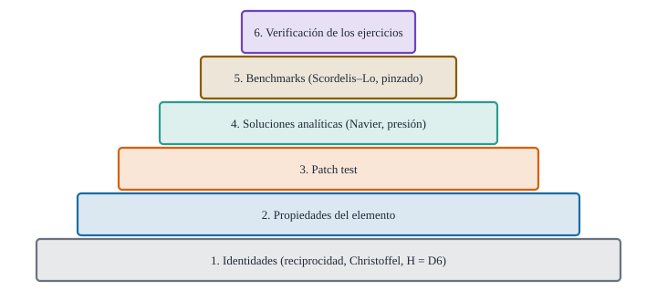

{#fig-piramide .portada fig-alt="Una pirámide de seis niveles, de las identidades en la base a la verificación de los ejercicios en la cúspide, con una etiqueta en cada nivel"}

::: {.pregunta-guia}
Cómo se organiza el código para que cualquiera pueda repetir cada número del libro y saber en qué grado fiarse de él
:::

## Objetivos y prerrequisitos {.unnumbered}

**Objetivos.** Al terminar el tema sabrás:

- describir la **arquitectura** del paquete `Geometria` (geometría, láminas, elemento) y qué función corresponde a cada tema;
- explicar la **pirámide de pruebas**: identidades, patch test, soluciones analíticas y *benchmarks*;
- elegir **tolerancias** con criterio y justificar cada una;
- repetir un resultado del libro desde cero (entorno, semilla, versiones);
- conocer las **limitaciones** del código y las mejoras previstas.

**Prerrequisitos.** Los temas [F1](F1-validacion-placa.qmd)–[F5](F5-frecuencias-hypar.qmd) y [E9](../E-elementos-finitos/E9-ensamblaje-autovalores.qmd).

**Secciones del tema**

- **@sec-arquitectura-f6** · Arquitectura · **@sec-piramide-f6** · Pirámide de pruebas · **@sec-tolerancias-f6** · Tolerancias
- **@sec-repetir-f6** · Repetir un resultado · **@sec-limites-f6** · Límites y mejoras · **@sec-julia-f6** · Práctica guiada

::: {.callout-note title="Notación y convenciones de este tema"}
| Término | Significado |
|---|---|
| `Geometria` | paquete Julia del libro (`julia/`), con tres archivos de código |
| *calculado / analítico / ilustrativo* | etiqueta de la procedencia de cada resultado |
| *verificación* | comprobar que el código resuelve bien el modelo (F1) |
| *freeze* | resultados de las celdas Julia guardados en `_freeze/` para publicar sin ejecutar |
:::

::: {.callout-note .ingenieros title="Explicación para ingenieros: el cuaderno de laboratorio y la báscula certificada"}
Un resultado de cálculo sin código y sin pruebas es como una medida **sin báscula certificada ni cuaderno de laboratorio**: puede ser cierta, pero nadie puede comprobarlo. La **báscula certificada** son los casos con solución conocida (Navier, el cilindro a presión, el patch test); el **cuaderno** son las versiones fijas, las semillas y la receta para repetir el cálculo. Con ambos, quien lea el libro (o un revisor dentro de cinco años) puede **llegar a los mismos números** y detectar un error si lo hay.
:::

## Arquitectura {#sec-arquitectura-f6}

El paquete tiene **tres capas**, cada una apoyada en la anterior:

| Archivo | Contenido | Temas |
|---|---|---|
| `Geometria.jl` | bases, métrica, Christoffel, superficies (hypar, cilindro, esfera…), curvaturas, operadores tensoriales | A–C |
| `Laminas.jl` | elasticidad del sólido, cinemática de la lámina, deformaciones lineales y exactas, rigideces `CE, CB, CS` | D |
| `ElementoLamina.jl` | funciones de forma, `matrices_H`, rigidez por subdominios, masa, cargas, ensamblaje, autovalores | E, F |

Cada función lleva su documentación (`?rigidez_elemento`) y se usa **igual en el libro y en las pruebas**: no hay una versión «para el texto» y otra «real». El flujo de trabajo para cambiar algo es: **código → tests → capítulo**. Si la geometría cambia, se regeneran los JSON de referencia que usa el JavaScript de los laboratorios interactivos y se comprueba que ambos lenguajes coinciden (`npm test`).

::: {.callout-warning title="Dos puntos que suelen confundir"}
- **El código del libro no es «pseudocódigo».** Se ejecuta al publicar; sus salidas son las que se leen en cada capítulo. Si se modifica una función, los resultados cambian y las pruebas deben seguir pasando.
- **Las derivadas de la geometría son numéricas** (diferencias finitas, $h\sim10^{-6}$). Limitan la precisión de $\Gamma$ y $b_{\alpha\beta}$ a unos $10^{-8}$ relativos (sección @sec-limites-f6).
:::

## Pirámide de pruebas {#sec-piramide-f6}

Las pruebas van **de lo más pequeño a lo más grande**:

1. **Identidades** (base de la pirámide): reciprocidad $\mathbf g_i\cdot\mathbf g^j=\delta_i^j$, $\Gamma$ frente a la métrica, Gauss–Codazzi, equivalencia de $\mathbf H\boldsymbol\delta$ con las relaciones de D6 (error $<10^{-8}$). Muchas, rápidas, locales.
2. **Propiedades del elemento**: simetría de $\mathbf K$, **seis** autovalores nulos, partición de la unidad de $N_k$, masa total $=\rho tA$, cargas que suman la presión por área.
3. **Patch test** (F1): estados constantes en mallas irregulares, con $\mathbf K\mathbf d$ residual $\sim10^{-9}$.
4. **Soluciones analíticas**: Navier, cilindro a presión, respiración del cilindro, barra (exacta en los nodos), hypar de membrana (F3), frecuencias de la placa (F4).
5. **Benchmarks de la literatura**: Scordelis–Lo y cilindro pinzado (F2). Es la capa más cara y la que más confianza da.
6. **Verificación de los ejercicios**: todas las respuestas numéricas de los ejercicios interactivos se recalculan con el código (`scripts/verificar_ejercicios.jl`) y deben coincidir.

Un error de **signo** en la curvatura $b_{\alpha\beta}$, por ejemplo, rompe a la vez el patch test de láminas curvas, el cilindro a presión y el Scordelis–Lo; en cambio una placa plana lo ignora. Por eso hay pruebas en cada nivel y sobre **superficies distintas**.

::: {.ejercicio tipo="opcion" id="f6-que-detecta" respuesta="d"}
Se introduce un error de signo en la curvatura $b_{\alpha\beta}$ del código. ¿Qué prueba lo detectaría y cuál **no**?

::: {.opciones}
- El patch test de una placa plana lo detecta
- La solución de Navier de una placa plana lo detecta
- Ninguna prueba lo detectaría
- El cilindro a presión lo detecta; la placa plana (con $b_{\alpha\beta}=0$) no
:::

::: {.solucion}
En una placa plana $b_{\alpha\beta}=0$, y el signo no importa. En el cilindro a presión, el término $-b_{22}u_3$ de la deformación de aro cambia de signo y el hinchado sale **negativo**: error inmediato (y en Scordelis–Lo, la flecha cambia de valor). Por eso las pruebas deben incluir **superficies curvas**.
:::
:::

## Tolerancias {#sec-tolerancias-f6}

Una tolerancia no se elige «a ojo»: depende de **qué error se espera**.

| Prueba | Tolerancia | Por qué |
|---|---|---|
| Identidad algebraica exacta (por ejemplo, $\mathbf K=\mathbf K^{\mathsf T}$) | $10^{-10}$–$10^{-12}$ | sólo redondeo |
| Relaciones con geometría derivada numéricamente | $10^{-6}$–$10^{-8}$ | error de diferencias finitas |
| Patch test | $<10^{-6}$ | ruido de $\Gamma,b$ numéricos, no del elemento |
| Solución analítica con malla (Navier, F1) | 2 × 10⁻³ (con $n=8$) | error de discretización conocido |
| Benchmark de la literatura | 2 %–5 % | la referencia misma varía un 2 % (F2) |

::: {.callout-important title="Idea clave: la tolerancia es una afirmación"}
Escribir `@test x ≈ y rtol = 1e-6` **afirma** que el error es menor que $10^{-6}$. Una tolerancia más ancha de lo necesaria puede esconder un error real; una más estrecha da falsos fallos con otros compiladores o versiones. Cada tolerancia debe poder justificarse con una frase.
:::

## Repetir un resultado {#sec-repetir-f6}

Para repetir cualquier resultado del libro desde cero:

1. **Entorno**: Julia 1.12 y el paquete `Geometria` (`Project.toml` en la raíz; `Pkg.instantiate()`). El único añadido a la biblioteca estándar es `SparseArrays`, también estándar.
2. **Código**: la función citada en el capítulo, con los mismos datos (están en la celda).
3. **Semilla**: las pocas celdas con números aleatorios usan semilla fija.
4. **Pruebas**: `julia --project=julia -e 'using Pkg; Pkg.test()'`.
5. **Libro completo**: `quarto render` (los resultados Julia se guardan en `_freeze/` para publicar sin Julia).

Los SVG de las figuras se **generan** con scripts (`julia/scripts/generar_figuras*.jl`) a partir de los mismos cálculos: no hay figuras «dibujadas a mano» de resultados numéricos.

## Límites y mejoras {#sec-limites-f6}

- **Geometría numérica.** $\mathbf a_\alpha$, $b_{\alpha\beta}$ y $\Gamma$ se obtienen por diferencias finitas; una **derivada automática** (con un paquete como ForwardDiff) o fórmulas analíticas por superficie reduciría el error y el tiempo. No se adoptó para no añadir dependencias externas.
- **Autovalores densos.** Con $n=32$ el problema del hypar tiene $\sim5000$ g.d.l. libres y la resolución densa tarda unos 15 s; para mallas mayores hace falta un solver de **autovalores dispersos** (Lanczos).
- **Malla rectangular en el plano paramétrico.** El elemento exige rectángulos de $(\theta^1,\theta^2)$: no sirve para contornos arbitrarios sin una transformación previa.
- **Convenios por confirmar.** g.d.l. covariantes, giros del director, factor de cortante (el código usa $\kappa=1$) y definición de apoyo simple en láminas curvas.
- **Sólo comportamiento lineal.** La formulación por subdominios admite extensión no lineal (tema E6), no implementada aquí.

::: {.ejercicio tipo="numerico" id="f6-gdl-libres" respuesta="5053" tol="0.1%" unidad="g.d.l."}
En el hypar SSSS de $32\times32$ elementos (nodos $33\times33$), en cada borde se fijan $u_{\text{tang}}$, $u_3$ y $\varphi_{\text{tang}}$ (3 g.d.l.), y en las **cuatro esquinas** (que pertenecen a dos bordes) quedan fijos los cinco. ¿Cuántos g.d.l. libres quedan?

::: {.pista}
Nodos: $33^2=1089$ ($5445$ g.d.l.). Esquinas: 4. Nodos de borde que no son esquina: $4\cdot31=124$.
:::

::: {.solucion}
Fijos: $4\cdot5+124\cdot3=392$. Libres: $5445-392=5053$.
:::
:::

::: {.callout-tip .aplicacion title="Aplicación real: modelos que respaldan decisiones"}
<span class="etiqueta-resultado ilustrativo">ilustrativo</span> En ingeniería estructural y en biomecánica, los modelos de elementos finitos que apoyan una decisión (un peritaje, el diseño de una prótesis, la verificación de una cubierta) se acompañan de una **verificación documentada**: las pruebas de esta sección, sus tolerancias y la versión exacta del código. El mismo esquema (pirámide de pruebas y registro de versiones) es el que haría falta para pasar de este libro a un uso profesional. *Idea de aplicación sin fuente verificada: es una orientación, no una cita.*
:::

## Práctica guiada en Julia {#sec-julia-f6}

::: {.callout-tip title="Ejemplo computacional"}
<span class="etiqueta-resultado calculado">calculado</span> (1) Una **verificación rápida** de cuatro de los niveles de la pirámide, con sus tolerancias. (2) El número de g.d.l. libres del hypar de $32\times32$ y el tiempo del problema de autovalores en una malla menor. (3) El entorno en uso.
:::

```{julia}
using Geometria, LinearAlgebra

cil_x(R) = θ -> [θ[1], R * sin(θ[2]), R * cos(θ[2])]
resultados = Tuple{String,Bool}[]
reg(nombre, ok) = push!(resultados, (nombre, ok))

# Nivel 2: propiedades del elemento (6 autovalores nulos, simetría)
plana = placa_oblicua(π / 2); X = [0.0 1 1 0; 0 0 1 1]
K = rigidez_elemento(plana, X, 1.0, 0.3, 0.1)
ev = eigvals(Symmetric(K))
reg("K simétrica (1e-10)", norm(K - K') < 1e-10)
reg("6 autovalores nulos", count(<(1e-9 * maximum(ev)), ev) == 6)

# Nivel 4: tubo a presión (analítica)
R, t, E, ν, p = 500.0, 5.0, 210e3, 0.3, 0.5
r = cil_x(R); nodos, conn = malla_rectangular((0, 100.0), (0, π / 2), 2, 8)
Kc, _, F = ensamblar(r, nodos, conn, E, ν, t; f = θ -> p .* [0, sin(θ[2]), cos(θ[2])])
fij = Int[]
for k in 1:size(nodos, 2)
    _, φ = nodos[:, k]; append!(fij, [gdl(k, 1), gdl(k, 4)])
    (φ ≈ 0 || φ ≈ π / 2) && append!(fij, [gdl(k, 2), gdl(k, 5)])
end
u = resolver_estatica(Kc, F, unique(fij))
k45 = argmin([norm(nodos[:, k] .- [50.0, π / 4]) for k in 1:size(nodos, 2)])
reg("tubo a presión (rtol 1e-4)", isapprox(u[gdl(k45, 3)], p * R^2 * (1 - ν^2) / (E * t); rtol = 1e-4))

# Nivel 2: masa total y carga total de un elemento
M = masa_elemento(cil_x(0.5), [0.0 0.1 0.1 0; 0 0 0.1 0.1], 7850.0, 0.005)
δ = zeros(20); for k in 1:4; δ[5(k-1)+1] = 1.0; end
reg("masa total ρtA (rtol 1e-9)", isapprox(δ' * M * δ, 7850 * 0.005 * 0.1 * 0.5 * 0.1; rtol = 1e-9))

[(nombre = n, pasa = ok) for (n, ok) in resultados]
```

```{julia}
# (2) g.d.l. libres del hypar 32×32 SSSS y tiempo de autovalores en 12×12
n = 32
nodos, conn = malla_rectangular((-1.0, 1.0), (-1.0, 1.0), n, n)
fijos = Int[]
for j in 1:size(nodos, 2)
    x, y = nodos[:, j]
    abs(x) ≈ 1 && append!(fijos, [gdl(j, 2), gdl(j, 3), gdl(j, 5)])
    abs(y) ≈ 1 && append!(fijos, [gdl(j, 1), gdl(j, 3), gdl(j, 4)])
end
libres = 5 * size(nodos, 2) - length(unique(fijos))

nodos12, conn12 = malla_rectangular((-1.0, 1.0), (-1.0, 1.0), 12, 12)
K12, M12, _ = ensamblar(paraboloide_recto(0.5), nodos12, conn12, 1.0e4, 0.3, 0.01; ρ = 1.0)
fij12 = Int[]
for j in 1:size(nodos12, 2)
    x, y = nodos12[:, j]
    abs(x) ≈ 1 && append!(fij12, [gdl(j, 2), gdl(j, 3), gdl(j, 5)])
    abs(y) ≈ 1 && append!(fij12, [gdl(j, 1), gdl(j, 3), gdl(j, 4)])
end
tiempo = @elapsed frecuencias(K12, M12, unique(fij12); n = 4)
(gdl_libres_32x32 = libres, segundos_autovalores_12x12 = round(tiempo, digits = 2))
```

```{julia}
# (3) Entorno
(julia = string(VERSION), hilos = Threads.nthreads(), paquete = "Geometria", modulos = ("Geometria.jl", "Laminas.jl", "ElementoLamina.jl"))
```

## Ejercicios {#sec-ejercicios-f6}

1. **Justificar una tolerancia.** Un test compara $\mathbf H\boldsymbol\delta$ con las relaciones de D6 con `rtol = 1e-6`. ¿Por qué no `1e-14`?

   ::: {.callout-note collapse="true" title="Solución"}
   Porque las relaciones de D6 usan derivadas covariantes calculadas por diferencias finitas ($h\sim10^{-5}$) y los símbolos de Christoffel numéricos: el error de truncamiento es $\sim10^{-8}$. Una tolerancia de $10^{-14}$ daría fallos falsos.
   :::

2. **Falso negativo.** Un test de convergencia del hypar usa una sola malla. ¿Qué se puede estar perdiendo?

   ::: {.callout-note collapse="true" title="Solución"}
   Que el valor está lejos del límite (con $8\times8$ el hypar curvo está un 18 % por encima, F5). Se necesita al menos una **secuencia de mallas** y comprobar el orden de convergencia.
   :::

3. **Nueva superficie.** Quieres usar el elemento en un toroide. ¿Qué pruebas harías antes de fiarte?

   ::: {.callout-note collapse="true" title="Solución"}
   (i) $\mathbf H\boldsymbol\delta$ frente a D6 con la nueva $\mathbf r$; (ii) patch test sobre ella; (iii) un caso analítico (presión interna, que en un toro tiene solución de membrana); (iv) convergencia con mallas sucesivas.
   :::

## La doy por superada si… {.unnumbered}

- Nombro las tres capas del código y qué temas cubre cada una.
- Enumero la pirámide de pruebas y sé qué detecta cada nivel.
- Justifico una tolerancia con una frase.
- Sé repetir un resultado del libro desde cero.
- Conozco las limitaciones y los convenios por confirmar.

::: {.callout-note collapse="true" title="Fuentes, correcciones y qué queda pendiente"}
**Fuentes.** Texto autónomo; es una descripción del propio proyecto (`julia/`, `scripts/`, `web/`). La práctica verifica el estado actual del código.

**Qué queda pendiente.** Derivación automática de la geometría; solver disperso de autovalores; una prueba de convergencia automática en CI (hoy los benchmarks de F2 se ejecutan al renderizar, no en las pruebas); no hay nota histórica; la «Aplicación real» es una orientación sin fuente.
:::
